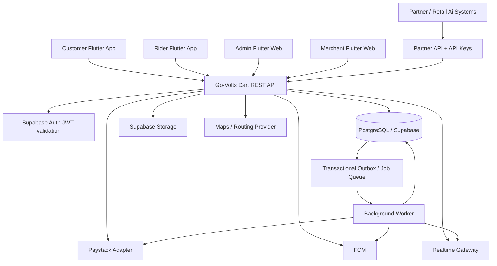

# Go-Volts Mobility and Logistics Platform
## Technical Specification and Implementation Blueprint

**Document status:** Engineering baseline for implementation  
**Version:** 1.4  
**Date:** 30 October 2026  
**Companion document:** Go-Volts Developer Concept Note  
**Audience:** Software developers, technical leads, QA engineers, DevOps engineers, product owner, and AI coding agents

---

## 1. Purpose and scope

This document translates the Go-Volts product concept into an implementable software architecture. It defines the application stack, repository layout, service boundaries, database model, API contracts, booking and dispatch state machines, payment and wallet invariants, access controls, integrations, testing requirements, and delivery plan. Version 1.4 adds the complete Go-Volts Send parcel-delivery technical module, including admin configuration, parcel-specific data, APIs, lifecycle, proof of delivery, exception handling, and test requirements.

The platform supports four product surfaces:

1. **Customer mobile app:** book passenger rides where enabled, send parcels, arrange eligible store deliveries, track jobs, manage profile and safety options, use coupons, earn referral/loyalty rewards, and redeem points into ride-wallet credit.
2. **Rider mobile app:** complete onboarding, manage availability, receive and accept jobs, navigate to pickup/drop-off, record delivery milestones, contact support, and view earnings.
3. **Admin web app:** manage live operations, customers, riders, merchants, service areas, pricing, bookings, refunds, promotions, wallets, loyalty, referrals, support, roles, and audit records.
4. **Merchant portal:** onboard a store, create delivery bookings, manage pickup details, track jobs, view invoices/reports, and manage authorized staff. External stores/apps can integrate through a versioned partner API.

Initial business channels include Retail Ai order delivery, independent merchant bookings, customer parcel delivery, passenger rides where legally and operationally enabled, and Scheduled Pickup for one-off future trips and recurring transport. Scheduled Pickup is an MVP requirement. School-run workflows are included in MVP scope but must remain disabled in any service area until legal, insurance, safeguarding, rider eligibility, school protocol, and operational readiness approvals are recorded.

### 1.1 Out of scope for the first implementation

- Building the Retail Ai supermarket app itself.
- A public third-party marketplace where merchants compete for customer orders.
- Cash withdrawals from loyalty-derived ride-wallet credit.
- Direct custody or transfer of customer funds between users.
- Unapproved school transport, medical transport, or other specialized services.
- A microservices deployment from day one. Use a modular monolith with clean module boundaries first.

### 1.2 Normative language

- **MUST** means required for correctness or security.
- **SHOULD** means strongly recommended unless a documented reason exists.
- **MAY** means optional or later-phase capability.
- **Decision required** means the product owner must choose before production launch.

---

## 2. Recommended technology stack

Use a single repository with separate deployable app folders and a shared backend folder. The stack below is selected for a Flutter-first product, transactional payment requirements, mobile geolocation, and the need for a reliable ledger.

| Layer | Selected technology | Responsibility |
|---|---|---|
| Customer mobile app | Flutter + Dart | iOS and Android customer experience |
| Rider mobile app | Flutter + Dart | Rider workflow, GPS, job updates, push notifications |
| Admin web app | Flutter Web + Dart | Internal operations and configuration |
| Merchant portal | Flutter Web + Dart | Merchant booking and account management |
| Backend API | Dart + Shelf (or Dart Frog if the team standardizes on it) | REST API, authorization, business logic, webhook endpoints |
| Database | PostgreSQL managed by Supabase | Relational records, transactions, constraints, reporting |
| Authentication | Supabase Auth | Customer, rider, staff, and merchant identity; JWT issuance |
| File storage | Supabase Storage | Rider documents, merchant logos, proof-of-delivery files where appropriate |
| Realtime updates | Supabase Realtime selectively; backend WebSocket/SSE gateway if needed | Booking status and live operational updates |
| Push notifications | Firebase Cloud Messaging (FCM) | Android/iOS push; web push where configured |
| Maps and routing | Google Maps Platform or a selected regional provider | Geocoding, route distance, ETA, navigation hand-off |
| Payment provider | Paystack initially, behind a provider adapter | Checkout, payment verification, refunds where supported |
| Background jobs | PostgreSQL-backed job/outbox tables plus a Dart worker process | Dispatch retries, notifications, webhook processing, reconciliation |
| Cache/rate limit | Redis-compatible managed cache when scale requires it | Rate limits, short-lived locks, ephemeral presence; never source of financial truth |
| API documentation | OpenAPI 3.1 | Contract definition and generated clients/tests |
| Mobile/web state management | Riverpod | App state, dependency injection, async workflows |
| Routing | `go_router` | Navigation and route guards |
| Models/serialization | `freezed` + `json_serializable` | Immutable DTOs and serialization |
| Forms/validation | Flutter form validation plus shared API validation | User input validation; backend remains authoritative |
| Backend tests | `package:test`, `mocktail`, PostgreSQL integration tests | Unit, integration, and contract testing |
| Frontend tests | `flutter_test`, integration_test | Widget, unit, and end-to-end tests |
| CI/CD | GitHub Actions or equivalent | Formatting, tests, builds, migrations, release checks |
| Observability | Structured logs + Sentry or equivalent + OpenTelemetry-compatible traces | Error monitoring, tracing, metrics, alerting |

### 2.1 Why a modular monolith first

Payments, booking state, wallet redemption, and dispatch assignment have cross-module transactional requirements. A modular monolith reduces distributed-transaction risk while keeping domain boundaries clear. Run the API and background worker as separate processes from the same backend codebase. Split modules into independent services only when measurable scale or team ownership justifies it.

### 2.2 Important stack rules

- PostgreSQL is the system of record for bookings, money, reward points, wallet balances, and audit history.
- Supabase Auth handles identity only. It does not replace application-level role and resource authorization.
- Do not expose the Supabase `service_role` key to any app, browser bundle, or third-party partner.
- Do not let mobile clients write financial tables directly. Financial mutations must go through backend commands and database transactions.
- Use integer minor units for money (for NGN, kobo) and integer points. Never use floating-point values for financial calculations.
- Keep provider-specific payment and map code behind interfaces so providers can be changed without rewriting business logic.
- Choose and pin supported package versions at project bootstrap; commit lockfiles and upgrade intentionally.

---

## 3. System architecture



### 3.1 Main backend modules

1. **Identity and access:** profiles, roles, memberships, permissions, account status, device registration.
2. **Service catalogue:** enabled services, operating hours, service areas, package restrictions, feature flags.
3. **Pricing:** versioned fare rules, distance/time inputs, base fee, minimum fare, surcharges, discounts, and quoted price expiry.
4. **Bookings:** ride and delivery requests, lifecycle state, pickup/drop-off details, status history, cancellations.
5. **Dispatch:** candidate discovery, eligibility, offer expiry, acceptance locking, reassignment, no-rider escalation.
6. **Rider operations:** onboarding, documents, vehicle details, availability, presence, service capabilities.
7. **Payments:** checkout initialization, provider verification, webhook ingestion, refunds, reconciliation.
8. **Ledger and wallet:** immutable double-entry journal, customer ride credit, reward conversion, wallet application, reversals.
9. **Promotions:** coupon definitions, eligibility, reservations/redemptions, referral campaign rules.
10. **Loyalty:** earning rules, points ledger, redemption quotes, expiry and reversal.
11. **Merchant and partners:** merchant organizations, branches, staff memberships, API credentials, webhook endpoints, usage limits.
12. **Notifications:** push, in-app notifications, templates, delivery attempts.
13. **Support and safety:** support tickets, incident records, emergency escalation settings.
14. **Reporting and audit:** admin actions, financial reports, operational metrics, exports.
15. **Ride configuration:** ride categories, vehicle eligibility, category availability, ride-specific rules, and the controlled publication of configuration to customer and rider apps.
16. **Parcel delivery:** customer parcel declarations, recipient details, package eligibility, delivery options, quote/payment integration, rider dispatch, verification, proof of delivery, returns and parcel-specific operational configuration.

### 3.2 Domain boundaries

Modules may call each other through application services, not by directly changing another module's tables without an explicit shared transaction. Database tables should be owned by a module and named consistently. Keep API DTOs separate from persistence models. Avoid a generic `utils` module that becomes a home for business rules.

### 3.3 Environment boundaries

Maintain separate development, staging, and production Supabase projects, payment keys, FCM configuration, map keys, API origins, and webhook secrets. Production data must never be copied into development unless it has been safely anonymized.

---

## 4. Monorepo and project folder structure

Each app has its own folder, its own `pubspec.yaml`, build configuration, tests, and release workflow. Shared Dart packages are kept under `packages/`. Backend services and migrations are kept under `backend/`.

```text
go-volts/
├── README.md
├── CONTRIBUTING.md
├── SECURITY.md
├── .gitignore
├── .editorconfig
├── melos.yaml                     # Optional workspace orchestration
├── docs/
│   ├── product-concept.md
│   ├── technical-specification.md
│   ├── api/
│   │   ├── openapi.yaml
│   │   └── partner-api.md
│   ├── architecture/
│   │   ├── adr/                    # Architecture decision records
│   │   ├── state-machines.md
│   │   └── threat-model.md
│   ├── runbooks/
│   └── release-checklists/
├── apps/
│   ├── customer_app/
│   │   ├── pubspec.yaml
│   │   ├── lib/
│   │   │   ├── main.dart
│   │   │   ├── bootstrap.dart
│   │   │   ├── app.dart
│   │   │   ├── core/
│   │   │   │   ├── config/
│   │   │   │   ├── routing/
│   │   │   │   ├── theme/
│   │   │   │   ├── networking/
│   │   │   │   ├── errors/
│   │   │   │   └── widgets/
│   │   │   └── features/
│   │   │       ├── auth/
│   │   │       ├── home/
│   │   │       ├── ride_booking/
│   │   │       ├── parcel_booking/
│   │   │       ├── tracking/
│   │   │       ├── payments/
│   │   │       ├── wallet/
│   │   │       ├── loyalty/
│   │   │       ├── referrals/
│   │   │       ├── coupons/
│   │   │       ├── activity/
│   │   │       ├── profile/
│   │   │       └── support/
│   │   └── test/
│   ├── rider_app/
│   │   ├── pubspec.yaml
│   │   ├── lib/{main.dart,bootstrap.dart,app.dart,core,features}
│   │   └── test/
│   ├── admin_web/
│   │   ├── pubspec.yaml
│   │   ├── lib/{main.dart,bootstrap.dart,app.dart,core,features}
│   │   └── test/
│   └── merchant_portal/
│       ├── pubspec.yaml
│       ├── lib/{main.dart,bootstrap.dart,app.dart,core,features}
│       └── test/
├── packages/
│   ├── design_system/              # Brand tokens, common widgets
│   ├── api_client/                 # Typed REST client, auth header, error parsing
│   ├── app_models/                 # Safe shared DTOs/enums; no DB entities
│   ├── app_config/                 # Non-secret environment configuration
│   ├── analytics_client/
│   └── testing_support/
├── backend/
│   ├── pubspec.yaml
│   ├── bin/
│   │   ├── api_server.dart
│   │   ├── worker.dart
│   │   └── migrate.dart
│   ├── lib/
│   │   ├── src/
│   │   │   ├── app.dart
│   │   │   ├── config/
│   │   │   ├── http/
│   │   │   │   ├── middleware/
│   │   │   │   ├── routes/
│   │   │   │   ├── request_validation/
│   │   │   │   └── response_envelopes/
│   │   │   ├── shared/
│   │   │   │   ├── database/
│   │   │   │   ├── auth/
│   │   │   │   ├── clock.dart
│   │   │   │   ├── ids.dart
│   │   │   │   ├── money.dart
│   │   │   │   ├── result.dart
│   │   │   │   └── outbox/
│   │   │   └── modules/
│   │   │       ├── identity/
│   │   │       ├── merchants/
│   │   │       ├── catalogue/
│   │   │       ├── pricing/
│   │   │       ├── bookings/
│   │   │       ├── dispatch/
│   │   │       ├── riders/
│   │   │       ├── payments/
│   │   │       ├── ledger/
│   │   │       ├── wallet/
│   │   │       ├── loyalty/
│   │   │       ├── promotions/
│   │   │       ├── referrals/
│   │   │       ├── notifications/
│   │   │       ├── support/
│   │   │       └── reporting/
│   │   └── generated/
│   ├── test/
│   │   ├── unit/
│   │   ├── integration/
│   │   ├── contract/
│   │   └── fixtures/
│   ├── migrations/
│   ├── seeds/
│   └── openapi/
├── infra/
│   ├── docker/
│   ├── ci/
│   ├── scripts/
│   ├── monitoring/
│   └── deployment/
└── tool/
    ├── codegen.sh
    ├── lint_all.sh
    └── test_all.sh
```

The abbreviated brace syntax above illustrates directory grouping. Create real directories and files explicitly; do not create a directory literally named `{main.dart,...}`.

### 4.1 Feature folder pattern

Use feature-first architecture in each Flutter app. Each feature may contain:

```text
feature_name/
├── data/
│   ├── datasources/
│   ├── dto/
│   └── repositories/
├── domain/
│   ├── entities/
│   ├── repositories/
│   └── use_cases/
└── presentation/
    ├── controllers/               # Riverpod providers/notifiers
    ├── pages/
    └── widgets/
```

Do not share app-specific screens across customer, rider, admin, and merchant apps. Share design tokens, DTOs, API clients, and small neutral widgets only. Role-specific navigation and authorization must remain separate.

### 4.2 Backend module pattern

```text
module_name/
├── domain/
│   ├── entities.dart
│   ├── value_objects.dart
│   ├── policies.dart
│   └── errors.dart
├── application/
│   ├── commands/
│   ├── queries/
│   └── services.dart
├── infrastructure/
│   ├── repositories.dart
│   └── provider_adapters.dart
└── presentation/
    └── routes.dart
```

Domain rules should not depend on HTTP, Supabase SDK calls, or Flutter. The application layer coordinates transactions and module calls. Infrastructure implements persistence and provider integrations. Presentation maps HTTP input/output to application commands.

---

## 5. Database conventions and core schema

Use PostgreSQL with UUID primary keys (`gen_random_uuid()`), `timestamptz` timestamps, UTC storage, and explicit `created_at` / `updated_at` columns where useful. Use database constraints for invariants that must survive concurrent requests. Add indexes based on access patterns and verify with query plans.

### 5.1 Naming and data rules

- Table and column names: `snake_case`, plural table names.
- Primary key: `id uuid` unless an externally meaningful public identifier is needed.
- Public booking reference: random, non-sequential, non-sensitive code such as `GV-` plus a generated suffix. Never expose database IDs as proof of authorization.
- Money: `bigint` minor units, e.g. `amount_kobo`. Currency code stored explicitly, default `NGN`.
- Percentages/rates: `numeric`, with documented precision and rounding rule.
- Coordinates: latitude and longitude as validated numeric values or PostGIS `geography(Point, 4326)` if spatial queries are enabled.
- JSONB: only for genuinely variable metadata or provider payload snapshots. Do not hide core queryable fields in JSONB.
- Use soft deletion only for records that need recoverability. Financial records and audit events are immutable and must not be deleted.
- Store only necessary personal information. Do not log authentication tokens, full payment secrets, or sensitive document content.

### 5.2 Core identity and access tables

**`profiles`**

- `id uuid primary key references auth.users(id)`
- `display_name text not null`
- `phone_e164 text unique`
- `email text`
- `avatar_path text`
- `status text not null` (`active`, `suspended`, `closed`)
- `preferred_language text`
- `created_at`, `updated_at timestamptz not null`

**`role_assignments`**

- `id uuid primary key`
- `user_id uuid not null references profiles(id)`
- `role text not null` (`customer`, `rider`, `ops_agent`, `safety_officer`, `finance`, `promotions_manager`, `merchant_admin`, `merchant_staff`, `admin`, `super_admin`)
- `scope_type text` (`global`, `merchant`, `branch`, `service_area`)
- `scope_id uuid null`
- `granted_by uuid references profiles(id)`
- `created_at timestamptz not null`
- Index `(user_id, role)` and `(scope_type, scope_id)`.

Enforce that a role assignment's scope is valid for that role. Privileged role changes require audit logging and preferably a second-person approval for production super-admin access.

**`user_devices`**

- `id uuid primary key`
- `user_id uuid not null references profiles(id)`
- `platform text` (`android`, `ios`, `web`)
- `push_token text not null`
- `last_seen_at timestamptz`
- `revoked_at timestamptz`
- Unique active token constraint or deduplication logic.

### 5.3 Merchant and partner tables

**`merchants`**: `id`, `legal_name`, `display_name`, `status`, `support_phone`, `billing_email`, `default_pickup_address_id`, `created_at`, `updated_at`.

**`merchant_branches`**: `id`, `merchant_id`, `name`, `address_id`, `latitude`, `longitude`, `opening_hours jsonb`, `status`, `created_at`.

**`merchant_memberships`**: `id`, `merchant_id`, `branch_id nullable`, `user_id`, `role` (`owner`, `manager`, `dispatcher`, `viewer`), `status`, `created_at`; unique active membership as appropriate.

**`partner_integrations`**: `id`, `merchant_id nullable`, `name`, `partner_type` (`retail_ai`, `merchant`, `platform`), `status`, `webhook_url`, `webhook_secret_ref`, `rate_limit_profile`, `created_at`.

**`partner_api_credentials`**: `id`, `partner_integration_id`, `key_prefix`, `secret_hash`, `scopes text[]`, `expires_at`, `last_used_at`, `revoked_at`, `created_at`. Store a one-way hash of partner secrets; show the secret once at issuance. Prefer OAuth client credentials for large partners; API keys are acceptable for early server-to-server integration when scoped and rotated.

**`partner_webhook_deliveries`**: `id`, `partner_integration_id`, `event_id`, `event_type`, `payload jsonb`, `attempt_count`, `next_attempt_at`, `delivered_at`, `last_status_code`, `last_error`, `created_at`. Do not put secrets in payloads.

### 5.4 Service catalogue and service areas

**`service_types`**: `id`, `code` unique (`parcel_delivery`, `store_delivery`, `passenger_ride`), `name`, `enabled`, `requires_rider_vehicle`, `created_at`.

**`service_areas`**: `id`, `name`, `city`, `state`, `country_code`, `geometry` (PostGIS when available), `enabled`, `timezone`, `created_at`.

**`service_area_service_types`**: `service_area_id`, `service_type_id`, `enabled`, `effective_from`, `effective_to`.

**`ride_categories`**: `id`, `code` unique, `name`, `description`, `display_order`, `icon_key`, `passenger_capacity`, `status` (`draft`, `active`, `inactive`, `archived`), `created_by`, `updated_by`, `created_at`, `updated_at`. Categories are admin-managed catalogue records, not client constants.

**`ride_category_service_areas`**: `ride_category_id`, `service_area_id`, `enabled`, `effective_from`, `effective_to`; unique active category/area assignment.

**`ride_category_vehicle_requirements`**: `id`, `ride_category_id`, `vehicle_type`, `minimum_capacity`, `required_vehicle_attributes jsonb`, `created_at`. Use controlled vehicle-type values and validate them against approved rider vehicle records.

**`ride_category_rules`**: `id`, `ride_category_id`, `version`, `status` (`draft`, `published`, `retired`), `minimum_passengers`, `maximum_passengers`, `minimum_trip_distance_meters nullable`, `maximum_trip_distance_meters nullable`, `booking_lead_time_seconds nullable`, `advance_booking_limit_seconds nullable`, `effective_from`, `effective_to`, `created_by`, `approved_by nullable`, `created_at`. Only explicitly approved fields belong here; do not use arbitrary JSON as a substitute for typed business rules.

**`ride_configuration_audit`**: `id`, `actor_user_id`, `entity_type`, `entity_id`, `action`, `before_snapshot jsonb`, `after_snapshot jsonb`, `reason`, `request_id`, `created_at`. Append-only record of configuration changes.

Ride categories must reference applicable service areas and pricing rules. A category cannot be published unless it has valid vehicle requirements, an active service-area assignment, and an applicable published pricing rule. Historical bookings retain their category and pricing snapshots even if an administrator later changes or deactivates the category.

**`package_categories`**: `id`, `code unique`, `name`, `description`, `icon_key`, `display_order`, `status` (`draft`, `active`, `inactive`, `archived`), `restricted_reason nullable`, `requires_declaration boolean`, `requires_declared_value boolean`, `created_by`, `updated_by`, `created_at`, `updated_at`. Package categories are admin-managed catalogue records and must not be hardcoded in Flutter apps.

**`package_category_rules`**: `id`, `package_category_id`, `version`, `status` (`draft`, `published`, `retired`), `minimum_weight_grams nullable`, `maximum_weight_grams nullable`, `maximum_length_mm nullable`, `maximum_width_mm nullable`, `maximum_height_mm nullable`, `maximum_declared_value_kobo nullable`, `requires_special_handling boolean`, `effective_from`, `effective_to`, `created_by`, `approved_by nullable`, `created_at`. Published rule versions are immutable.

**`package_category_service_areas`**: `package_category_id`, `service_area_id`, `enabled`, `effective_from`, `effective_to`; unique active category/area assignment.

**`delivery_options`**: `id`, `code unique`, `name`, `description`, `service_level_label`, `status` (`draft`, `active`, `inactive`, `archived`), `display_order`, `created_at`, `updated_at`.

**`delivery_option_rules`**: `id`, `delivery_option_id`, `version`, `status`, `minimum_lead_time_seconds nullable`, `maximum_lead_time_seconds nullable`, `target_delivery_window_seconds nullable`, `cutoff_time_local nullable`, `created_by`, `approved_by nullable`, `effective_from`, `effective_to`, `created_at`. Service-level promises must be operationally approved before publication.

**`delivery_option_service_areas`**: `delivery_option_id`, `service_area_id`, `enabled`, `effective_from`, `effective_to`.

**`delivery_handling_options`**: `id`, `code unique`, `name`, `description`, `status`, `requires_operations_approval`, `created_at`, `updated_at`.

**`package_category_handling_options`**: `package_category_id`, `handling_option_id`, `enabled`; defines which handling requests are valid for each category.

**`delivery_policy_versions`**: `id`, `policy_type` (`prohibited_items`, `restricted_items`, `declared_value`, `cancellation`, `failed_delivery`, `returns`, `proof_of_delivery`, `privacy_retention`), `version`, `content`, `status` (`draft`, `published`, `retired`), `effective_from`, `effective_to`, `created_by`, `approved_by nullable`, `created_at`. Store customer acknowledgement against the exact published policy version.

**`parcel_delivery_configuration_audit`**: `id`, `actor_user_id`, `entity_type`, `entity_id`, `action`, `before_snapshot jsonb`, `after_snapshot jsonb`, `reason`, `request_id`, `created_at`. Append-only.

Do not hard-code all operating rules into the client. The server determines which services are enabled in a location and which package categories are allowed.

### 5.5 Address and booking tables

**`addresses`**: `id`, `owner_user_id nullable`, `label`, `contact_name`, `contact_phone`, `address_text`, `landmark`, `latitude`, `longitude`, `place_id`, `created_at`. Minimize address retention for completed jobs according to an approved retention policy.

**`bookings`** (common parent for rides and deliveries):

- `id uuid primary key`
- `public_reference text unique not null`
- `service_type_id uuid not null references service_types(id)`
- `booking_channel text not null` (`customer_app`, `merchant_portal`, `retail_ai`, `partner_api`, `admin`)
- `customer_user_id uuid nullable references profiles(id)`
- `merchant_id uuid nullable references merchants(id)`
- `merchant_branch_id uuid nullable references merchant_branches(id)`
- `partner_integration_id uuid nullable references partner_integrations(id)`
- `external_reference text nullable`
- `status text not null`
- `dispatch_status text not null`
- `pickup_address_id uuid references addresses(id)`
- `dropoff_address_id uuid references addresses(id)`
- `pickup_latitude numeric`, `pickup_longitude numeric`, `dropoff_latitude numeric`, `dropoff_longitude numeric`
- `pickup_contact_name text`, `pickup_contact_phone text`
- `dropoff_contact_name text`, `dropoff_contact_phone text`
- `quoted_amount_kobo bigint not null`
- `currency char(3) not null default 'NGN'`
- `pricing_quote_id uuid not null`
- `coupon_redemption_id uuid nullable`
- `wallet_credit_applied_kobo bigint not null default 0`
- `customer_payable_kobo bigint not null`
- `assigned_rider_id uuid nullable references profiles(id)`
- `requested_at timestamptz not null`
- `accepted_at`, `picked_up_at`, `completed_at`, `cancelled_at timestamptz`
- `cancel_reason_code text`, `cancelled_by uuid nullable`
- `metadata jsonb not null default '{}'`
- `created_at`, `updated_at timestamptz not null`

Constraints: amounts must be non-negative; wallet credit applied cannot exceed quote after valid discount; `completed_at` only when completed; `external_reference` unique per partner when non-null; a completed booking cannot be assigned to a different rider without an explicit correction workflow.

**`ride_details`**: `booking_id primary key references bookings(id)`, `passenger_count`, `ride_category`, `rider_note`, `pickup_pin_hash nullable`, `dropoff_pin_hash nullable`, `scheduled_for nullable`. Passenger rides must not be enabled in an area until required legal and safety approvals are configured.

**`delivery_details`**: `booking_id primary key references bookings(id)`, `package_category_id`, `package_category_rule_version_id`, `delivery_option_id nullable`, `delivery_option_rule_version_id nullable`, `package_description`, `weight_grams nullable`, `length_mm nullable`, `width_mm nullable`, `height_mm nullable`, `declared_value_kobo nullable`, `proof_of_delivery_required boolean`, `recipient_otp_hash nullable`, `delivery_instructions`, `merchant_order_reference nullable`, `policy_version_id`, `customer_policy_acknowledged_at nullable`, `created_at`.

**`delivery_recipients`**: `id`, `booking_id`, `recipient_type` (`individual`, `business`), `name`, `business_name nullable`, `phone_e164`, `address_id nullable`, `address_text`, `landmark nullable`, `latitude`, `longitude`, `additional_instructions nullable`, `created_at`. Access must be scoped to the booking and minimized in customer/rider responses.

**`delivery_handling_selections`**: `id`, `booking_id`, `handling_option_id`, `handling_note nullable`, `created_at`. Only options allowed by the published package/category rules may be selected.

**`delivery_quotes`**: `id`, `booking_id nullable`, `pricing_quote_id`, `delivery_option_id`, `delivery_option_rule_version_id`, `package_category_rule_version_id`, `policy_version_id`, `input_snapshot jsonb`, `price_breakdown jsonb`, `currency`, `total_amount_kobo`, `expires_at`, `created_at`. Store a snapshot of all price-affecting inputs and configuration versions.

**`delivery_verifications`**: `id`, `booking_id`, `verification_stage` (`pickup`, `delivery`), `method` (`otp`, `pin`, `recipient_confirmation`, `photo`, `authorized_exception`), `challenge_hash nullable`, `result` (`pending`, `verified`, `failed`, `expired`, `waived_by_authorized_operator`), `attempt_count`, `verified_by nullable`, `verified_at nullable`, `expires_at nullable`, `metadata_redacted jsonb`, `created_at`. Never store raw OTP/PIN values.

**`proof_of_delivery_records`**: `id`, `booking_id`, `verification_id nullable`, `proof_type` (`otp`, `recipient_confirmation`, `photo`, `signature`, `authorized_handover`, `other_approved`), `evidence_storage_path nullable`, `recipient_name_snapshot nullable`, `captured_by`, `captured_at`, `latitude nullable`, `longitude nullable`, `retention_policy_version_id`, `created_at`. Evidence is private, access-audited and retained only under an approved retention policy.

**`delivery_exceptions`**: `id`, `booking_id`, `exception_type` (`no_rider_available`, `pickup_failed`, `recipient_unavailable`, `recipient_refused`, `address_not_found`, `payment_issue`, `damaged_package`, `other_approved`), `reason_code`, `description_redacted nullable`, `reported_by`, `status`, `resolution_type nullable`, `resolved_by nullable`, `resolved_at nullable`, `created_at`. Use structured reason codes and avoid unnecessary personal information.

**`delivery_attempts`**: `id`, `booking_id`, `attempt_number`, `attempt_type` (`pickup`, `delivery`, `return`), `rider_id nullable`, `outcome`, `reason_code nullable`, `started_at`, `completed_at nullable`, `created_at`. Preserve attempt history; do not overwrite previous attempts.

**`delivery_returns`**: `id`, `booking_id`, `return_status`, `return_reason_code`, `return_quote_id nullable`, `return_amount_kobo nullable`, `authorized_by nullable`, `created_at`, `completed_at nullable`. Use only when return-to-sender operations and pricing have been approved.

**`delivery_policy_acknowledgements`**: `id`, `booking_id`, `policy_version_id`, `acknowledged_by`, `acknowledged_at`, `client_version nullable`, `created_at`. Store acknowledgement against the exact published policy version.

**`booking_status_events`**: `id`, `booking_id`, `from_status`, `to_status`, `actor_user_id nullable`, `actor_type`, `reason_code`, `metadata jsonb`, `created_at`. Append-only; status changes must be recorded in the same transaction as the booking update.

**`booking_assignments`**: `id`, `booking_id`, `rider_id`, `offer_status` (`offered`, `accepted`, `declined`, `expired`, `cancelled`), `offered_at`, `expires_at`, `responded_at`, `attempt_number`; unique active offer per booking/rider/attempt rules. Keep assignment history instead of overwriting the only record.

**`booking_locations`** (optional high-volume table): `id`, `booking_id`, `rider_id`, `latitude`, `longitude`, `accuracy_m`, `speed_mps nullable`, `recorded_at`; partition/expire according to privacy policy. Do not store continuous location history when no active job requires it.

### 5.6 Rider tables

**`rider_profiles`**: `user_id primary key references profiles(id)`, `onboarding_status`, `approval_status`, `availability_status`, `service_capabilities text[]`, `current_vehicle_id nullable`, `rating_average numeric`, `completed_jobs_count`, `created_at`, `updated_at`.

**`rider_documents`**: `id`, `rider_id`, `document_type`, `storage_path`, `status`, `submitted_at`, `reviewed_by`, `reviewed_at`, `rejection_reason_code`, `expires_at`. Private bucket only; signed URLs short-lived; access audited.

**`rider_vehicles`**: `id`, `rider_id`, `vehicle_type`, `registration_number`, `make`, `model`, `colour`, `capacity`, `status`, `verified_at`, `created_at`.

**`rider_presence`**: `rider_id primary key`, `is_online`, `latitude`, `longitude`, `service_area_id`, `last_heartbeat_at`, `active_booking_id nullable`, `updated_at`. Presence is ephemeral; expire stale online states after a configurable heartbeat timeout.

**`rider_earnings_entries`**: `id`, `rider_id`, `booking_id`, `entry_type` (`earning`, `bonus`, `adjustment`, `payout`, `reversal`), `amount_kobo`, `currency`, `ledger_transaction_id`, `created_at`. Payout workflow and rider commission rules require product-owner approval.

### 5.7 Pricing tables

**`pricing_rules`**: `id`, `service_area_id`, `service_type_id`, `version`, `status`, `currency`, `base_fee_kobo`, `per_km_kobo`, `per_minute_kobo`, `minimum_fare_kobo`, `pickup_fee_kobo`, `waiting_fee_per_minute_kobo`, `surge_multiplier numeric`, `rounding_rule`, `effective_from`, `effective_to`, `created_by`, `created_at`. Use immutable published versions; create a new version for changes.

**`pricing_quotes`**: `id`, `quote_reference`, `service_type_id`, `service_area_id`, `pricing_rule_id`, `distance_meters`, `duration_seconds`, `base_amount_kobo`, `distance_amount_kobo`, `time_amount_kobo`, `surcharge_amount_kobo`, `discountable_subtotal_kobo`, `total_amount_kobo`, `currency`, `expires_at`, `input_snapshot jsonb`, `created_at`.

A booking references a quote and snapshots the final amount so later pricing changes do not alter existing bookings. Ride quotes must also reference the selected `ride_category_id` and the exact published category/rule and pricing-rule versions used. The quote response must return the category display data needed by the customer app. A later admin edit must never silently alter an existing quote or confirmed booking. If actual route distance changes materially, any fare adjustment must follow a transparent, approved rule and be visible to the customer before charge where possible.

### 5.8 Payments and financial ledger tables

**`payment_intents`**: `id`, `booking_id`, `customer_user_id`, `provider` (`paystack`), `provider_reference` unique, `amount_kobo`, `currency`, `status` (`created`, `initialized`, `pending`, `succeeded`, `failed`, `cancelled`, `refunded`, `partially_refunded`), `idempotency_key`, `provider_payload_redacted jsonb`, `created_at`, `updated_at`. Unique `(customer_user_id, idempotency_key)`.

**`payment_events`**: `id`, `provider`, `provider_event_id`, `provider_reference`, `event_type`, `signature_valid`, `payload_redacted jsonb`, `processing_status`, `received_at`, `processed_at`, `error_code`. Unique provider event ID where supported; webhook processing must be idempotent.

**`refunds`**: `id`, `payment_intent_id`, `booking_id`, `amount_kobo`, `reason_code`, `status`, `provider_reference`, `requested_by`, `approved_by nullable`, `created_at`, `completed_at`.

**`ledger_accounts`**: `id`, `code unique`, `name`, `account_type` (`asset`, `liability`, `income`, `expense`, `equity`), `currency`, `owner_user_id nullable`, `active`, `created_at`.

**`ledger_transactions`**: `id`, `transaction_reference unique`, `transaction_type`, `source_type`, `source_id`, `idempotency_key`, `status` (`pending`, `posted`, `reversed`), `description`, `created_by nullable`, `created_at`, `posted_at`. Unique idempotency key in its appropriate scope.

**`ledger_entries`**: `id`, `ledger_transaction_id`, `ledger_account_id`, `side` (`debit`, `credit`), `amount_minor bigint check (amount_minor > 0)`, `currency`, `created_at`. A posted transaction must have at least two entries and total debits must equal total credits per currency. Enforce posting through a database function or tightly controlled transaction service; prevent app clients from inserting entries directly.

**`wallet_accounts`**: `id`, `owner_user_id`, `wallet_type` (`ride_credit`), `currency`, `status`, `created_at`; unique owner/type/currency. This wallet is an internal credit liability, not a bank account or cash account.

**`wallet_transactions`**: `id`, `wallet_account_id`, `ledger_transaction_id`, `transaction_type` (`credit`, `debit`, `refund_credit`, `expiry`, `adjustment`, `reversal`), `amount_kobo`, `balance_after_kobo` optional cached value, `booking_id nullable`, `reference unique`, `expires_at nullable`, `created_at`. Treat ledger entries as the authoritative accounting record; cached balances must reconcile.

**`wallet_reservations`**: `id`, `wallet_account_id`, `booking_id`, `amount_kobo`, `status` (`reserved`, `consumed`, `released`, `expired`), `expires_at`, `created_at`, `updated_at`. Reservation and consumption happen transactionally to avoid spending the same credit twice.

**`reconciliation_runs`**: `id`, `provider`, `period_start`, `period_end`, `status`, `matched_count`, `mismatch_count`, `report_path`, `started_at`, `completed_at`.

### 5.9 Loyalty, coupons, referrals

**`loyalty_accounts`**: `id`, `user_id unique`, `status`, `created_at`.

**`loyalty_rules`**: `id`, `name`, `status`, `earning_event` (`completed_paid_ride`, `completed_delivery`, `referral_qualified`, `admin_adjustment`), `points_per_amount_minor numeric nullable`, `fixed_points integer nullable`, `minimum_spend_kobo nullable`, `eligible_service_types uuid[]`, `effective_from`, `effective_to`, `expiry_days nullable`, `version`, `created_by`.

**`loyalty_transactions`**: `id`, `loyalty_account_id`, `transaction_type` (`earn`, `redeem`, `expire`, `reverse`, `adjustment`), `points_delta integer`, `booking_id nullable`, `referral_id nullable`, `source_event_id`, `idempotency_key unique`, `rule_version nullable`, `created_at`. Balance is sum of immutable point deltas, optionally cached with reconciliation.

**`loyalty_redemption_quotes`**: `id`, `user_id`, `points_requested`, `credit_amount_kobo`, `conversion_rule_version`, `expires_at`, `status`, `created_at`. A quote locks a rate version for a short period; final redemption revalidates balance and eligibility inside a transaction.

**`loyalty_conversion_rules`**: `id`, `points_required`, `credit_amount_kobo`, `minimum_points`, `maximum_points`, `eligible_service_types uuid[]`, `effective_from`, `effective_to`, `version`, `created_by`, `created_at`. Admin controls conversion value and effective dates. Avoid changing the interpretation of historical redemptions.

**`coupons`**: `id`, `code`, `name`, `discount_type` (`fixed`, `percentage`), `discount_value`, `currency nullable`, `max_discount_kobo nullable`, `minimum_spend_kobo`, `eligible_service_types uuid[]`, `eligible_user_segment`, `first_booking_only`, `starts_at`, `ends_at`, `total_redemption_limit nullable`, `per_user_limit nullable`, `stacking_policy`, `funding_party` (`go_volts`, `merchant`, `partner`), `merchant_id nullable`, `status`, `created_by`, `created_at`. Store code normalized uppercase; use a unique index for active global codes as policy permits.

**`coupon_redemptions`**: `id`, `coupon_id`, `user_id`, `booking_id`, `status` (`reserved`, `applied`, `released`, `reversed`), `discount_amount_kobo`, `idempotency_key`, `reserved_at`, `applied_at`, `created_at`. Enforce usage limits transactionally, not by a client-side count.

**`referral_codes`**: `id`, `owner_user_id`, `code unique`, `status`, `campaign_id nullable`, `created_at`.

**`referral_campaigns`**: `id`, `name`, `status`, `referrer_reward_points`, `referred_reward_points`, `qualifying_event`, `minimum_qualifying_spend_kobo nullable`, `max_rewards_per_user`, `starts_at`, `ends_at`, `terms_version`, `created_by`.

**`referrals`**: `id`, `campaign_id`, `referrer_user_id`, `referred_user_id`, `referral_code_id`, `status` (`registered`, `pending_qualification`, `qualified`, `rewarded`, `reversed`, `rejected`), `qualifying_booking_id nullable`, `rewarded_at nullable`, `rejection_reason_code nullable`, `created_at`. Prevent self-referrals and duplicate referral attribution; detect abuse without relying on device fingerprinting as the sole criterion.

### 5.10 Operations, audit, and messaging tables

**`notifications`**: `id`, `user_id`, `channel`, `template_key`, `payload jsonb`, `status`, `sent_at`, `read_at`, `created_at`.

**`outbox_events`**: `id`, `aggregate_type`, `aggregate_id`, `event_type`, `payload jsonb`, `status`, `attempt_count`, `available_at`, `processed_at`, `last_error`, `created_at`. Insert the outbox event in the same database transaction as the domain change that generated it.

**`support_tickets`**: `id`, `created_by`, `booking_id nullable`, `category`, `priority`, `status`, `assigned_to nullable`, `subject`, `created_at`, `updated_at`, `closed_at`.

**`safety_incidents`**: `id`, `booking_id nullable`, `reported_by`, `incident_type`, `severity`, `status`, `description_redacted`, `assigned_to`, `created_at`, `resolved_at`. Restrict access to authorized safety staff; do not expose incident notes to ordinary operational roles.

**`audit_logs`**: `id`, `actor_user_id nullable`, `actor_type`, `action`, `resource_type`, `resource_id`, `request_id`, `ip_hash nullable`, `before_snapshot jsonb nullable`, `after_snapshot jsonb nullable`, `reason_code nullable`, `created_at`. Append-only. Exclude secrets and unnecessary personal data.

**`idempotency_records`**: `id`, `scope`, `key`, `request_hash`, `response_status`, `response_body jsonb`, `created_at`, `expires_at`; unique `(scope, key)`. Financial and booking commands need durable idempotency records.

### 5.11 Required indexes and constraints

At minimum:

- `bookings(status, created_at desc)`
- `bookings(customer_user_id, created_at desc)`
- `bookings(assigned_rider_id, status)`
- `bookings(merchant_id, created_at desc)`
- `booking_assignments(booking_id, offer_status, expires_at)`
- `rider_presence(is_online, service_area_id, last_heartbeat_at)`; add PostGIS spatial index for production spatial matching.
- `payment_intents(provider_reference)` unique and `payment_intents(booking_id, status)`
- `ledger_entries(ledger_transaction_id)`, `ledger_entries(ledger_account_id, created_at)`
- `wallet_transactions(wallet_account_id, created_at desc)`
- `loyalty_transactions(loyalty_account_id, created_at desc)`
- `coupon_redemptions(coupon_id, status)`, `coupon_redemptions(user_id, created_at desc)`
- `outbox_events(status, available_at)`
- `audit_logs(resource_type, resource_id, created_at desc)`

Use foreign keys and check constraints. Add partial unique indexes for active states where useful. Validate migrations against a production-sized synthetic dataset before applying large index changes in production.

---

## 6. API conventions and contracts

### 6.1 API base and versioning

- Public API base: `/api/v1`
- Partner API base: `/partner/v1`
- JSON request and response bodies use `application/json`.
- Use ISO 8601 UTC timestamps.
- Use UUIDs for internal resource identifiers and separate public references for customer-facing display.
- All write operations that may be retried by a client MUST accept an `Idempotency-Key` header.
- All responses include a request ID for support and tracing.
- Breaking changes require a new version or a documented compatibility window.

### 6.2 Authentication

Mobile and web apps authenticate through Supabase Auth and send `Authorization: Bearer <access_token>`. Backend validates the JWT signature, issuer, audience, expiry, and subject. It then loads authoritative profile, role assignments, account status, and resource membership. Do not trust a client-supplied role field or user ID as proof of access.

Partner integrations use scoped server-to-server credentials. Credentials must be revocable, rotatable, rate-limited, audited, and restricted by partner and environment. For higher-risk partners, use OAuth 2.0 client credentials with short-lived tokens.

### 6.3 Standard success and error envelopes

Success response:

```json
{
  "data": { "id": "uuid", "status": "example" },
  "meta": { "request_id": "req_..." }
}
```

Error response:

```json
{
  "error": {
    "code": "VALIDATION_ERROR",
    "message": "One or more fields are invalid.",
    "details": [{ "field": "pickup.latitude", "issue": "out_of_range" }]
  },
  "meta": { "request_id": "req_..." }
}
```

Never return stack traces, SQL messages, provider secrets, or sensitive data in API errors. Stable error codes should be documented in OpenAPI.

### 6.4 Main customer endpoints

| Method and path | Purpose | Auth / idempotency |
|---|---|---|
| `GET /api/v1/me` | Current profile and permitted capabilities | User JWT |
| `PATCH /api/v1/me` | Update allowed profile fields | User JWT |
| `GET /api/v1/catalogue/services?lat=&lng=` | Enabled services in a location | User JWT or public limited response |
| `POST /api/v1/pricing/quotes` | Calculate a fare quote | User JWT; rate-limited |
| `POST /api/v1/bookings` | Create ride/delivery booking from valid quote | User JWT; Idempotency-Key |
| `GET /api/v1/bookings/{id}` | Read own booking and status | Owner or scoped operator |
| `GET /api/v1/bookings` | Paginated own booking history | User JWT |
| `POST /api/v1/bookings/{id}/cancel` | Request cancellation | Owner or authorized operator; idempotent |
| `POST /api/v1/bookings/{id}/payment-intents` | Initialize remaining payment | Owner; idempotent |
| `GET /api/v1/payments/{id}` | Read payment status | Owner or finance scope |
| `GET /api/v1/wallet` | Ride-credit balance and rules | User JWT |
| `GET /api/v1/wallet/transactions` | Paginated wallet history | User JWT |
| `POST /api/v1/loyalty/redemption-quotes` | Preview points-to-credit conversion | User JWT |
| `POST /api/v1/loyalty/redemptions` | Redeem points into ride-wallet credit | User JWT; Idempotency-Key |
| `GET /api/v1/loyalty` | Points balance and eligible rules | User JWT |
| `POST /api/v1/coupons/validate` | Validate coupon against booking draft | User JWT; no redemption yet |
| `GET /api/v1/referrals/me` | Referral code, status, campaign terms | User JWT |
| `POST /api/v1/referrals/claim` | Attribute a referral during allowed window | User JWT; idempotent |
| `POST /api/v1/devices` | Register push token | User JWT |
| `POST /api/v1/support/tickets` | Create support ticket | User JWT |

### 6.4.1 Parcel delivery customer endpoints

The following parcel-specific routes are proposed contracts and must be reflected in OpenAPI before implementation. They reuse the shared booking, pricing, payment, dispatch and support services.

| Method and path | Purpose | Auth / idempotency |
|---|---|---|
| `GET /api/v1/delivery/catalogue?lat=&lng=` | Return active delivery options, package categories, size/weight bands, handling options and policy notices available at the supplied location | Customer JWT; location/service-area validation |
| `GET /api/v1/delivery/policies/current` | Return current customer-facing restricted-item and declared-value policy versions | Customer JWT |
| `POST /api/v1/deliveries/quotes` | Validate pickup, destination, package declaration and delivery option; return authoritative quote | Customer JWT; rate-limited |
| `POST /api/v1/deliveries` | Create parcel booking from valid quote and policy acknowledgement | Customer JWT; `Idempotency-Key` |
| `GET /api/v1/deliveries/{id}` | Retrieve own delivery and current state | Owner or scoped operator |
| `GET /api/v1/deliveries/{id}/tracking` | Retrieve authorized milestones, rider/ETA data and proof status | Owner or scoped tracking token |
| `POST /api/v1/deliveries/{id}/cancel` | Request cancellation subject to current state and policy | Owner; idempotent |
| `POST /api/v1/deliveries/{id}/pickup-verifications` | Start or verify configured pickup challenge | Authorized sender/rider flow; rate-limited |
| `POST /api/v1/deliveries/{id}/delivery-verifications` | Verify recipient OTP/PIN or approved alternative | Authorized rider/recipient flow; rate-limited |
| `POST /api/v1/deliveries/{id}/proof-of-delivery` | Register approved evidence metadata and private file reference | Authorized rider; idempotent |
| `POST /api/v1/deliveries/{id}/delivery-attempts` | Record a failed attempt with structured reason | Authorized rider; idempotent |
| `GET /api/v1/deliveries/{id}/receipt` | Retrieve finalized receipt | Owner or authorized finance scope |

A booking create request must include the valid `quote_id`, pickup and recipient references/details, package declaration, selected delivery option, policy version acknowledgements and an idempotency key. Client-submitted totals are ignored. Backend validation must re-check quote expiry, serviceability, configuration versions, package eligibility and payment requirements.

### 6.5 Booking create request example

```json
{
  "service_code": "parcel_delivery",
  "pricing_quote_id": "5f1d5d2e-9a88-4d87-aee4-4f5b20b5d3f9",
  "pickup": {
    "address_text": "Pickup address",
    "landmark": "Near a known landmark",
    "latitude": 9.0123,
    "longitude": 7.4567,
    "contact_name": "Sender",
    "contact_phone": "+2348000000000"
  },
  "dropoff": {
    "address_text": "Drop-off address",
    "latitude": 9.0456,
    "longitude": 7.4890,
    "contact_name": "Recipient",
    "contact_phone": "+2348111111111"
  },
  "delivery": {
    "package_category": "small_parcel",
    "description": "Documents",
    "proof_of_delivery_required": true
  },
  "coupon_code": "WELCOME",
  "wallet_credit_requested_kobo": 0,
  "customer_note": "Call on arrival"
}
```

The backend MUST recalculate or validate the quote, service availability, coordinates, package rules, coupon eligibility, wallet balance, and payable amount. Client-submitted totals are never trusted.

### 6.6 Quote response example

```json
{
  "data": {
    "quote_id": "uuid",
    "service_code": "parcel_delivery",
    "currency": "NGN",
    "distance_meters": 4200,
    "duration_seconds": 900,
    "base_amount_kobo": 50000,
    "distance_amount_kobo": 35000,
    "time_amount_kobo": 0,
    "surcharge_amount_kobo": 0,
    "discount_amount_kobo": 10000,
    "wallet_credit_eligible_kobo": 75000,
    "total_amount_kobo": 75000,
    "expires_at": "2026-10-21T16:00:00Z"
  },
  "meta": { "request_id": "req_example" }
}
```

Values are illustrative only, not Go-Volts pricing. Actual prices must come from published pricing rules. In production, ensure fields sum consistently and define whether quote totals include or exclude coupon discounts explicitly in the API schema.

### 6.7 Rider endpoints

- `POST /api/v1/rider/onboarding` submit profile and documents metadata.
- `GET /api/v1/rider/status` retrieve approval and capability status.
- `POST /api/v1/rider/availability` set online/offline with current location and service area.
- `POST /api/v1/rider/location` update active-job location; enforce minimum update interval and accuracy policy.
- `GET /api/v1/rider/offers` retrieve currently available offers.
- `POST /api/v1/rider/offers/{assignment_id}/accept` accept an offer using an idempotency key.
- `POST /api/v1/rider/offers/{assignment_id}/decline` decline an offer.
- `POST /api/v1/rider/bookings/{id}/arrived` record arrival at pickup/drop-off.
- `POST /api/v1/rider/bookings/{id}/pickup` confirm pickup, optionally with a validated OTP.
- `POST /api/v1/rider/bookings/{id}/complete` complete ride/delivery with required proof/OTP.
- `GET /api/v1/rider/earnings` retrieve earnings ledger view.

A rider cannot update another rider's assignment or complete a booking not assigned to them. The server validates state transitions and OTPs.

### 6.8 Admin endpoints

- `GET /api/v1/admin/operations/overview`
- `GET /api/v1/admin/ride-categories` list categories with status, area and pagination filters
- `POST /api/v1/admin/ride-categories` create a draft ride category
- `GET /api/v1/admin/ride-categories/{id}` retrieve category, rules, vehicle requirements and area assignments
- `PATCH /api/v1/admin/ride-categories/{id}` update an editable draft; published changes create a new version rather than mutating history
- `POST /api/v1/admin/ride-categories/{id}/publish` validate and publish a category/configuration version
- `POST /api/v1/admin/ride-categories/{id}/deactivate` deactivate for new quotes/bookings while preserving historical records
- `PUT /api/v1/admin/ride-categories/{id}/service-areas` set permitted service-area availability
- `PUT /api/v1/admin/ride-categories/{id}/vehicle-requirements` manage eligible vehicle requirements
- `PUT /api/v1/admin/ride-categories/{id}/rules` create/update draft ride rules
- `GET /api/v1/admin/ride-configuration/audit-logs` review configuration history
- `GET /api/v1/admin/bookings` with filters and cursor pagination
- `POST /api/v1/admin/bookings/{id}/reassign`
- `POST /api/v1/admin/bookings/{id}/cancel`
- `GET /api/v1/admin/riders` and `POST /api/v1/admin/riders/{id}/review`
- `GET /api/v1/admin/merchants` and merchant membership management endpoints
- `POST /api/v1/admin/pricing-rules` create draft version
- `POST /api/v1/admin/pricing-rules/{id}/publish`
- `POST /api/v1/admin/coupons` and campaign management endpoints
- `POST /api/v1/admin/loyalty-rules` and `POST /api/v1/admin/loyalty-conversion-rules`
- `POST /api/v1/admin/referral-campaigns`
- `POST /api/v1/admin/refunds` create refund request
- `POST /api/v1/admin/refunds/{id}/approve` approve when role/policy permits
- `GET /api/v1/admin/audit-logs`

Every admin mutation must verify role and scope on the server, validate the target resource, require a reason for sensitive adjustments, and create an audit log entry. Finance adjustments should require maker-checker approval above a configurable threshold.

### 6.8.1 Ride Configuration module (Admin Web App)

The Admin Web App MUST provide a dedicated **Ride Configuration** module. It is the control surface for configuring which ride options customers can see and book. Ride category names, descriptions, icons, display order, passenger capacity, vehicle requirements, area availability and approved booking constraints MUST be managed as backend data, not hardcoded in Flutter customer or rider apps.

**Admin capabilities**

1. Create a ride category as a draft, edit its display information and set its display order.
2. Define the eligible vehicle types, minimum vehicle capacity and any approved vehicle attributes.
3. Assign the category to one or more enabled service areas.
4. Configure approved category-specific booking constraints, such as passenger limits and permitted advance-booking windows.
5. Link the category to a published pricing rule for the relevant service area. Pricing values remain managed through the Pricing module, with a clear link from Ride Configuration.
6. Preview how the category will appear in the customer Ride Options screen.
7. Publish, deactivate or archive a category, subject to validation and permission checks.
8. Review the change history, actor, timestamp, reason and before/after values.

**Publication and runtime behaviour**

- Draft changes are not visible to customers or used for new quotes.
- Publishing validates required fields, active service areas, vehicle requirements, applicable pricing and any required operational/legal approvals.
- Deactivation prevents the category from being offered for new quotes/bookings. It MUST NOT cancel, reprice or alter existing quoted or confirmed bookings.
- Customer app catalogue/quote APIs return only categories eligible for the pickup area, route, time and current operating conditions. The backend is authoritative; hiding a category in the UI is not an authorization or booking control.
- The rider dispatch engine must check the assigned category's vehicle and rider eligibility requirements.
- Every quote and booking stores immutable category and pricing version snapshots for audit and dispute handling.
- High-impact changes, including fare-related changes, require the configured approval workflow. The creator must not approve their own change where maker-checker policy applies.

**Suggested Admin UI sections**

- Ride Categories: searchable table, status, category name, assigned areas, active pricing version, last updated.
- Category Details: customer-facing name/description/icon/order and passenger capacity.
- Vehicle Eligibility: allowed vehicle types and capacity/attribute requirements.
- Service Area Availability: enable/disable per service area and effective dates.
- Ride Rules: approved passenger and scheduling constraints.
- Pricing Link: read-only summary of the active pricing rule with a link to Pricing Management.
- Preview: customer-facing category card preview.
- History: version timeline, approver, reason and audit details.

**Permissions**

Use separate permissions such as `ride_config.view`, `ride_config.create`, `ride_config.edit`, `ride_config.publish`, `ride_config.deactivate` and `ride_config.approve`. Operations may view configuration; authorized product/operations administrators may draft and edit; only designated approvers may publish sensitive changes. Super-admin access does not remove audit requirements.

**API response contract**

The customer-facing ride catalogue must return only eligible published categories and include stable category ID/code, display name, description, icon key, passenger capacity, availability, and the applicable quote inputs or quote reference. Do not expose internal approval notes, draft values or admin-only metadata. Exact customer display values are controlled by the published category configuration.


### 6.8.2 Parcel Delivery Configuration module (Admin Web App)

The Admin Web App MUST provide a dedicated **Parcel Delivery Configuration** module. It controls the delivery options and package rules available to customers and riders. These values are backend-managed catalogue data, not Flutter constants.

**Admin capabilities**

1. Create, edit, preview, publish, deactivate and archive delivery options.
2. Configure option availability by service area and effective dates.
3. Create and manage package categories, descriptions, icons and display order.
4. Configure package weight, dimension and declared-value bands using typed fields.
5. Publish versioned prohibited/restricted-item notices and declared-value policy text.
6. Configure supported handling options and category compatibility.
7. Link delivery options to published pricing rules and service-level rules.
8. Configure pickup and delivery verification methods, retry limits and expiry periods after operational approval.
9. Configure proof-of-delivery requirements and evidence retention policy after legal/privacy approval.
10. Configure cancellation, failed-delivery, retry and return-to-sender rules only after Operations and Finance approval.
11. Preview the customer-facing catalogue and review version history.
12. Review append-only audit records, including actor, reason and before/after snapshots.

**Publication rules**

- Draft configuration is never returned by customer catalogue or quote APIs.
- Publishing validates service area, package limits, pricing link, policy version and required approvals.
- Deactivation affects new quotes/bookings only; it must not silently change existing quotes or confirmed bookings.
- Every quote and booking snapshots the exact published delivery option, package rule, pricing rule and policy versions used.
- The creator must not self-approve high-impact changes where maker-checker policy applies.

**Suggested permissions**

`parcel_config.view`, `parcel_config.create`, `parcel_config.edit`, `parcel_config.publish`, `parcel_config.deactivate`, `parcel_config.approve`, `parcel_policy.manage`, `parcel_pricing.link`, `parcel_evidence.view`.

**Admin endpoints**

- `GET /api/v1/admin/delivery-options`
- `POST /api/v1/admin/delivery-options`
- `GET /api/v1/admin/delivery-options/{id}`
- `PATCH /api/v1/admin/delivery-options/{id}`
- `POST /api/v1/admin/delivery-options/{id}/publish`
- `POST /api/v1/admin/delivery-options/{id}/deactivate`
- `PUT /api/v1/admin/delivery-options/{id}/service-areas`
- `GET /api/v1/admin/package-categories`
- `POST /api/v1/admin/package-categories`
- `PATCH /api/v1/admin/package-categories/{id}`
- `PUT /api/v1/admin/package-categories/{id}/rules`
- `POST /api/v1/admin/package-categories/{id}/publish`
- `POST /api/v1/admin/package-categories/{id}/deactivate`
- `GET /api/v1/admin/delivery-policies`
- `POST /api/v1/admin/delivery-policies`
- `POST /api/v1/admin/delivery-policies/{id}/publish`
- `GET /api/v1/admin/delivery-configuration/audit-logs`
- `GET /api/v1/admin/deliveries` with filters and cursor pagination
- `POST /api/v1/admin/deliveries/{id}/reassign`
- `POST /api/v1/admin/deliveries/{id}/resolve-exception`
- `POST /api/v1/admin/deliveries/{id}/authorize-return`

Every mutation must validate server-side role and scope, require a reason for sensitive changes, and write an audit record. Return authorization must be unavailable unless the return policy and operations workflow are active.

### 6.9 Merchant portal endpoints

- `POST /api/v1/merchant/bookings` create delivery booking for an authorized merchant branch.
- `GET /api/v1/merchant/bookings` list bookings only for authorized merchant/branch scope.
- `GET /api/v1/merchant/bookings/{id}` read booking details.
- `POST /api/v1/merchant/bookings/{id}/cancel` cancel within allowed state/policy.
- `GET /api/v1/merchant/reports/deliveries` delivery summary.
- `GET /api/v1/merchant/billing/invoices` invoice listing if merchant billing is enabled.

### 6.10 Partner API contracts

Use a distinct partner base path and scope every credential to a partner integration. Minimum endpoints:

- `POST /partner/v1/deliveries/quotes`
- `POST /partner/v1/deliveries` create booking
- `GET /partner/v1/deliveries/{partner_booking_reference}` retrieve status
- `POST /partner/v1/deliveries/{partner_booking_reference}/cancel`
- `GET /partner/v1/health` optional, without sensitive details

Partner create requests must include an `Idempotency-Key` and `external_reference`. Enforce unique `(partner_integration_id, external_reference)`. Return `202 Accepted` when asynchronous dispatch begins and provide current booking status. Partner integrations must not be allowed to query unrelated customers, riders, or merchants.

### 6.11 Webhook contracts

Outbound event names may include:

- `delivery.created`
- `delivery.rider_assigned`
- `delivery.picked_up`
- `delivery.completed`
- `delivery.cancelled`
- `payment.succeeded`
- `payment.refunded`

Each webhook payload contains `event_id`, `event_type`, `created_at`, `partner_reference`, `booking_reference`, and a minimal status snapshot. Sign payloads using HMAC-SHA256 with a per-partner secret, include a timestamp, and require receivers to reject stale signatures. Retry with exponential backoff and jitter; delivery is at-least-once, so receivers must deduplicate by `event_id`. Never promise exactly-once webhook delivery.

### 6.12 API pagination and filtering

Use cursor pagination for large lists. Return `data`, `next_cursor`, and `has_more`. Do not use unbounded list endpoints. Filter values must be allowlisted and query parameters validated. Set request body size limits and timeouts.

---

## 7. Booking lifecycle and state machines

Use explicit enumerated states in the database and domain code. Do not allow arbitrary status strings from clients.

### 7.1 Common booking states

`draft` → `quoted` → `awaiting_payment` or `ready_for_dispatch` → `searching_rider` → `rider_assigned` → `in_progress` → `completed`.

Alternative terminal states: `cancelled`, `failed`, `expired`. Payment state is separate from booking state. A booking may be `awaiting_payment` while its payment intent is pending; never infer payment success from a client redirect.

### 7.2 Delivery transitions

- `ready_for_dispatch` only when required payment/credit authorization rules are satisfied, or merchant billing policy explicitly permits postpaid dispatch.
- `rider_assigned` when a rider accepts and the assignment transaction commits.
- `picked_up` after rider arrival and pickup confirmation; use pickup PIN/OTP for higher-risk deliveries if configured.
- `in_transit` after pickup.
- `completed` only when required delivery proof/recipient OTP is validated.
- `cancelled` only from states allowed by cancellation policy.

### 7.3 Ride transitions

- `ready_for_dispatch` after the selected payment authorization policy succeeds.
- `rider_assigned` after acceptance.
- `rider_arrived` when rider confirms pickup location.
- `in_progress` after passenger pickup confirmation.
- `completed` after trip completion and final fare rules are applied.

### 7.4 State transition enforcement

Implement one domain transition function per aggregate, such as `BookingStateMachine.transition(current, command, actor, context)`. It returns the next state or a typed error. Persist the status change, status event, and outbox event in one transaction. Use row locks (`SELECT ... FOR UPDATE`) or optimistic version columns to prevent concurrent conflicting transitions.

Every transition needs:
- allowed prior state(s)
- authorized actor type and ownership/scope
- required fields/evidence
- side effects
- emitted event
- idempotency behavior
- cancellation/refund consequences

---

## 8. Pricing, coupons, wallet credit, and checkout

### 8.1 Authoritative checkout calculation

The backend calculates the amount due. The client only submits selections, never a trusted total. A recommended calculation pipeline is:

1. Validate service and route.
2. Resolve active pricing rule and create a short-lived quote.
3. Calculate base fare, distance/time charges, permitted fees and surcharges.
4. Validate coupon against the eligible subtotal and reserve it transactionally at booking creation.
5. Determine the maximum eligible loyalty-derived wallet credit under the current policy.
6. Apply requested ride-wallet credit up to the eligible amount and available unreserved balance.
7. Compute the remaining payable amount.
8. Create booking, coupon reservation, wallet reservation, payment intent if needed, and outbox events transactionally where possible.
9. Collect external payment for the remaining amount.
10. Release reservations on payment failure/expiry, or consume them once booking/payment reaches the configured commit point.

The product owner must approve coupon-versus-wallet stacking and whether loyalty-derived credit can pay fees, surcharges, or only base fare. Store the chosen checkout policy version with each booking.

### 8.2 Wallet semantics

The Go-Volts ride wallet is an internal ledger-backed credit balance. Loyalty points are a separate unit and cannot be used as money until redeemed according to a configured conversion rule. Redeemed credit is restricted to the services configured by the product owner, initially expected to include ride services. Do not enable withdrawals or peer-to-peer transfers unless separately designed, legally reviewed, and approved.

### 8.3 Atomic wallet debit

To apply wallet credit:

1. Start a database transaction.
2. Lock the wallet account row.
3. Verify account status, available balance, credit eligibility, expiry, and booking ownership.
4. Insert a wallet reservation for the requested amount.
5. Calculate remaining payment amount on the server.
6. Commit the reservation and booking checkout snapshot.
7. When the booking/payment is committed, convert reservation into a wallet debit ledger transaction. If checkout expires or fails, release reservation exactly once.

A cached `balance_after_kobo` may support display but is not authoritative unless maintained atomically and reconciled to the ledger. Avoid calculating available balance with an unlocked read followed by a later debit.

### 8.4 Double-entry ledger rules

- Each posted ledger transaction has at least one debit and one credit, and total debits equal total credits for each currency.
- Posted ledger entries are immutable. Corrections are new reversing transactions.
- Ledger posting, wallet transaction insertion, and business state changes occur in the same database transaction when all are in PostgreSQL.
- External provider calls do not occur inside long-running database transactions. Use a pending intent + outbox/worker pattern.
- Every financial transaction has a stable reference and idempotency key.
- Daily reconciliation compares Go-Volts payment records, Paystack settlements, refunds, wallet liabilities, and ledger totals.

### 8.5 Example ledger postings

Illustrative account names only; final chart of accounts must be reviewed by finance.

**External customer payment succeeds for a booking**
- Debit: payment-provider clearing/receivable account
- Credit: customer booking liability or the approved revenue/settlement allocation accounts

**Wallet credit is issued after points redemption**
- Debit: loyalty reward expense or promotion funding account
- Credit: customer ride-wallet credit liability

**Wallet credit pays for a ride**
- Debit: customer ride-wallet credit liability
- Credit: booking settlement/revenue allocation account

**Refund of an eligible external payment**
- Post a reversal/refund transaction linked to the original payment. Never delete the original transaction.

The finance owner must define revenue recognition, rider payable, taxes, merchant-funded discount accounting, and provider fee accounts before production accounting sign-off.

### 8.6 Loyalty points lifecycle

- Earn points only on a defined qualifying event, normally a successfully completed and paid booking, after refunds/cancellation checks.
- Enforce a unique source event/idempotency key to prevent duplicate earnings from repeated webhooks or retries.
- Redeem points by creating a quote using a specific conversion-rule version; final redemption locks the loyalty account, rechecks available points, writes a negative point ledger entry, and credits ride-wallet liability atomically.
- If a qualifying booking is refunded, reverse earned points if policy allows. If the points have already been redeemed, follow a defined negative-balance/credit-recovery policy; do not silently delete prior points.
- Expiry is a ledger transaction, not a destructive edit.
- Admin adjustments require a reason, role validation, audit record, and maker-checker approval where configured.

### 8.7 Coupon reservation and concurrency

Coupon validation at quote time is advisory. At booking creation, lock the coupon/campaign counter or use a safe atomic quota pattern and insert a redemption reservation. If the transaction cannot reserve the last available redemption, reject the coupon and recalculate totals. On successful booking, mark it applied. On cancellation or checkout timeout, release it according to policy. Coupon discount cannot exceed eligible subtotal or configured maximum discount.

### 8.8 Payment provider integration

Implement a `PaymentProvider` interface:

```dart
abstract interface class PaymentProvider {
  Future<PaymentInitialization> initialize(PaymentInitializationRequest request);
  Future<VerifiedPayment> verify(String providerReference);
  Future<RefundResult> refund(RefundRequest request);
  bool verifyWebhookSignature(Map<String, String> headers, List<int> rawBody);
}
```

Use a Paystack adapter initially. Verify current provider API requirements and supported payment/refund capabilities against official provider documentation during implementation. Never rely only on the mobile/web redirect result. Verify server-to-server via signed webhook and/or provider verification endpoint before marking payment successful.

**Webhook handling sequence:**
1. Read raw request bytes.
2. Validate provider signature using the exact documented algorithm and secret.
3. Persist the event with a unique provider event/reference key.
4. Acknowledge quickly after durable receipt.
5. Process asynchronously with idempotency.
6. Verify amount, currency, provider reference, customer/booking association, and current intent state.
7. Post ledger transaction and update intent/booking in one transaction.
8. Emit outbox events for notifications and partner callbacks.
9. Send unmatched, duplicate, or suspicious events to reconciliation/manual review.

Do not log full card data, authorization headers, secret keys, or unredacted webhook payloads.

### 8.9 Refunds and cancellations

Refund amount and eligibility depend on service state, reason, provider capability, and approved policy. Model cancellation fee and refundable amount separately. A refund request should have states such as `requested`, `pending_approval`, `processing`, `succeeded`, `failed`, `rejected`. External refund calls run outside database transactions; record intent first and reconcile the result. A successful refund posts a ledger reversal and updates the payment record exactly once.

**Decision required:** cancellation fee matrix, who can approve refunds, approval threshold, refund destination for wallet-paid portion, treatment of merchant-funded discounts, and whether a failed delivery qualifies for a full or partial refund.

---

## 9. Dispatch engine

### 9.1 Dispatch objectives

Assign each eligible booking to a qualified, available rider with minimal pickup time while considering fairness, service capability, safety, service-area boundaries, and rider workload. Do not use an opaque score without observable operational reasons.

### 9.2 Rider eligibility filters

A rider is a candidate only if all applicable checks pass:

- rider account is approved and active;
- required documents and vehicle are valid;
- rider is online with a fresh heartbeat;
- rider has the capability/vehicle required for the service and package;
- rider is in the service area or within configured radius;
- rider has no conflicting active job if multi-job capacity is disabled;
- rider is not suspended or blocked from the booking;
- estimated pickup distance/time is within configured limits;
- service is available at current time.

### 9.3 Candidate ranking

Start with a simple, explainable score:

`score = pickup_eta_weight * normalized_pickup_eta + distance_weight * normalized_pickup_distance + workload_weight * current_workload + fairness_weight * recent_offer_count + reliability_weight * reliability_penalty`

Lower score ranks first. Tune weights with real operations data; do not hard-code city-specific assumptions. Apply eligibility filters before scoring. Record a dispatch decision snapshot (candidate IDs, key score components, rule version, and timestamp) for diagnostics, but do not retain unnecessary precise location data indefinitely.

### 9.4 Offer and accept flow

1. Booking enters `searching_rider` and a dispatch job is added to the outbox.
2. Worker finds and ranks candidates.
3. Create an offer with an expiry time and send push/realtime notification.
4. A rider accepts. Backend starts a transaction and locks booking and offer rows.
5. Confirm booking is still unassigned/searching and offer has not expired; confirm rider remains eligible.
6. Mark offer accepted, set assigned rider, change booking state, close other open offers, append status event, and emit event in one transaction.
7. If acceptance loses a race, return `409 OFFER_NO_LONGER_AVAILABLE` and refresh the rider app.
8. If no rider accepts, expire offers and try the next candidate batch/radius. After configured attempts, alert operations and show an honest no-rider status to the customer.

### 9.5 Reassignment

Reassignment must close or invalidate the previous assignment, record reason and actor, preserve history, notify both riders where appropriate, and avoid two riders believing they own the same job. If a rider is already at pickup or has collected the parcel/passenger, require an operations-controlled handover procedure.

### 9.6 Location updates

- Only request high-accuracy location while a rider is online or actively serving a booking, subject to clear consent and platform permissions.
- Apply a minimum update interval, accuracy threshold, and server-side validation.
- Reject impossible jumps and stale timestamps; do not treat every bad GPS point as misconduct.
- Use live presence for matching; keep trip history only for an approved, limited retention period.
- Provide a manual operations fallback if maps or location services fail.

### 9.7 Dispatch reliability

- Dispatch workers must be safe to retry.
- Outbox events and job records need retry count, backoff, dead-letter/manual-review state, and operational alerts.
- Expired offers must be closed by a scheduled worker.
- A periodic sweeper should identify bookings stuck in `searching_rider`, `rider_assigned`, or `in_progress` beyond configured service-specific thresholds.
- Never lose a booking merely because a push notification failed; the rider app must also poll or subscribe to current offers.

---

## 10. Security, privacy, and access control

### 10.1 Authorization model

Use role-based access control combined with resource ownership and scope checks. Example:

- Customer: own profile, own bookings, own wallet and loyalty records.
- Rider: own profile/documents, current offers, bookings assigned to them, own earnings.
- Merchant owner/manager: only their merchant and permitted branches.
- Operations: bookings and dispatch functions according to assigned service areas.
- Finance: payment/refund/ledger reports and approved adjustments, not rider documents unless separately authorized.
- Promotions manager: campaigns and redemption metrics, not raw payment secrets or sensitive safety reports.
- Safety officer: assigned incidents and limited booking context.
- Admin: explicitly granted operational scopes.
- Ride configuration editor: only categories, vehicle requirements, service-area assignments and draft ride rules within assigned scope.
- Ride configuration approver: may publish/deactivate approved configuration versions within assigned scope; approval separation applies to high-impact changes.
- Super admin: high-privilege controls protected by MFA, short sessions where practical, audit trails, and least-privilege assignment.

### 10.2 Supabase Row Level Security

Enable RLS on tables exposed through Supabase APIs. Prefer exposing only views or non-sensitive tables to client SDKs. Financial writes go through the backend API. Policies should be deny-by-default and test every role. A backend using privileged credentials bypasses RLS, so it MUST enforce equivalent authorization itself.

Example policy intent, not copy-paste complete SQL:

- A user may read their own `profiles` row.
- A customer may read bookings where `customer_user_id = auth.uid()`.
- A rider may read booking data only when an active assignment links the booking to `auth.uid()`.
- A merchant user may read bookings only where the booking's merchant is within their active membership scope.
- No mobile/web client may insert or update `ledger_entries`, `ledger_transactions`, `payment_events`, wallet balances, coupon counters, or loyalty transactions directly.

### 10.3 Secrets and transport

- HTTPS only in all deployed environments.
- Secrets stored in deployment secret manager/environment configuration, never committed to Git.
- Rotate Supabase service role, Paystack secret, webhook secrets, partner credentials, and signing keys on a documented schedule and after suspected exposure.
- Restrict CORS to known app origins; CORS is not authorization.
- Rate-limit login-sensitive, quote, coupon, referral, location, and payment endpoints.
- Use secure HTTP headers on web apps and short-lived signed URLs for private files.

### 10.4 Abuse prevention

- Enforce OTP and phone verification where required.
- Apply velocity limits to account creation, referral claims, coupon validation, and wallet redemption.
- Use server-side fraud signals such as repeated payment instruments or unusual redemption patterns only under an approved privacy policy; avoid treating one signal as proof of abuse.
- Make referral rewards pending until the qualifying event is verified.
- Prevent self-referral and duplicate reward issuance through database constraints and idempotent handlers.
- Add staff audit events for rider suspension, wallet adjustments, refund approvals, coupon changes, and pricing publication.

### 10.5 Privacy and retention

- Publish clear privacy notice and location permission rationale.
- Collect the minimum personal data needed to deliver the service.
- Define retention periods for exact rider location, proof-of-delivery images, identity documents, support tickets, and audit records with legal/operational review.
- Allow profile correction and account closure workflows while preserving records that must remain for financial, fraud, or legal obligations.
- Redact phone numbers and addresses from general-purpose logs and analytics.
- Restrict safety incident access and audit reads of highly sensitive records.

### 10.6 Threat model checklist

Test at least: IDOR/resource-ownership attacks; JWT expiry and role escalation; stolen partner keys; replayed payment webhooks; duplicated idempotency keys with altered payloads; race conditions in wallet/coupon redemption; forged rider status changes; malicious file uploads; location spoofing; webhook SSRF attempts; export abuse; SQL injection; mass assignment; excessive API requests; and accidental exposure of environment variables in Flutter Web builds.

---

## 11. File uploads and proof of delivery

- Use private Supabase Storage buckets for rider identity documents, vehicle documents, and sensitive proof-of-delivery images.
- Use separate buckets/policies for public merchant logos and private operational documents.
- Upload through signed upload URLs or authenticated, policy-checked upload endpoints.
- Validate content type and file size server-side; do not trust file extensions or client MIME headers alone.
- Consider malware scanning for uploaded files before staff access.
- Generate short-lived signed download URLs only after authorization.
- Proof-of-delivery requirements should be service- and merchant-configurable. Avoid forcing a recipient to install the app; use an OTP or authorized photo/signature alternative as policy allows.

---

## 12. Notifications and realtime

Use FCM for push notifications, in-app notification records for durable history, and a realtime channel for foreground updates where useful. Push delivery is not guaranteed and must never be the only source of state.

Recommended event flow:
1. Domain transaction writes an outbox event.
2. Worker claims the event with a lease/lock.
3. Notification module selects template and recipient.
4. Send push and/or partner webhook.
5. Persist attempt outcome, retry transient failures, dead-letter permanent failures.

Keep notification payloads minimal. Do not include full addresses, payment information, or sensitive incident details in lock-screen text. Customer and rider apps should refresh booking state from the API after receiving a push.

---

## 13. Reporting and operational observability

### 13.1 Product and operations metrics

- booking requests, confirmed bookings, completion rate, cancellation rate;
- median and p90 time to rider assignment;
- pickup ETA accuracy and rider acceptance rate;
- delivery success rate and proof-of-delivery completion;
- payment initialization/success/failure rate;
- refund rate and refund turnaround;
- wallet credit issued, redeemed, expired, outstanding liability, and reconciliation mismatch;
- loyalty points earned/redeemed/reversed/expired;
- coupon usage and campaign cost by funding party;
- referral conversion and suspected abuse queue;
- merchant delivery volume and failed partner webhooks;
- rider online hours, completed jobs, earnings, and support incidents.

### 13.2 Logs, metrics, traces

- Use structured JSON logs with request ID, actor ID where appropriate, route, latency, status, and error code.
- Redact tokens, secrets, full phone numbers, full addresses, and payment payloads.
- Monitor API p50/p95/p99 latency, error rates, DB connection saturation, queue age, outbox backlog, webhook retries, dispatch latency, payment mismatch count, and failed scheduled jobs.
- Alert on ledger imbalance, repeated payment verification failures, growing queue age, stuck bookings, excessive failed login attempts, and elevated refund/reversal rates.
- Establish dashboards and on-call runbooks before public launch.

---

## 14. Testing strategy

### 14.1 Unit tests

Test domain policies and calculations independently:
- fare calculation and rounding;
- quote expiry;
- state transitions and actor permissions;
- coupon eligibility and discount caps;
- points earning, conversion, expiry, and reversal;
- wallet available-balance calculations;
- dispatch eligibility and ranking;
- cancellation/refund rules;
- partner scope enforcement.

### 14.2 Database integration tests

Run tests against PostgreSQL, not SQLite substitutes, for transaction-sensitive features. Include concurrent tests for:
- two bookings attempting to spend the same wallet balance;
- two customers consuming the last coupon redemption;
- two riders accepting the same offer simultaneously;
- duplicate payment webhooks;
- repeated booking requests with the same idempotency key;
- reward processing from repeated completion events;
- simultaneous admin refund approvals.

### 14.2.1 Ride configuration tests

- A draft category is not returned by customer catalogue or quote endpoints.
- A category cannot be published without an eligible service area, valid vehicle requirements and an applicable published pricing rule.
- Only authorized roles can create, edit, publish, deactivate or approve category changes.
- Maker-checker rules prevent self-approval where required.
- Deactivation removes a category from new customer quotes while existing quotes/bookings retain their snapshots.
- Customer catalogue results are filtered by service area and operational eligibility.
- Dispatch rejects riders/vehicles that do not satisfy the selected category requirements.
- Every configuration mutation creates an append-only audit record.
- Concurrent edits/publications cannot overwrite a newer configuration version silently.

### 14.2.2 Parcel delivery configuration and lifecycle tests

- Draft delivery options, package categories and policy versions are never returned to customer catalogue or quote APIs.
- A delivery option cannot be published without an enabled service area, approved service-level rule and applicable published pricing rule.
- Package categories enforce configured weight, dimensions, declared-value and handling constraints on the backend.
- Restricted-item policy acknowledgement is recorded against the exact published policy version.
- Changes to any price-affecting input invalidate the prior quote.
- Expired quotes cannot create bookings.
- Repeated create/payment requests with the same idempotency key do not create duplicate bookings or charges.
- Booking and payment states remain separate; dispatch begins only after the required payment/credit condition is verified.
- Recipient data and tracking access are scoped to the correct delivery.
- Raw OTP/PIN values are never stored; attempts are rate-limited and verification is auditable.
- Delivery cannot transition to `delivered` until configured proof-of-delivery requirements are satisfied.
- Private proof files require authorized access and short-lived signed URLs.
- Failed delivery records a structured exception and cannot be presented as a successful completion.
- Return-to-sender endpoints and UI remain unavailable unless the return workflow is approved and enabled.
- Admin configuration mutations require permission, audit history and maker-checker approval where configured.
- Deactivation affects new quotes/bookings only; historical quotes and bookings retain configuration snapshots.

### 14.3 API contract tests

Validate implementation against `docs/api/openapi.yaml`. Test success, validation failure, unauthorized, forbidden, conflict, rate-limited, and provider-error responses. Verify partner callbacks against a mock receiver and verify signature generation.

### 14.4 Frontend tests

For each app, test navigation guards, loading/error/empty states, offline recovery, form validation, booking summary, wallet display, and role-specific visibility. Critical end-to-end flows should be tested on Android, iOS, and supported desktop browsers.

### 14.5 End-to-end acceptance scenarios

1. Customer creates a parcel booking, pays successfully, rider accepts, pickup is confirmed, recipient OTP is validated, booking completes, receipt is visible.
2. Customer attempts to book a prohibited or out-of-limit package; backend rejects it with a clear policy error.
3. Customer changes destination or package weight after quoting; prior quote is invalidated and a new quote is required.
4. Payment request times out; client checks authoritative payment/booking status before retrying.
5. Recipient is unavailable; rider records a failed attempt and the approved next action is shown.
6. Delivery proof is missing or invalid; booking cannot be marked delivered.
7. Retail Ai submits the same order twice with the same idempotency key; only one booking exists.
3. Merchant staff cannot read or cancel another merchant's booking.
4. Customer redeems points to ride-wallet credit, applies eligible credit to a ride, and sees correct balances and ledger history.
5. Two simultaneous wallet spends cannot overdraw the wallet.
6. Invalid or replayed payment webhook cannot mark a payment successful twice.
7. Coupon cap is not exceeded under concurrent booking requests.
8. Referral rewards are issued only once after the qualifying event.
9. Rider loses network during a job and later synchronizes without duplicate completion.
10. Refund reverses the correct original amounts and creates balanced ledger entries.
11. Admin pricing change affects new quotes but not an existing confirmed booking.
12. An unauthorized role cannot view rider documents, safety incident notes, or ledger entries.

---

## 15. CI/CD, deployment, and environments

### 15.1 Pull request checks

Every pull request should run:
- `dart format --set-exit-if-changed .`
- `dart analyze` for Dart packages/backend
- `flutter analyze` and `flutter test` for each app
- backend unit tests and PostgreSQL integration tests
- OpenAPI lint and breaking-change check
- migration validation on a clean database
- secret scanning and dependency vulnerability scanning
- build checks for Android, iOS where runners permit, and Flutter Web

### 15.2 Deployment shape

- Deploy the Dart API as a stateless service with horizontal scaling.
- Deploy one or more background workers separately from the API process.
- Use managed PostgreSQL/Supabase with backups and point-in-time recovery if available on the selected plan.
- Use Flutter Web static hosting for admin and merchant portal, behind access controls and suitable security headers.
- Publish mobile apps through their official stores after staged internal/beta testing.
- Keep staging isolated from production provider credentials and user data.

### 15.3 Database migration discipline

- Migrations are versioned and committed to Git.
- Never manually edit production schema without a migration record.
- Prefer expand-and-contract changes for zero-downtime deployment: add compatible columns/tables, deploy code that supports both, backfill, then remove old fields in a later release.
- Back up before risky migrations and test restore procedures periodically.
- Seed only non-sensitive demo data in development/staging.

### 15.4 Backups and disaster recovery

Define RPO/RTO targets with the business owner. Verify database restore, object storage recovery, key rotation, and worker replay procedures. A backup is not considered valid until a restore test has succeeded. Financial ledger and payment reconciliation data require stronger protection and documented recovery ownership.

---

## 16. Implementation plan

Build in vertical slices, with a working deployable path at the end of each phase. Do not build all screens first and leave backend/payment logic until last.

### Phase 0: Decisions and engineering foundation

- Confirm launch geography, service availability, fare policy, cancellation/refund matrix, wallet scope, coupon stacking, referral qualifying event, point conversion rules, merchant billing, and package restrictions.
- Confirm payment provider account, settlement ownership, legal review, and map provider.
- Create repository, code style, environments, CI, secrets process, error conventions, and OpenAPI skeleton.
- Create Supabase projects, baseline migrations, auth callback configuration, and RLS test harness.
- Produce architecture decision records for unresolved technical choices.

**Exit criteria:** clean builds, CI green, isolated environments, initial migration and auth flow working.

### Phase 1: Core platform and identity

- Profile and role assignments.
- Customer app authentication/profile.
- Admin login and RBAC.
- Merchant organizations, branches, and memberships.
- Service catalogue, service areas, address model.
- Parcel Delivery Configuration admin module: delivery options, package categories, package bands, policy versions, handling options, proof-of-delivery and exception policies, with draft/publish/deactivate workflow, permissions and audit trail.
- Ride Configuration admin module: category CRUD, vehicle requirements, service-area assignments, draft/publish/deactivate workflow, permissions and audit trail.
- Audit log and request tracing foundations.

**Exit criteria:** users can authenticate; each role can access only authorized resources; admin can configure enabled service areas and publish validated ride categories with appropriate permissions and audit history.

### Phase 2: Booking and dispatch MVP

- Versioned pricing rules and quote API.
- Go-Volts Send parcel booking flow, including package eligibility, recipient details, delivery option, quote, payment handoff, rider dispatch, tracking and delivery verification.
- Customer store-delivery booking flow.
- Rider onboarding, document review, availability, offers, accept/decline.
- Dispatch worker, assignment locking, location updates, tracking.
- Shared booking state machine and status history, with explicit parcel delivery milestones and exception states.
- Proof-of-delivery evidence storage and access controls.
- Merchant portal delivery creation and tracking.
- Notifications and operational dashboard.

**Exit criteria:** a test booking can progress end-to-end without manual database edits; dispatch retries and no-rider escalation work.

### Phase 3: Payments, ledger, and reconciliation

- Paystack adapter and server-side verification.
- Payment intents, signed webhook processing, idempotency.
- Double-entry ledger and account setup reviewed by finance.
- Receipts, payment failure recovery, refund workflow.
- Reconciliation jobs and finance reporting.

**Exit criteria:** repeated webhooks do not duplicate transactions; ledger balances; payment and settlement reconciliation produces an actionable report.

### Phase 4: Wallet, loyalty, coupons, and referrals

- Ride-wallet accounts and reservations.
- Points earning, redemption quotes, conversion-rule versioning.
- Coupon campaigns and concurrency-safe redemptions.
- Referral codes, qualification, reward issuance, abuse review.
- Admin controls and campaign analytics.

**Exit criteria:** concurrency tests pass; no negative wallet balances; all adjustments and reversals are auditable.

### Phase 5: Retail Ai and external partner integration

- Partner credentials/scopes and partner API.
- External reference idempotency.
- Signed outbound webhooks with retries and delivery logs.
- Retail Ai sandbox-to-production integration and contract tests.
- Merchant billing/invoicing if approved.

**Exit criteria:** partner can create and track a booking without customer/rider data leakage; partner retries create no duplicates.

### Phase 6: Passenger rides and production hardening

- Passenger ride UX and rider trip states.
- Pickup confirmation, emergency/support workflow, incident handling.
- Legal and operational approval for each launch service area.
- Load, security, recovery, and app-store readiness testing.
- Monitoring, on-call runbooks, staff training, staged rollout.

**Exit criteria:** all critical acceptance scenarios pass, incident response is rehearsed, reconciliation is operational, and release approval is documented.

### Phase 7: Future capabilities

- Route batching, merchant fleet features, advanced analytics.
- Scheduled Pickup and school-run workflows are MVP scope and must be implemented in the booking/dispatch/payment vertical slices described in Section 21, not deferred to this phase. School-run launch remains gated by recorded legal, insurance, safeguarding, rider eligibility, school protocol and operational readiness approvals.
- Split dispatch service only if measured throughput or team boundaries justify it.

---

## 17. Product-owner decisions required before production

These items must be recorded as explicit decisions. Developers should use feature flags/configuration while a decision is pending and must not invent the rule.

1. Launch city/areas and which services are active in each.
2. Passenger ride legal/insurance and operational approval.
3. Parcel delivery options and service-level promises at launch (Standard, Express, Scheduled or other approved options).
4. Supported package categories, weight/dimension limits, prohibited items, declared-value and insurance rules.
4. Pricing formula, waiting fees, surge policy, minimum fares, rounding, and quote expiry.
5. Customer payment timing for ordinary bookings. For Scheduled Pickup subscriptions, full upfront payment is confirmed. For one-off future Scheduled Pickup trips, use the existing approved ride checkout policy and explicitly confirm the timing before launch; do not invent a new payment rule.
6. Cancellation fees and refund matrix by booking state and actor.
7. Wallet top-up policy. Initial recommendation: no customer cash top-ups until separately approved; wallet credit is issued from loyalty/promotion or approved refunds only.
8. Eligible services for wallet credit. Initial recommendation: passenger rides only, configurable by rule version.
9. Points earning formula, expiry, redemption minimum/maximum, conversion value, and funding account.
10. Whether redeemed credit can be combined with coupons and how stacking is ordered.
11. Referral qualification event, rewards for referrer/referred user, reward expiry, and anti-abuse policy.
12. Coupon funding party, stacking, limits, and liability allocation.
13. Rider earnings/commission formula, payout frequency, and payout approval flow.
14. Merchant billing model, invoice schedule, credit limits, and failed-payment behavior.
15. Dispatch radius, offer expiry, retry count, ranking weights, multi-job policy, and operations escalation thresholds.
16. Required parcel pickup/delivery OTP, signature/photo proof, fallback verification, and evidence retention periods.
17. Parcel cancellation windows/fees, failed-delivery retry rules, rider search timeout, return-to-sender availability, return charges and custody process.
18. Emergency response and safety incident escalation ownership.
19. Data retention/deletion periods for location, identity documents, delivery proof, and audit logs.
20. Finance chart of accounts, revenue recognition, taxes, provider fees, rider payables, and merchant-funded discounts.
21. Support hours, SLA, service outage messaging, and escalation process.

---

## 18. Definition of done

A feature is not done merely because its screen exists. It is complete when:

- acceptance criteria are documented and tested;
- server-side validation and authorization are implemented;
- loading, empty, error, offline, and retry states exist in the relevant app;
- data changes are transactional where required;
- duplicate/retry behavior is idempotent;
- audit and observability are sufficient for support;
- migration and rollback/recovery implications are understood;
- OpenAPI and developer docs are updated;
- accessibility and mobile usability have been checked;
- automated tests cover normal, boundary, failure, and concurrency cases;
- no secrets or sensitive personal data are exposed in logs/builds;
- the feature has been verified in staging by an authorized tester.

---

## 19. Instructions for developers and AI coding agents

1. Read the concept note and this technical specification before implementation.
2. Treat this document as the technical baseline, but do not interpret unconfirmed product-owner decisions as approved policy.
3. Implement one vertical slice at a time: migration, domain logic, API contract, UI, tests, monitoring.
4. Keep customer, rider, admin, and merchant apps in separate folders and release targets.
5. Keep shared packages small and neutral. Do not put all business logic in shared frontend models.
6. Never trust client-supplied price, wallet balance, user role, booking state, coupon eligibility, rider assignment, or payment status.
7. Use database transactions, locks/constraints, and idempotency for payments, wallet, coupons, referrals, and dispatch acceptance.
8. Financial data is append-only. Correct errors with reversals, not edits/deletions.
9. Use the outbox pattern for reliable asynchronous jobs and partner callbacks.
10. Add an ADR when a technical choice changes this specification.
11. Do not add a new service, database, queue, or provider merely because it is familiar; explain the operational benefit and maintenance cost first.
12. Do not expose Supabase service credentials or payment secrets to any frontend app.
13. Do not activate passenger rides or specialized services in a launch area until the product owner signs off on legal and operational readiness.
14. Keep example amounts, keys, identifiers, and payloads in documentation clearly marked as examples.
15. Before production, complete a threat model, financial reconciliation test, backup restore test, load test, and operational handover.

---

## Appendix A. Recommended API error codes

| HTTP status | Code | Meaning |
|---|---|---|
| 400 | `VALIDATION_ERROR` | Request shape or field invalid |
| 401 | `UNAUTHENTICATED` | Missing/invalid/expired authentication |
| 403 | `FORBIDDEN` | Authenticated but not permitted |
| 404 | `NOT_FOUND` | Resource not found or not visible to caller |
| 409 | `STATE_CONFLICT` | Resource no longer in requested state |
| 409 | `IDEMPOTENCY_KEY_REUSED` | Same key reused with a different request payload |
| 409 | `OFFER_NO_LONGER_AVAILABLE` | Another rider accepted first or offer expired |
| 409 | `INSUFFICIENT_WALLET_CREDIT` | Available credit is insufficient |
| 409 | `COUPON_UNAVAILABLE` | Coupon is invalid, exhausted, or not eligible |
| 422 | `SERVICE_UNAVAILABLE_IN_AREA` | Service not enabled at the requested location/time |
| 422 | `QUOTE_EXPIRED` | Quote must be refreshed |
| 429 | `RATE_LIMITED` | Request limit exceeded |
| 502 | `PAYMENT_PROVIDER_ERROR` | Provider could not be reached or returned an unusable response |
| 503 | `TEMPORARILY_UNAVAILABLE` | Safe retry may be possible |

## Appendix B. Example event catalogue

Domain events should be versioned and carry only fields required by consumers.

- `booking.created.v1`
- `booking.payment_required.v1`
- `booking.payment_confirmed.v1`
- `booking.dispatch_requested.v1`
- `booking.rider_offered.v1`
- `booking.rider_assigned.v1`
- `booking.pickup_confirmed.v1`
- `booking.completed.v1`
- `booking.cancelled.v1`
- `payment.succeeded.v1`
- `payment.failed.v1`
- `payment.refund_succeeded.v1`
- `wallet.credit_issued.v1`
- `wallet.credit_reserved.v1`
- `wallet.credit_consumed.v1`
- `wallet.credit_released.v1`
- `loyalty.points_earned.v1`
- `loyalty.points_redeemed.v1`
- `promotion.coupon_applied.v1`
- `referral.qualified.v1`
- `referral.reward_issued.v1`

## Appendix C. Minimum production launch checklist

- [ ] Product-owner decisions in Section 17 approved and versioned.
- [ ] Pricing and coupon policies reviewed by finance/business owner.
- [ ] Paystack production configuration verified against current official documentation.
- [ ] Webhook signatures, duplicate events, and replay behavior tested.
- [ ] Ledger balancing and daily reconciliation run successfully in staging.
- [ ] Wallet/coupon/referral concurrency tests pass.
- [ ] RLS and backend authorization tests pass for every role.
- [ ] Admin MFA and privileged-access process enabled.
- [ ] Rider document storage and proof-of-delivery access tested.
- [ ] Dispatch fallback and stuck-booking alerts tested.
- [ ] Support and safety incident runbooks rehearsed.
- [ ] Backup restore and deployment rollback tested.
- [ ] Monitoring, alerting, and on-call ownership active.
- [ ] Privacy notice, terms, retention schedule, and required legal approvals complete.
- [ ] Android/iOS/web release checks and staged rollout plan approved.

---

## 20. Admin-managed partner integration provisioning

### 20.1 Objective

The Admin Web App MUST include an **Integrations** area that lets authorized Go-Volts administrators register, configure, test, activate, suspend, rotate credentials for, and revoke connections to external e-commerce platforms such as Retail Ai. The design should support many independent partner apps without requiring a separate Go-Volts code deployment for every partner.

**Important limitation:** admin data entry alone cannot make an arbitrary e-commerce app send orders. The partner must use the Go-Volts Partner API, install a supported connector/plugin, or implement a small server-side adapter. The admin workflow provisions credentials and configuration; the partner connector performs the actual API communication. For a platform that exposes a compatible API and authorizes Go-Volts to call it, an adapter can also be configured to pull eligible orders, but that is a separate connector mode and needs platform-specific validation.

### 20.2 Supported integration modes

1. **Go-Volts Partner API (default):** the external app's backend calls Go-Volts to create delivery bookings and receives booking updates through signed webhooks. Recommended for Retail Ai and custom e-commerce apps.
2. **Supported platform connector/plugin:** a Go-Volts plugin for a known e-commerce platform handles order events, credentials, and status mapping. The admin selects the connector and configures it.
3. **Pull-based connector (optional, only where justified):** Go-Volts calls a partner's documented API to find eligible orders. Requires partner-issued scoped credentials, rate-limit rules, cursor/polling strategy, and explicit permission to read the required order/customer fields.
4. **Custom adapter:** a separately implemented connector for a partner's non-standard API. It must implement the canonical Go-Volts integration interface and pass the same contract/security tests.

Do not make the default design depend on storing a partner's full e-commerce admin password. Prefer scoped credentials or partner-initiated calls. Never request or store credentials that are not required.

### 20.3 Information required from the partner

The admin form should collect only fields appropriate to the selected integration mode.

| Field | Required? | Purpose / validation |
|---|---|---|
| Integration display name | Yes | Human-readable label, e.g. `Retail Ai - Production` |
| Legal/business name | Yes | Organization accountable for the connection |
| Partner type | Yes | `ecommerce`, `retail_store`, `marketplace_order_source`, or `other` |
| Platform/connector type | Yes | `go_volts_api`, a supported plugin, or `custom_adapter` |
| Environment | Yes | `sandbox` or `production`; credentials and events are isolated by environment |
| Primary technical contact email | Yes | Integration notices and incident contact |
| Operational contact | Recommended | Contact for pickup/delivery issues |
| App/store public name | Yes | Merchant-facing display name |
| Store/tenant ID in partner system | Yes for multi-store platforms | Stable partner-side identifier; not trusted as authorization on its own |
| Partner base URL | Conditional | Required only for a pull connector or a platform-specific callback/health endpoint; validate HTTPS and block private/link-local/metadata IP destinations to prevent SSRF |
| Partner webhook/callback URL | Required for status callbacks | HTTPS endpoint that receives Go-Volts booking events; validate ownership where feasible and test reachability |
| Partner API documentation URL | Conditional | Required for custom/pull connectors; must be reviewed by an engineer, not blindly fetched or trusted |
| Authentication type | Yes | Partner API mode, OAuth, scoped bearer token, signed webhook, or connector-specific auth |
| Partner credentials | Conditional | Only for pull/custom connector mode; encrypt at rest, mask in UI, never log or re-display the full secret |
| Pickup locations/branches | Yes for delivery | Registered locations with address, coordinates, contact, opening hours, and supported service areas |
| Default pickup instructions | Optional | Operational note; avoid unnecessary personal data |
| Order reference format | Yes | Stable unique partner order ID and display reference |
| Order status mapping | Yes for connectors | Map partner statuses to canonical states such as ready_for_pickup, cancelled, and fulfilled |
| Supported services | Yes | Parcel/store delivery; passenger rides must not be enabled through merchant order integration unless separately approved |
| Package defaults/restrictions | Yes for delivery | Package categories, size/weight constraints, restricted-item acknowledgement, handling notes |
| Billing model | Yes before production | Per job, merchant invoice, prepaid account, or another approved model |
| Allowed webhook events | Yes | Only the event topics the partner needs |
| IP allowlist / signing preferences | Optional | Additional control where partner infrastructure supports it; never a substitute for authentication/signature verification |
| Support and escalation contact | Yes before production | Contact for failed dispatches, security incidents, and payment/order mismatches |

Do not ask the e-commerce partner for Go-Volts API keys. Go-Volts generates its own client credentials. Do not ask the partner for payment processor secret keys; Go-Volts delivery payments use Go-Volts' own approved payment flow unless a separately designed, reviewed merchant-settlement integration is approved.

### 20.4 Admin navigation and screens

Add `Admin > Integrations` with the following pages.

**A. Integration list**
- Search by partner, display name, store ID, integration ID, environment, status, connector type, and date.
- Filters: Draft, Pending verification, Testing, Active, Suspended, Revoked, Error.
- Columns: partner name, platform, environment, enabled services, last successful request, last webhook result, health, created by, and status.
- Actions: View, Configure, Run test, Rotate credentials, Suspend, Reactivate, Revoke, View logs. Only appropriately privileged roles see security-sensitive actions.

**B. Create integration wizard**
1. **Partner details:** business/app name, contact, partner type, environment.
2. **Connection type:** Go-Volts API, supported plugin, pull connector, or custom adapter.
3. **Store and service setup:** store IDs, pickup branches, service areas, package rules, and billing model.
4. **Events and callbacks:** callback URL, subscribed event topics, signing method, retry policy display.
5. **Permissions:** choose scopes using a least-privilege preset, then allow authorized customization.
6. **Provision credentials:** create client ID and a high-entropy secret. Show the secret once only; require the user to confirm secure copying. Store a one-way verifier/hash when using shared-secret bearer authentication, or use a secret manager/encrypted credential storage when the server must retrieve a credential for outbound calls.
7. **Test connection:** run credential validation, schema validation, webhook challenge/test event, and a non-billable test booking in sandbox.
8. **Review and activate:** show configuration summary, outstanding checks, terms/operational approval, and activation button.

**C. Integration detail**
- Overview and current state.
- Environment, scopes, service capabilities, branches, rate limits, webhook URL and subscriptions.
- Last API request time, success/error rates, last webhook delivery, latency, and recent failure reason.
- Credential metadata (prefix, creation date, expiry, last-used date, revoked date), never full secret after initial display.
- Test connection and send test event.
- Rotate credentials with overlap period where supported, then revoke the old credential.
- Suspend new booking creation without deleting historical bookings; define whether status callbacks continue during suspension (recommended: continue callbacks for existing jobs).
- Revoke access immediately and invalidate active credentials/tokens.

**D. Event delivery log**
- Event ID, integration ID, event type/version, booking reference, attempt count, timestamp, response status, latency, and next retry time.
- Redact personal information and never display bearer tokens or signing secrets.
- Allow authorized replay of a failed event. Replay MUST preserve the original event ID or use a stable idempotency key so the partner can deduplicate it.

**E. Audit history**
Record who created, changed, tested, activated, suspended, rotated, or revoked an integration, including changed fields, timestamp, actor, request correlation ID, and reason. Never put secret values in audit records.

### 20.5 Integration lifecycle

`draft -> pending_verification -> testing -> active -> suspended -> active` is the normal path. `revoked` is terminal for a credential/integration version. A new credential version can be issued under an existing integration. Failed checks return the integration to a safe non-active state and display actionable errors.

Only an authorized integration administrator may activate production access. Creation does not automatically grant production permissions. Production activation should require successful sandbox tests, approved service areas/billing, valid callback configuration if callbacks are used, and acceptance of the partner integration terms.

### 20.6 Credential and permission design

Each integration has a stable `integration_id`, one or more credential records, explicit scopes, environment, status, and rate limits. Recommended scopes include:

- `deliveries:create`
- `deliveries:read`
- `deliveries:cancel`
- `deliveries:quote`
- `branches:read`
- `webhooks:manage` (restricted to integration administrators, not ordinary booking clients)
- `reports:read` (only if the partner reporting feature is approved)

Do not grant `admin:*`, customer account access, wallet access, rider earnings access, or general database access to a partner integration. A partner may read or change only bookings owned by its own integration and permitted store/tenant IDs. Credentials must be server-to-server and must never be embedded in Flutter/mobile/browser bundles.

Preferred authentication is OAuth 2.0 client credentials with short-lived access tokens where practical. A simpler high-entropy API key is acceptable for the first version if it is scoped, hashed for verification, rate-limited, revocable, environment-specific, and rotated. Every write endpoint requires an `Idempotency-Key`. Use HTTPS only. For signed callbacks, sign the exact raw request body with HMAC-SHA256 (or a stronger approved standard), include timestamp and event ID, and reject stale/replayed signatures while still allowing controlled retries.

### 20.7 Database additions

The existing `partner_integrations` / `partner_api_credentials` concepts should be expanded or aligned to the following canonical fields. Implement with UUID primary keys and UTC timestamps.

**`partner_integrations`**
- `id uuid primary key`
- `integration_key text unique not null` (public stable identifier, not a secret)
- `display_name text not null`
- `legal_business_name text not null`
- `partner_type text not null`
- `connector_type text not null`
- `environment text not null check (environment in ('sandbox','production'))`
- `status text not null check (status in ('draft','pending_verification','testing','active','suspended','revoked','error'))`
- `partner_tenant_id text null`
- `partner_base_url text null`
- `callback_url text null`
- `callback_signing_secret_ref text null` (secret-manager reference, not secret value)
- `technical_contact_email text not null`
- `operational_contact text null`
- `enabled_services text[] not null default '{}'
- `allowed_scopes text[] not null default '{}'
- `rate_limit_per_minute integer not null`
- `created_by uuid not null`
- `activated_by uuid null`
- `activated_at timestamptz null`
- `last_success_at timestamptz null`
- `last_error_at timestamptz null`
- `last_error_code text null`
- `metadata jsonb not null default '{}'` (non-secret connector configuration only)
- `created_at`, `updated_at timestamptz not null`

**`partner_api_credentials`**
- `id uuid primary key`
- `partner_integration_id uuid not null references partner_integrations(id)`
- `credential_name text not null`
- `key_prefix text not null`
- `secret_hash text not null` (for verifier-only API key authentication; use a suitable password-hashing/KDF strategy or keyed HMAC verifier for high-entropy keys)
- `scopes text[] not null`
- `environment text not null`
- `expires_at timestamptz null`
- `last_used_at timestamptz null`
- `created_by uuid not null`
- `revoked_at timestamptz null`
- `rotated_from_credential_id uuid null references partner_api_credentials(id)`
- `created_at timestamptz not null`

**`partner_webhook_subscriptions`**
- `id uuid primary key`
- `partner_integration_id uuid not null references partner_integrations(id)`
- `target_url text not null`
- `event_types text[] not null`
- `signing_secret_ref text not null` (secret-manager reference)
- `is_active boolean not null default true`
- `created_at`, `updated_at timestamptz not null`

**`partner_webhook_deliveries`**
- `id uuid primary key` (stable event/delivery ID)
- `partner_integration_id uuid not null references partner_integrations(id)`
- `event_type text not null`
- `event_version integer not null default 1`
- `resource_type text not null`
- `resource_id uuid not null`
- `payload jsonb not null` (minimal, privacy-filtered event payload)
- `attempt_count integer not null default 0`
- `status text not null check (status in ('pending','delivering','succeeded','retrying','dead_letter'))`
- `next_attempt_at timestamptz null`
- `last_http_status integer null`
- `last_error_code text null`
- `delivered_at timestamptz null`
- `created_at timestamptz not null`

**`partner_integration_audit_logs`**
- `id uuid primary key`
- `partner_integration_id uuid not null references partner_integrations(id)`
- `actor_user_id uuid null`
- `action text not null`
- `changed_fields jsonb not null default '{}'` (field names and safe before/after values only)
- `reason text null`
- `correlation_id text null`
- `created_at timestamptz not null`

Add indexes on `(status, environment)`, `(partner_integration_id, created_at desc)`, `(status, next_attempt_at)`, and `(partner_integration_id, last_used_at)`. Use uniqueness constraints to prevent duplicate integration tenant identities within the relevant environment where the business rules require it. Validate all `jsonb` connector configuration through typed schemas at the API boundary.

### 20.8 API contract additions

Admin-only routes require staff authentication, the `integration.manage` permission, and audit logging. Partner routes use partner credentials and scopes. Example routes below are the canonical initial contract; include them in OpenAPI.

**Admin integration management**
- `POST /v1/admin/integrations` - create draft integration.
- `GET /v1/admin/integrations` - filter/search integrations.
- `GET /v1/admin/integrations/{integrationId}` - view configuration and health.
- `PATCH /v1/admin/integrations/{integrationId}` - update editable non-secret configuration.
- `POST /v1/admin/integrations/{integrationId}/credentials` - issue a credential; return the secret only once.
- `POST /v1/admin/integrations/{integrationId}/test-connection` - run sandbox-safe validation.
- `POST /v1/admin/integrations/{integrationId}/test-webhook` - enqueue a signed test event.
- `POST /v1/admin/integrations/{integrationId}/activate` - activate after policy checks.
- `POST /v1/admin/integrations/{integrationId}/suspend` - suspend new partner operations.
- `POST /v1/admin/integrations/{integrationId}/reactivate` - reactivate after checks.
- `POST /v1/admin/integrations/{integrationId}/rotate-credentials` - issue replacement credential and begin rotation window.
- `POST /v1/admin/integrations/{integrationId}/revoke` - revoke access.
- `GET /v1/admin/integrations/{integrationId}/events` - list event delivery logs.
- `POST /v1/admin/integrations/{integrationId}/events/{eventId}/replay` - replay authorized failed event.

**Partner API**
- `POST /v1/partner/delivery-quotes` - request quote for an eligible delivery.
- `POST /v1/partner/deliveries` - create delivery booking.
- `GET /v1/partner/deliveries/{partnerDeliveryId}` - read delivery status owned by the calling integration.
- `POST /v1/partner/deliveries/{partnerDeliveryId}/cancel` - request cancellation subject to state/policy.
- `GET /v1/partner/branches` - read permitted pickup branches.
- `GET /v1/partner/health` - authenticate and return integration health/version, without exposing sensitive system details.

**Example create delivery request**

```http
POST /v1/partner/deliveries HTTP/1.1
Authorization: Bearer <partner-access-token>
Content-Type: application/json
Idempotency-Key: retailai-order-84721-delivery-v1
X-GoVolts-Integration-Id: int_example_public_id
```

```json
{
  "partner_order_id": "84721",
  "store_id": "retailai-store-kaduna-01",
  "service_type": "store_delivery",
  "pickup": {
    "branch_id": "branch_example",
    "contact_name": "Store Dispatch",
    "contact_phone": "+2348000000000",
    "address": "Store pickup address",
    "latitude": 10.0001,
    "longitude": 7.0001,
    "instructions": "Collect from dispatch counter"
  },
  "dropoff": {
    "contact_name": "Customer",
    "contact_phone": "+2348000000001",
    "address": "Customer delivery address",
    "latitude": 10.002,
    "longitude": 7.004,
    "instructions": "Call on arrival"
  },
  "package": {
    "category": "groceries",
    "description": "Sealed grocery order",
    "weight_kg": 4.2,
    "declared_value_minor": 250000
  },
  "customer_reference": "order-84721",
  "requested_pickup_at": null,
  "metadata": {"order_display_reference": "RA-84721"}
}
```

Example response:

```json
{
  "data": {
    "delivery_id": "gv_delivery_example",
    "partner_order_id": "84721",
    "status": "quote_required",
    "quote_id": "quote_example",
    "currency": "NGN",
    "created_at": "2026-10-23T11:00:00Z"
  },
  "request_id": "req_example"
}
```

This is an illustrative contract, not a claim that these endpoints already exist. The final schema must align to the canonical delivery/booking model in this specification. Use integer minor units for money (kobo for NGN), define quote expiry and booking/payment flow explicitly, and reject client-supplied final prices. The backend calculates/validates service pricing and returns a quote before a confirmed billable booking where required.

### 20.9 Canonical webhook events sent to partners

- `delivery.created.v1`
- `delivery.quote_ready.v1`
- `delivery.payment_required.v1` (only if relevant to the partner's chosen billing flow)
- `delivery.payment_confirmed.v1`
- `delivery.dispatch_started.v1`
- `delivery.rider_assigned.v1`
- `delivery.picked_up.v1`
- `delivery.in_transit.v1`
- `delivery.delivered.v1`
- `delivery.failed.v1`
- `delivery.cancelled.v1`
- `delivery.refunded.v1`

Webhook envelope:

```json
{
  "id": "evt_example",
  "type": "delivery.rider_assigned.v1",
  "created_at": "2026-10-23T11:10:00Z",
  "integration_id": "int_example_public_id",
  "data": {
    "delivery_id": "gv_delivery_example",
    "partner_order_id": "84721",
    "status": "rider_assigned",
    "rider": {"display_name": "Assigned Rider"},
    "updated_at": "2026-10-23T11:10:00Z"
  }
}
```

Do not send rider phone number, full live location, customer phone/address, proof-of-delivery image, or other personal data by default. Define separate scopes and purpose-based access if any such field is operationally necessary.

### 20.10 Reliable webhook delivery

- Persist the event and payload to `partner_webhook_deliveries` in the same database transaction that commits the corresponding domain change, using a transactional outbox pattern.
- A worker sends HTTPS POST requests with `X-GoVolts-Event-Id`, `X-GoVolts-Event-Type`, `X-GoVolts-Timestamp`, and `X-GoVolts-Signature` headers.
- Signature format: `v1=<hex HMAC-SHA256(timestamp + "." + raw_body, secret)>`. Document exact bytes and canonicalization; do not sign a parsed/re-serialized JSON object.
- Receiver verifies signature in constant time, checks timestamp tolerance, deduplicates by event ID, and returns a 2xx after durable receipt.
- Retry transient timeouts, network errors, and 5xx responses with exponential backoff and jitter. Do not retry ordinary 4xx indefinitely. After the configured retry window, move to dead-letter state and alert operations.
- Replays preserve the event ID. Partners must be instructed to handle at-least-once delivery and deduplicate.
- Set connection/read timeouts, response size limits, redirect restrictions, and egress allowlists where possible. Revalidate callback destinations to reduce SSRF and DNS-rebinding risks.

### 20.11 Provisioning test suite and activation gate

An integration cannot enter production `active` state until all required checks pass:

1. Valid partner and store identity; duplicate identity policy checked.
2. Authentication works in sandbox and scopes are least-privilege.
3. Partner can request a quote and create a test delivery with an idempotency key.
4. Repeating the same request/key returns the same logical result; same key with a different payload returns `IDEMPOTENCY_KEY_REUSED`.
5. Unauthorized cross-integration booking reads and mutations are denied.
6. Callback URL passes HTTPS/ownership checks and receives a valid signed test event.
7. Duplicate and out-of-order webhook events do not corrupt partner state.
8. Invalid signature, expired timestamp, oversized payload, and replayed event tests are rejected safely.
9. Rate limits and suspension/revocation behavior are verified.
10. A human operator confirms pickup branch, service area, billing, and support contacts.

### 20.12 Retail Ai initial setup checklist

For Retail Ai, collect and confirm:

- Retail Ai production display name and the stable Retail Ai store/branch identifiers.
- A technical contact and an operations contact.
- Confirmation that Retail Ai backend can make outbound HTTPS requests to the Go-Volts Partner API.
- Retail Ai backend callback/webhook URL for delivery status events, if two-way updates are required.
- A test/sandbox environment and a sample order with the required pickup/drop-off fields.
- Pickup branch addresses, coordinates, operating hours, and contact instructions.
- Retail Ai's order-ready, cancelled, and fulfilled status semantics so status mapping is correct.
- Expected delivery types, package restrictions, delivery pricing/billing arrangement, and the source of customer payment.
- An agreed mapping between Retail Ai order IDs and Go-Volts delivery IDs.
- Sandbox test results, then production activation approval.

Retail Ai does **not** need to hand over a Go-Volts secret. Go-Volts issues credentials in the admin dashboard, and an authorized Retail Ai developer installs them in Retail Ai's server-side configuration/secret store. If Retail Ai does not have a backend integration point, a supported plugin or a small connector service must be developed; the dashboard cannot safely inject code into an unrelated app.

### 20.13 Operational metrics and alerts

Track per integration: request count, 2xx/4xx/5xx rate, authentication failures, rate-limit events, latency percentiles, idempotency conflicts, webhook success rate, oldest pending event, dead-letter count, last successful delivery, and credential expiry. Alert on unusual auth failures, sustained 5xx rates, a dead-letter event, expired credentials, or an integration with no successful activity beyond its expected operating window. Keep logs privacy-minimized and redact secrets, tokens, phone numbers, and exact addresses unless a narrowly controlled support workflow requires them.

---

## Appendix D. Official integration security references

- Paystack API key handling: https://paystack.com/docs/developer-tools/api-keys/ . Secret and restricted keys must stay server-side; never embed them in frontend bundles.
- Paystack authentication: https://paystack.com/docs/api/authentication/ . API requests use authenticated HTTPS requests.
- Paystack webhooks: https://paystack.com/docs/payments/webhooks/ . Verify webhook signatures and design for retries/delivery failures.

These references concern Go-Volts' payment-provider integration. The Go-Volts partner API has its own separate credentials, signing secrets, scopes, and revocation controls.

---

**End of technical specification, version 1.1.**


---

## 21. Scheduled Pickup MVP: Technical Design

This section is normative for the Scheduled Pickup MVP and expands the product-owner decisions in the companion concept note. Where a specific database naming convention differs from the existing schema, use equivalent names but preserve the described invariants and relationships. Scheduled Pickup must not be deferred as a future feature.

### 21.1 Domain model and boundaries

Keep the following concepts separate:

- `scheduled_plans`: recurring transport agreement and schedule definition.
- `scheduled_plan_legs` or schedule-leg definitions: outbound and return journey templates, each with independent pickup/destination/time configuration.
- `scheduled_trips`: concrete one-off or generated journeys with their own lifecycle and dispatch assignment.
- `trip_entitlement_accounts` / `trip_entitlement_entries`: package allowance and append-only entitlement ledger.
- Existing `quotes`, `payments`, `refunds`, financial ledger, `riders`, `profiles`, `addresses`, `notifications`, `audit_events`, and dispatch/booking records should be reused where their semantics fit. Do not create duplicate financial sources of truth.
- `school_passenger_profiles`, `school_protocols`, `authorised_contacts`, `handover_events`, and `school_run_incidents`: school-run-specific records with strict access controls.
- `scheduled_plan_change_requests` or immutable plan-version snapshots: preserve the approved schedule, quote, terms, and later accepted changes.

A one-off future booking creates one `scheduled_trip` and does not require a `scheduled_plan`. A recurring plan generates individual trip records for each eligible date/leg. Each leg of a round trip is a distinct trip, independently priced and tracked. A package may provide entitlements to those trips; a pay-per-trip booking has its own payment relationship. Keep the plan lifecycle separate from trip lifecycle.

### 21.2 Suggested relational records and key fields

Implement these fields in the existing schema style, with UUID primary keys, created/updated timestamps, foreign keys, constraints, and indexes. Avoid duplicate columns if an equivalent normalized field already exists.

**`scheduled_plans`**
- `id`, `customer_id`, `plan_type` (`recurring_subscription`), `purpose` (`school_run`, `work_commute`, `other`), `status`, `service_area_id`, `timezone`, `start_date`, `end_date`, `package_id` or immutable package/quote snapshot reference, `billing_model` (`fixed_package`, `per_trip` where applicable), `preferred_rider_id` nullable, `reviewed_by`, `reviewed_at`, `rejection_reason`, `approved_quote_id`, `payment_deadline_at`, `activated_at`, `paused_at`, `cancelled_at`, `expired_at`, `created_at`, `updated_at`.
- Status semantics: `draft`, `pending_review`, `approved_awaiting_payment`, `active`, `paused`, `rejected`, `expired`, `cancelled`. Add other internal statuses only where required; do not conflate payment state and plan state.

**`scheduled_plan_legs`**
- `id`, `plan_id`, `direction` (`one_way`, `outbound`, `return`), `pickup_address_id` or immutable address snapshot, `pickup_lat`, `pickup_lng`, `pickup_instructions`, `destination_address_id` or immutable address snapshot, `destination_lat`, `destination_lng`, `destination_instructions`, `local_pickup_time`, `weekdays`, `valid_from`, `valid_until`, `calendar_rule_id` nullable, `leg_sequence`, `created_at`, `updated_at`.
- Outbound and return legs must be separately configurable. For a round trip, return time and route are not inferred from outbound values.

**`scheduled_trips`**
- `id`, `plan_id` nullable for one-off bookings, `plan_leg_id` nullable for one-off trips, `customer_id`, `passenger_profile_id` nullable, `trip_purpose`, `service_area_id`, `timezone`, `scheduled_pickup_at`, pickup/destination address snapshots and coordinates, `status`, `assigned_rider_id` nullable, `preferred_rider_id` nullable, `assignment_deadline_at`, `driver_offer_expires_at` nullable, `arrived_at_pickup_at` nullable, `pickup_confirmed_at` nullable, `arrived_at_destination_at` nullable, `handover_completed_at` nullable, `completed_at` nullable, `cancelled_at` nullable, `skip_reason` nullable, `failure_reason` nullable, `quote_id`, `payment_id` nullable, `entitlement_account_id` nullable, `entitlement_entry_id` nullable, `price_snapshot`, `created_at`, `updated_at`.
- Store immutable snapshots of material route and commercial details for historical integrity. A plan edit must not rewrite a previously generated trip's agreed route, price, or authorisation state silently.

**`scheduled_trip_status_events`**
- Append-only event history: `id`, `trip_id`, `from_status`, `to_status`, `actor_type`, `actor_id`, `reason_code`, `notes` (redacted/minimized), `occurred_at`, `recorded_at`, `correlation_id`. Restrict manual transitions through domain commands.

**`trip_entitlement_accounts`**
- `id`, `plan_id`, `customer_id`, `total_entitlements`, `valid_from`, `valid_until`, `status`, `package_snapshot`, `created_at`.

**`trip_entitlement_entries`**
- Append-only ledger entries: `id`, `account_id`, `trip_id` nullable, `entry_type` (`grant`, `consume`, `restore`, `expire`, `adjustment`), `quantity` signed integer, `reason_code`, `source_event_id` unique/idempotent, `actor_id` nullable, `created_at`, `metadata` with minimized non-sensitive details.
- Derive balance from entries or maintain a transactionally updated projection guarded by the ledger. Never edit/delete an entry to correct a mistake; post a compensating entry. Prevent duplicate consumption for one trip using a unique idempotency key/constraint.

**`scheduled_quotes` or quote snapshots**
- Reuse quote infrastructure if possible. Persist quote version, line items, route/dates, number of trip legs, price breakdown, terms version, issued timestamp, expiry timestamp (48 hours after issue), approval state and customer acceptance. The quote must remain immutable after issue.

**School-run records**
- `school_passenger_profiles`: guardian/customer relationship, minimum necessary child details, school reference, emergency contact references, status, consent/verification metadata.
- `school_protocols`: school, service area, approved pickup location, release steps, operating windows, contact route, effective dates, version, approval status.
- `authorised_contacts`: passenger/guardian relation, contact details, authorisation status, verification status, effective time, expiry/revocation time and audit references. Use immutable change history; do not overwrite history.
- `handover_events`: trip, handover type (`school_pickup`, `destination_dropoff`), timestamp, actor, verification method (`secure_code`, `operations_fallback`, other approved method), result, authorised-contact reference, optional acknowledgement reference, exception ID, sync status, audit metadata. Never store plaintext handover code.
- `school_run_incidents`: trip, incident type, severity, raised time, owner/assignee, contacts attempted, resolution, escalation history, closure actor/time and associated service recovery. Strictly limit access.
- Evidence object storage should be separate from public media. Photos are not mandatory by default; if approved for a justified purpose, record the lawful basis/purpose, access rules, retention/deletion schedule and references. Never assume a photo proves authorisation.

### 21.3 Core invariants and database constraints

1. At most one active driver assignment exists per trip. Enforce with transaction/locking and an appropriate partial unique constraint or equivalent.
2. Each trip entitlement can be consumed at most once per trip. Use idempotency plus database uniqueness.
3. Plan status, payment status, quote status, trip status, and entitlement balance are separate state dimensions.
4. A plan becomes `active` only after operational approval and verified successful full payment. Neither approval nor payment alone is sufficient.
5. The 48-hour payment deadline is computed server-side from quote issue time. Client clocks are not authoritative.
6. A quote expires at `expires_at`; a payment attempt initiated before expiry but confirmed after expiry follows an explicit payment reconciliation rule. Do not activate silently if availability has lapsed; route to revalidation/refund/void handling.
7. The six-hour skip cut-off uses the trip's stored service-area timezone and server timestamp. Define the boundary consistently: skip is on-time when accepted by the server at or before `scheduled_pickup_at - 6 hours`; after that, late-skip policy applies.
8. The 10-minute no-show timer begins only after driver arrival at the correct pickup point has been recorded. No-show confirmation also requires contact-attempt evidence and the defined exception checks.
9. Driver arrival at destination is not equivalent to successful school handover or completed trip.
10. Driver/Go-Volts service failures cannot consume the customer's entitlement. The entitlement ledger must support restoration/compensation without editing history.
11. All money uses integer minor units (NGN kobo) and the existing financial ledger/payment rules. Refunds are separate transactions linked to the original payment.
12. Material plan changes create a new quote/version and require explicit customer acceptance. Do not mutate prior accepted quote snapshots.
13. Config changes have effective timestamps/versioning; existing paid plans retain their accepted terms unless the customer explicitly accepts a change or law/policy requires otherwise.
14. Pending authorised-contact changes are not usable. Only a verified guardian can request changes, and the change becomes effective after verification and customer confirmation.
15. Handover codes are trip-specific, time-limited, single-use, rate-limited, stored as a verifier/hash where feasible, and never logged in plaintext.
16. Offline handover records are marked pending sync. Offline mode does not bypass mandatory verification; use the operations-approved fallback.
17. Every manual override, refund/credit, plan approval/rejection, policy change, contact change, handover exception and status correction is audited with actor, timestamp, reason, and before/after data as appropriate.

### 21.4 API contract additions

Use the existing `/v1` API conventions, standard response/error envelope, authentication, idempotency and pagination. Exact route naming may align with existing repository conventions, but provide equivalent operations:

**Customer**
- `POST /v1/scheduled-plans/quotes` — validate request and return a priced quote for a recurring plan; no activation.
- `POST /v1/scheduled-plans` — submit plan request using accepted quote/version and idempotency key.
- `GET /v1/scheduled-plans` and `GET /v1/scheduled-plans/{id}` — list/detail only for the owning customer or authorised guardian.
- `POST /v1/scheduled-plans/{id}/accept-quote` — accept a revised material quote version.
- `POST /v1/scheduled-plans/{id}/payment-intents` — initiate full package payment after approval.
- `POST /v1/scheduled-plans/{id}/pause`, `/resume`, `/cancel` — enforce policy and return affected future trips and refund/entitlement preview where applicable.
- `POST /v1/scheduled-trips/{id}/skip` — server validates 6-hour cut-off and returns the entitlement consequence before final confirmation where needed.
- `POST /v1/scheduled-trips/{id}/change-requests` — route/time/destination change request; material changes require re-quote and acceptance.
- `GET /v1/scheduled-trips/upcoming`, `GET /v1/scheduled-trips/{id}` — trip details and milestone history.
- `POST /v1/scheduled-plans/{id}/renewal-quotes` and payment flow — manual renewal only.
- `POST /v1/school-passengers`, `GET/PATCH /v1/school-passengers/{id}` — guardian-managed passenger profiles, strict authorization and field minimization.
- `POST /v1/school-passengers/{id}/authorised-contacts` and revoke/update commands — verified guardian only, audited, pending until effective.

**Rider**
- `GET /v1/rider/scheduled-trip-offers` and existing offer accept/decline commands, with expiry enforcement.
- `POST /v1/rider/scheduled-trips/{id}/arrived-at-pickup`, `/pickup-confirmation`, `/arrived-at-destination`, `/handover-confirmation`, `/no-show-report`, `/incident` — state transitions validated server-side and by role.
- Secure-code verification endpoint accepts code over TLS, rate-limits attempts, returns minimal response, and never logs the plaintext code.
- Driver may record an exception and contact operations but cannot self-approve an operations fallback or release a child through an unauthorised path.

**Admin/operations/finance/safety**
- `GET /v1/admin/scheduled-plans` with filters and queue states.
- `POST /v1/admin/scheduled-plans/{id}/approve` and `/reject` with reason; approval issues quote/payment deadline, rejection is audited.
- `POST /v1/admin/scheduled-trips/{id}/assign`, `/reassign`, `/override-status` with RBAC, reason and audit.
- `GET /v1/admin/scheduled-trips/unassigned`, `/exceptions`, `/school-run-incidents` for work queues.
- `POST /v1/admin/school-run-incidents/{id}/assign`, `/escalate`, `/resolve`.
- `POST /v1/admin/handover-exceptions/{id}/approve` restricted to authorised operations/safety roles and requiring evidence/reason.
- `POST /v1/finance/refunds` and `/wallet-credits` using existing financial workflow, approval limits and audit.
- `GET/PUT /v1/admin/scheduled-pickup-policies/{policy}` restricted to designated policy administrators, versioned, validated and effective-dated.

Do not expose administrative endpoints to customer/rider JWT roles. All mutations must be idempotent where retry is possible. Error codes should distinguish quote expiry, plan pending review, payment required, trip too close to pickup, late skip forfeiture, contact change pending, handover verification failed, operations approval required, and service-area not enabled.

### 21.5 Background jobs, schedules and notifications

Use the existing transactional outbox and worker. Required jobs/events include:

- Generate trips from active recurring plans for eligible dates/legs, with idempotent unique key `(plan_id, plan_leg_id, service_date)` or equivalent.
- Exclude configured weekdays, term/holiday exceptions, plan pause windows, and cancelled dates.
- Set assignment deadline per policy and create dispatch tasks according to configurable timing.
- Expire driver offers; alert/escalate unassigned trips as deadlines approach/past due; never rely only on client timers.
- Detect predicted delay crossing configured threshold and enqueue customer notification; urgent safety events bypass normal delay threshold.
- Send renewal reminders 7/3/1 days before expiry and suppress obsolete reminders after renewal/cancellation.
- Expire quotes 48 hours after issuance and release/cancel associated reservations according to policy.
- Process payment webhooks idempotently and reconcile ambiguous outcomes. Late payment after quote expiry must revalidate availability before activation.
- Process approved refunds and reconcile provider status; the 1–3 business day target is for initiation after approval, not guaranteed bank settlement.
- Handle no-show timer and contact-attempt workflow only after correct pickup arrival is recorded.
- Sync offline events idempotently and preserve event occurrence time and server receipt time.

Use database uniqueness and outbox event IDs to prevent duplicate trip generation, duplicate notifications where inappropriate, duplicate payment/entitlement mutations, and duplicate assignment. Store service timezone and UTC instants; render dates in the relevant local timezone.

### 21.6 State machines

**Plan lifecycle:** `draft -> pending_review -> approved_awaiting_payment -> active -> paused -> active`, or terminal `rejected`, `expired`, `cancelled`. Pausing does not erase generated or completed trips. Define cancellation effects on future trips separately from plan state.

**Quote lifecycle:** `draft -> issued -> accepted/paid` or `expired/rejected/superseded`. A material change supersedes the current quote and creates a new immutable quote version.

**Trip lifecycle:** `scheduled -> awaiting_assignment -> driver_offer_pending -> driver_assigned -> driver_approaching -> pickup_confirmed -> in_progress -> arrived_at_destination -> [handover_pending] -> completed`. Exception branches include `skipped`, `cancelled`, `no_show_pending_review`, `no_show_confirmed`, `failed`, and `service_recovery_pending`. Not every trip uses every state. School trips cannot transition to `completed` before required handover success or an explicitly approved safe resolution policy.

**Handover lifecycle:** `not_started -> code_pending -> verified -> completed`; exceptions use `verification_failed -> operations_review -> approved_fallback/rejected -> resolved`. Store verification outcome distinctly from the final trip status.

**Refund lifecycle:** reuse existing financial refund states; request, approval, provider initiation, provider result, reconciliation. Never treat an approved request as a settled refund.

### 21.7 RBAC and audit requirements

Implement least-privilege permissions for roles defined in the concept note. A small team may assign multiple roles to one staff member, but permissions remain separately granted and audited.

- Super admin: role management, system-wide settings and exceptional approvals.
- Operations manager: plan review, dispatch oversight, trip exceptions and service recovery within policy.
- Dispatcher: driver assignment, offer monitoring, reassignment and delay coordination; no unrestricted financial access.
- Safety officer: school protocols, handover exceptions and incident review.
- Finance: payments, refunds, credits and reconciliation; no unilateral driver assignment changes.
- Pricing/policy administrator: pricing, package terms, cut-off/waiting windows and notification thresholds.
- Customer support: customer communications and refund requests; no unrestricted refund approval.
- Driver: assigned-trip data, arrival and handover event submission, incident reporting; cannot approve own exception or bypass secure-code verification.

Audit at least plan approval/rejection, quote changes, price/policy changes, contact authorisation changes, manual assignment/reassignment, trip-status overrides, no-show decisions, handover fallback, incident escalation/resolution, refunds, wallet credits, entitlement adjustments, and access to sensitive school-run evidence. Include actor, timestamp, reason, related IDs, and before/after values where applicable. Audit records must be append-only.

### 21.8 Security, privacy and reliability

- Enforce customer/guardian ownership and staff scope on every read and mutation. A trip ID must not allow cross-customer access.
- Apply RLS as defence in depth, but privileged backend operations must still perform explicit authorization.
- Keep child and authorised-contact fields out of generic analytics, logs, push notification bodies, and partner webhooks unless specifically approved and necessary.
- Use secure storage, TLS, rate limiting and attempt lockout for handover codes. Do not return whether a guessed code is close or reveal recipient information.
- Minimize offline cached passenger data and clear it when no longer needed for assigned work. Protect local storage and ensure logout/revocation invalidates access.
- Preserve `occurred_at` and `recorded_at` separately for offline events. Resolve conflicting events through a server-side state transition policy, not client order alone.
- Use outbox/worker retries and dead-letter alerts for plan generation, notifications, assignment escalations, and payment reconciliation.
- Configure retention and deletion for passenger profiles, handover evidence, location history, and incident records; preserve records that must be retained for legal/financial/audit reasons under an approved schedule.
- Do not enable school-run service in a service area until recorded approvals for law, insurance, safeguarding, rider checks, school protocols, operations training, incident contacts, and support readiness are complete.

### 21.9 Admin dashboard, metrics and alerts

Provide operations queues for plans awaiting review, approved plans awaiting payment, unassigned trips, expiring driver offers, approaching assignment deadlines, driver cancellation, threshold-exceeding delays, failed handovers, unresolved incidents, and service recovery. Finance queues cover failed/ambiguous payments, refunds pending approval/initiation, wallet credits, entitlement discrepancies and reconciliation exceptions.

Track approval lead time, quote expiry, payment conversion, renewal rate, trip generation errors, entitlement balance, late skip/no-show rate, driver acceptance and cancellation, unassigned-at-deadline rate, pickup punctuality, school handover success/failure, incident resolution, refund initiation time, and customer complaints. Avoid exposing child data in broad dashboard reports.

### 21.10 Testing and acceptance requirements

In addition to existing platform tests, add unit, integration, API contract, security, and end-to-end tests for:

1. One-off future booking and recurring plan creation.
2. One-way/round-trip generation and independent leg pricing.
3. Schedule generation idempotency across retries and timezone/daylight/calendar boundaries as relevant.
4. Approval, rejection, 48-hour quote expiry, full payment, delayed/duplicate webhook and late payment revalidation.
5. Manual renewal and reminder suppression.
6. Six-hour skip boundary exactly before/at/after cutoff.
7. Ten-minute no-show timer starts only after correct pickup arrival; contact evidence and dispute handling.
8. Completion event replay cannot consume entitlement twice.
9. Service failure restores entitlement and refund/credit remains linked to original payment.
10. Concurrent driver acceptance and late acceptance after offer expiry never create duplicate active assignments.
11. Unassigned trip alert/escalation and manual operations replacement workflow.
12. Preferred driver unavailable triggers eligible alternative assignment and notification.
13. Delay threshold, urgent incident bypass, and notification deduplication.
14. Guardian-only passenger/contact changes, pending contacts not usable, and revocation behavior.
15. Valid, expired, reused, brute-forced and incorrect secure codes; rate limits and plaintext non-logging.
16. Operations fallback approval and immutable audit record.
17. School protocol enforcement, authorised-recipient verification, failed handover escalation, and prohibition on completion merely from destination arrival.
18. Offline events remain pending until server acknowledgement; replay is idempotent and does not bypass checks.
19. RBAC separation across dispatcher, safety, finance, support, policy admin, and super admin.
20. Refund initiation target monitoring and provider reconciliation; refund target is not misrepresented as settlement guarantee.
21. Data access/retention tests and redaction of child/contact details from logs and notifications.
22. School-run feature flag cannot be enabled without required approval checklist completion.

### 21.11 Implementation sequencing

Scheduled Pickup is MVP. Implement it as vertical slices, not a deferred future phase:

1. **Domain and product configuration:** plan/leg/trip model, immutable quote and plan snapshots, policy versioning, RBAC, audit, entitlement ledger.
2. **Customer plan flow:** one-off future trip, recurring plan, schedule calendar, quote review, submission, status, manual renewal, skip/pause/cancel/change request.
3. **Approval and payment:** operations review, 48-hour quote, full upfront package payment, payment verification, activation and refund workflow.
4. **Trip generation and dispatch:** idempotent trip generation, assignment deadlines, configurable offer windows, manual operations escalation, preferred-driver alternative and delay notifications.
5. **School-run controls:** guardian/passenger profile, school protocol, authorised contacts, secure-code verification, handover evidence, incident escalation and offline fallback.
6. **Admin dashboard and finance/safety queues:** plan review, unassigned trips, handover incidents, refunds, policy configuration and audit.
7. **Hardening and launch gate:** complete all acceptance tests, train operations, verify incident contacts, and record legal/insurance/safeguarding approvals per service area.

Do not launch a school-run service in a region solely because the screens and APIs exist. The safety/operational launch gate is mandatory.

---

**End of technical specification, version 1.2.**

---

## 22. Go-Volts Send: Parcel Delivery Technical Design

This section is the authoritative technical implementation reference for customer-originated Go-Volts Send parcel bookings. It supplements the shared booking, pricing, payment, dispatch, storage, notification and support modules defined earlier. It does not replace the existing Ride, Scheduled Pickup, merchant delivery or partner integration designs.

### 22.1 Module boundary

Parcel Delivery owns:
- parcel-specific booking details and recipient information;
- package declarations and selected handling instructions;
- delivery option and package-policy configuration;
- parcel quote snapshots and policy acknowledgements;
- pickup/delivery verification records;
- proof-of-delivery records;
- parcel delivery attempts, exceptions and return records.

Shared platform modules continue to own:
- identity and authorization;
- common booking references and booking state history;
- service areas and geospatial serviceability;
- pricing rules and quote calculation engine;
- payment intents, provider events, refunds and financial ledger;
- rider eligibility, dispatch offers and assignments;
- notifications, support tickets, audit logs and outbox processing.

Do not create a separate payment ledger, rider identity system or dispatch engine for parcels.

### 22.2 Customer workflow and screen mapping

The customer-facing flow contains these nine functional stages:

| Stage | Customer screen responsibility | Backend responsibility |
|---|---|---|
| 1. Pickup details | Select pickup address, saved address or map pin; provide sender contact/instructions | Geocode, validate service area, validate pickup contact |
| 2. Recipient details | Select individual/business; capture recipient name, phone and delivery address | Validate contact/address and minimize exposed recipient data |
| 3. Package details | Select configured category, size/weight, dimensions where required, description, declared value where required and supported handling options | Validate package rules and policy acknowledgement |
| 4. Quote and review | Review route, delivery option, package summary, itemized price and quote expiry | Generate authoritative quote and store input/configuration snapshot |
| 5. Payment and booking submission | Select eligible payment method, apply eligible coupon/wallet credit and confirm | Create payment intent, verify provider state and create booking idempotently |
| 6. Rider search and assignment | See confirmed booking and matching status | Dispatch eligible rider, manage offer expiry/reassignment and no-rider escalation |
| 7. Delivery tracking | See authorized milestones, rider identity/location and ETA when available | Publish booking events and authorized location updates |
| 8. Delivery confirmation | See verified outcome and evidence status | Verify OTP/PIN or approved alternative; commit delivered state only after proof requirements |
| 9. Receipt | View/download/share receipt and raise support issue | Return finalized receipt based on booking, payment and ledger records |

The 17-panel visual storyboard is a UI reference, not a backend screen-count requirement. Search, map selection, recipient selection and status states may be separate visual states within the nine functional stages.

### 22.3 Configuration source of truth

Customer and rider apps MUST fetch parcel options from published backend configuration.

The catalogue response should include:
- delivery option ID/code, display name, description and service-level wording;
- package category ID/code, description and icon key;
- active size/weight/dimension bands;
- allowed handling options per package category;
- whether declared value is required and the published limits, if any;
- customer-facing restricted/prohibited-item policy notice and version;
- available payment methods for the customer, service and area;
- effective availability by service area and current operating conditions.

Do not return draft configuration, internal policy notes, admin-only reason fields or unapproved service-level promises.

Configuration is versioned. A quote snapshots the versions used. A booking snapshots the quote and policy acknowledgement. Admin changes affect new quotes only unless an explicit, legally reviewed operational process says otherwise.

### 22.4 Quote calculation and repricing

The quote service receives:
- pickup and destination coordinates and address references;
- service area and selected delivery option;
- package category, weight, dimensions, declared value where required;
- supported handling selections;
- applicable customer/merchant/partner channel;
- eligible coupon and wallet-credit request, if supported.

The server validates serviceability and package eligibility before calculating price.

The quote response MUST contain:
- `quote_id` and public quote reference;
- currency;
- route distance and ETA where available;
- itemized base, distance, time, handling, service-level, surcharge and discount components as applicable;
- total amount and customer payable amount;
- pricing-rule version and delivery/package configuration versions;
- `created_at` and `expires_at`.

The names and applicability of price components are configurable and require Finance approval. No sample price in a generated design is a production price.

Any change to a price-affecting field invalidates the prior quote. A booking must reference a valid quote and the backend must re-check quote expiry, configuration eligibility and payment state during booking creation.

### 22.5 Booking and payment transaction

Recommended sequence:

1. Customer requests a quote.
2. Backend validates pickup, recipient, package, delivery option and policy versions.
3. Backend returns a time-limited quote.
4. Customer selects an eligible payment method and submits with an idempotency key.
5. Backend creates the booking/payment intent according to the approved payment orchestration.
6. Payment provider confirmation is verified server-side.
7. Booking transitions to `confirmed`/`ready_for_dispatch` only when required payment or an approved merchant-credit rule is satisfied.
8. Outbox event starts dispatch.
9. Customer receives booking confirmation and tracking reference.

A timeout is an unknown outcome, not an automatic failure. The client must query payment and booking state before offering a retry. Idempotency must prevent duplicate booking creation or duplicate payment attempts.

### 22.6 Parcel lifecycle and allowed transitions

Recommended parcel-specific customer-visible lifecycle:

`draft` → `quoted` → `awaiting_payment` (when required) → `confirmed` → `searching_rider` → `rider_assigned` → `approaching_pickup` → `arrived_at_pickup` → `parcel_collected` → `in_transit` → `approaching_destination` → `delivery_verification_pending` → `delivered`

Exception states:
- `quote_expired`
- `payment_failed`
- `booking_cancelled`
- `no_rider_available`
- `rider_reassigned`
- `pickup_failed`
- `delivery_attempt_failed`
- `return_in_progress` (feature-gated pending approval)
- `delivery_disputed`

Payment status remains a separate state machine. Every transition must be validated in the backend, recorded in `booking_status_events`, and emitted through the transactional outbox. Clients cannot set status directly.

### 22.7 Pickup and delivery verification

Verification configuration is service- and policy-dependent.

**Pickup**
- The rider sees only the pickup information needed for the assigned job.
- The handover milestone is recorded with actor and timestamp.
- A booking reference or pickup PIN/OTP may be required according to risk policy.
- Do not expose a raw reusable code in logs, analytics or push notifications.

**Delivery**
- Recipient OTP/PIN is the proposed primary verification method where feasible, subject to Operations approval.
- The code must be generated server-side, stored as a secure hash, time-limited, attempt-limited and scoped to one booking and one verification stage.
- A recipient who cannot receive a code must follow an approved exception process. A rider must not be able to self-approve delivery completion.
- Photo, signature or authorized handover evidence is captured only where policy requires it.
- The booking cannot become `delivered` until all configured proof requirements are satisfied.

### 22.8 Proof-of-delivery evidence and privacy

- Use a private storage bucket for evidence.
- Validate MIME type, file size and file signature server-side.
- Use short-lived signed URLs after authorization.
- Record evidence type, actor, timestamp, booking, verification result and retention-policy version.
- Restrict evidence access to the customer, authorized support/operations and other approved roles.
- Do not include recipient phone numbers, OTP values or full address details in notification payloads.
- Define retention and deletion periods with Legal/Compliance before production.
- Keep a tamper-evident audit trail for evidence access and administrative overrides.

### 22.9 Failed delivery, retries and returns

The rider must select a structured failure reason such as recipient unavailable, recipient refused, address not found, unsafe handover condition or other approved reason. Free-text notes should be optional and redacted where necessary.

The backend records each attempt and exposes the approved next step:
- retry within an approved time window;
- customer/support contact;
- operations review;
- return-to-sender, only when enabled.

Return-to-sender is not assumed to be a launch feature. Before enabling it, Product and Operations must define custody, rider workflow, return destination, customer consent, charges, proof of return and dispute handling. Finance must approve any return quote/refund/charge rules.

### 22.10 Cancellation and refunds

Cancellation eligibility depends on booking state, actor, dispatch status and the approved cancellation policy. The app must show any applicable fee before the customer confirms cancellation.

Cancellation and refund are separate processes:
- cancellation changes the booking state;
- refund creates a financial workflow and ledger/provider records;
- refund completion is confirmed by provider/backend reconciliation;
- cancellation does not imply that a refund has already completed.

Use reason codes, authorization and audit logs. Never mutate posted ledger entries; create reversal/refund transactions.

### 22.11 Admin operational views

Admin operations should be able to:
- search/filter parcel deliveries by reference, customer, rider, service area, status and date;
- inspect the status timeline, assignment attempts and payment state;
- view recipient/package information only within role permissions;
- resolve no-rider and failed-delivery exceptions;
- reassign riders subject to dispatch controls;
- authorize an exception only with a reason and permission;
- inspect proof-of-delivery status and access evidence through audited actions;
- create support/refund workflows without directly editing financial records.

Configuration management is defined in Section 6.8.2. Operational handling of individual bookings must be separated from configuration changes.

### 22.12 Security and authorization

- Customer can access only their own delivery and authorized recipient/tracking views.
- Rider can access only assigned active jobs and the minimum contact/location data required.
- Admin access is permission- and service-area-scoped.
- Finance can view payment/receipt/refund data but does not automatically receive access to private proof images.
- Support access to recipient details and evidence is reason-coded and audited.
- OTP/PIN endpoints are rate-limited and protected against brute force.
- Tracking links, if enabled, are random, expiring, revocable and scoped to one delivery.
- Do not trust client-submitted status, rider identity, payment state, quote total or verification result.

### 22.13 Events and notifications

Recommended internal domain events:
- `delivery.quote_created`
- `delivery.booking_confirmed`
- `delivery.rider_search_started`
- `delivery.rider_assigned`
- `delivery.rider_reassigned`
- `delivery.rider_approaching_pickup`
- `delivery.pickup_completed`
- `delivery.in_transit`
- `delivery.approaching_destination`
- `delivery.verification_required`
- `delivery.completed`
- `delivery.attempt_failed`
- `delivery.cancelled`
- `delivery.return_started`
- `delivery.return_completed`
- `delivery.disputed`

Events are emitted through the transactional outbox. Push notification delivery is best-effort; clients refresh authoritative state from the API. Partner webhooks use signed payloads, retries and receiver-side deduplication as specified in the partner integration section.

### 22.14 Parcel-specific metrics

Track:
- quote-to-booking conversion;
- quote expiry and requote rate;
- payment success/failure/pending rate;
- rider assignment time and no-rider rate;
- pickup punctuality;
- pickup-to-delivery duration;
- first-attempt delivery success;
- failed delivery reason distribution;
- proof-of-delivery verification failure rate;
- cancellation and refund rates;
- return-to-sender volume, only if enabled;
- support contacts and disputes per completed delivery.

Do not expose raw OTPs, recipient personal data or private evidence in analytics.

### 22.15 Acceptance and release gates

Parcel Delivery is ready for production only when:
1. Product approves the nine-stage journey and required customer data.
2. Operations approves delivery options, package handling, limits, rider workflow and proof-of-delivery policy.
3. Finance approves quote components, payment methods, cancellations, refunds and return charges.
4. Legal/Compliance approves prohibited/restricted items, declared-value wording, coverage claims, privacy and evidence retention.
5. Engineering reviews schema, API contracts, state transitions, idempotency and authorization.
6. QA passes normal, boundary, failure, retry, concurrency and dispute scenarios.
7. Admin configuration is audited, versioned and tested for draft/publish/deactivate behaviour.
8. Support and operations have runbooks for no-rider, payment pending, failed pickup, failed delivery, evidence dispute and service outage.

### 22.16 Pending business decisions

The following are deliberately not fixed in this technical specification:
- delivery types and promised service levels at launch;
- exact package categories and maximum weight/dimensions;
- prohibited/restricted item lists;
- declared-value rules and whether coverage/insurance is offered;
- payment methods, cash and merchant-credit availability;
- exact pricing formula and quote expiry;
- pickup and delivery verification methods and fallback;
- photo/signature evidence requirements and retention period;
- cancellation windows, fees and refund matrix;
- rider search timeout and reassignment thresholds;
- failed-delivery retry policy;
- return-to-sender availability, custody, charges and responsibility;
- recipient tracking-link policy.

Until approved, these values must remain unpublished or feature-disabled. Do not substitute illustrative values from design mockups.

