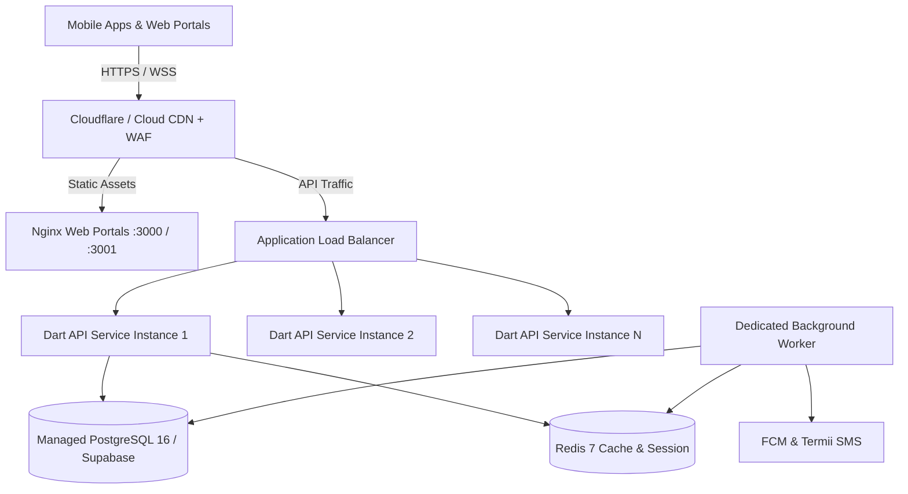

# Go_Volt Production Deployment Guide & Disaster Recovery Runbook

This document defines the deployment topology, environment orchestration, zero-downtime database release protocols, and disaster recovery runbooks in accordance with **Technical Specification §15 (CI/CD, Deployment, and Environments)**.

---

## 1. Production Architecture Overview

Go-Volts utilizes a containerized, modular monolith architecture with isolated deployment targets:



### Key Principles
1. **Stateless API Tier:** The Dart API instances do not store state in memory or local disk; all session and transactional data reside in PostgreSQL or Redis. Instances scale horizontally based on CPU (> 65%) or request queue depth.
2. **Dedicated Background Workers:** Heavy asynchronous operations (dispatch matching retry loops, outbox event publishing, webhook deliveries to Retail Ai) run in separate container tasks from the customer-facing API HTTP server.
3. **Managed PostgreSQL with PgBouncer:** Connection pooling via PgBouncer prevents connection exhaustion during sudden traffic spikes.

---

## 2. Container Images & Build Pipelines

Multi-stage production Dockerfiles are version-controlled under `infra/docker/`:

| Artifact | Dockerfile | Base Runtime Image | Port |
|---|---|---|---|
| **API Server** | [Dockerfile.backend](file:///mnt/newvolume/go_volt/infra/docker/Dockerfile.backend) | `debian:bookworm-slim` (AOT native binary) | 8080 |
| **Admin Web** | [Dockerfile.web](file:///mnt/newvolume/go_volt/infra/docker/Dockerfile.web) (`APP_DIR=apps/admin_web`) | `nginx:1.27-alpine` (WASM / CanvasKit) | 80 / 3000 |
| **Merchant Portal** | [Dockerfile.web](file:///mnt/newvolume/go_volt/infra/docker/Dockerfile.web) (`APP_DIR=apps/merchant_portal`) | `nginx:1.27-alpine` (WASM / CanvasKit) | 80 / 3001 |

### Building & Tagging
```bash
# Build backend native AOT container
docker build -f infra/docker/Dockerfile.backend -t registry.govolts.ng/backend:v1.0.0 .

# Build Admin Web
docker build -f infra/docker/Dockerfile.web --build-arg APP_DIR=apps/admin_web -t registry.govolts.ng/admin_web:v1.0.0 .

# Build Merchant Portal
docker build -f infra/docker/Dockerfile.web --build-arg APP_DIR=apps/merchant_portal -t registry.govolts.ng/merchant_portal:v1.0.0 .
```

---

## 3. Database Migration Discipline (Spec §15.3)

Database migrations are strictly versioned under `infra/supabase/migrations/` and managed using [infra/scripts/migrate.sh](file:///mnt/newvolume/go_volt/infra/scripts/migrate.sh).

### Zero-Downtime Expand-and-Contract Pattern
1. **Expand Phase (Release N):**
   - Add new nullable columns or new tables.
   - Deploy backend code that writes to both old and new columns, reading from the old column with fallback to new.
2. **Backfill Phase (Release N.1):**
   - Run asynchronous background backfill scripts to populate historical data in new columns.
3. **Contract Phase (Release N+1):**
   - Deploy code reading exclusively from the new column structure.
   - Drop deprecated columns via an explicit migration file.

### Production Migration Execution Order
1. Capture automated pre-migration snapshot:
   ```bash
   pg_dump -h $DB_HOST -U $DB_USER -d govolts_production -Fc > /backups/pre_migrate_$(date +%s).dump
   ```
2. Execute migration runner:
   ```bash
   ./infra/scripts/migrate.sh
   ```
3. Run post-migration health probe:
   ```bash
   ./infra/scripts/healthcheck.sh
   ```

---

## 4. Static Web Hosting & Edge Security Headers

For Flutter Web deployments (Admin Web & Merchant Portal), Nginx and Cloudflare MUST enforce the following security headers:

```nginx
add_header Strict-Transport-Security "max-age=31536000; includeSubDomains; preload" always;
add_header X-Content-Type-Options "nosniff" always;
add_header X-Frame-Options "DENY" always;
add_header Referrer-Policy "strict-origin-when-cross-origin" always;
add_header Content-Security-Policy "default-src 'self'; script-src 'self' 'unsafe-eval' 'wasm-unsafe-eval'; style-src 'self' 'unsafe-inline' https://fonts.googleapis.com; font-src 'self' https://fonts.gstatic.com data:; img-src 'self' data: https:; connect-src 'self' https://api.govolts.ng wss://api.govolts.ng;" always;
```

---

## 5. Disaster Recovery Runbook (Spec §15.4)

### Targets
- **Recovery Point Objective (RPO):** < 5 minutes (via PostgreSQL continuous archiving & WAL archiving).
- **Recovery Time Objective (RTO):** < 30 minutes for complete cluster restoration.

### Procedure 1: Restoring Database from Snapshot
1. Spin up a replacement database instance from the latest point-in-time recovery (PITR) snapshot.
2. Validate schema and table row counts against pre-incident telemetry.
3. Run financial ledger balance verification:
   ```sql
   SELECT COALESCE(SUM(amount_cents), 0) AS imbalance FROM ledger_entries;
   ```
   *Expected result: `0`.*
4. Update `DATABASE_URL` secret in Secret Manager.
5. Trigger rolling restart of API services.

### Procedure 2: Rolling Back a Service Deployment
1. Identify the previous stable image tag:
   ```bash
   kubectl rollout history deployment/govolts-backend
   ```
2. Revert deployment to previous revision:
   ```bash
   kubectl rollout undo deployment/govolts-backend --to-revision=PREVIOUS_REVISION
   ```
3. Verify service healthcheck:
   ```bash
   curl -f https://api.govolts.ng/health
   ```
