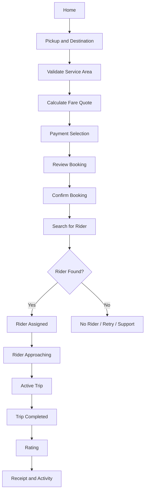
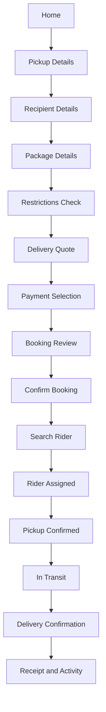
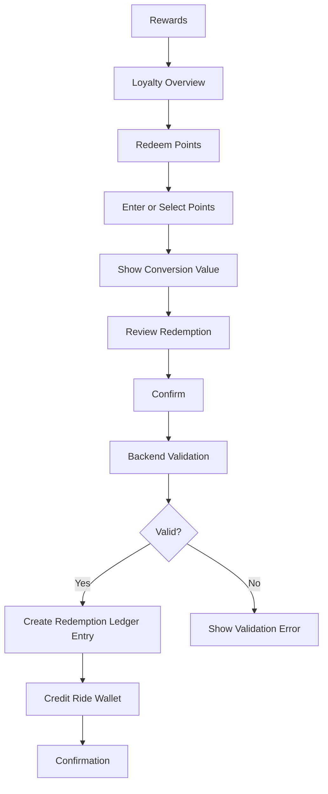
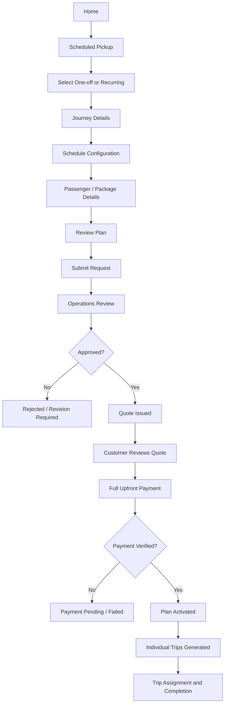
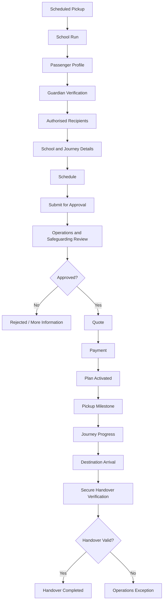
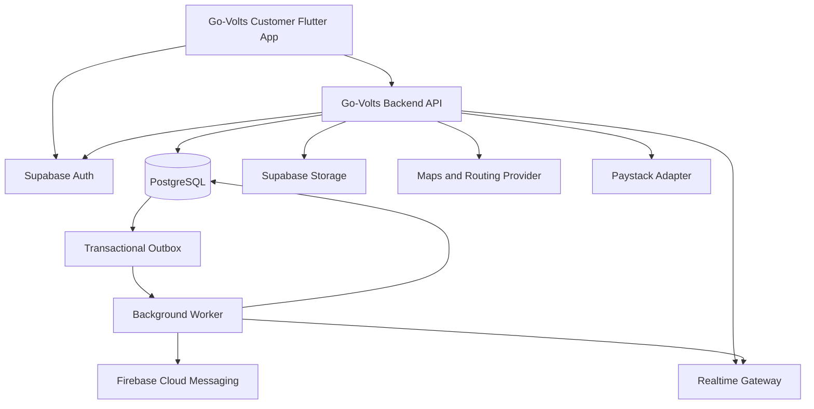

# GO-VOLTS CUSTOMER APP
## Product Concept Note, Functional Requirements, UX/UI Design Specification and Technical Implementation Blueprint

**Document type:** Product Requirements and Engineering Handoff  
**Product:** Go-Volts Customer Mobile Application  
**Document status:** Working master specification  
**Version:** 1.0  
**Date:** October 2026  
**Platforms:** Android and iOS  
**Primary audience:** Product Manager, UI/UX Designer, Flutter Developers, Backend Engineers, QA Engineers, Technical Lead and Operations Team

---

# 1. Executive Summary

Go-Volts is a Nigerian mobility and logistics platform designed to provide customers with a unified application for booking passenger rides, sending parcels, receiving store deliveries, tracking bookings, managing payments and accessing customer rewards.

The Customer App is the primary customer-facing interface of the Go-Volts ecosystem. It must provide a simple, reliable and consistent experience across all supported services.

The application should not feel like a collection of unrelated services. It should operate as one connected platform where customers can easily:

- Book a passenger ride.
- Send a parcel to another location.
- Receive and track eligible store deliveries.
- Schedule a future ride or recurring transport arrangement.
- Monitor active and previous bookings.
- Manage their ride wallet and payment methods.
- Earn loyalty points and redeem them into eligible ride-wallet credit.
- Use referral rewards and promotional coupons.
- Manage personal information, trusted contacts and support requests.

The application must be designed around three primary product objectives:

1. **Convenience:** Make the most frequently used services accessible with minimal steps.
2. **Transparency:** Show service availability, pricing, booking status, payment status and applicable terms clearly.
3. **Trust:** Provide dependable tracking, clear rider information, appropriate safety features and accessible customer support.

The application must also be configurable by service area. Customers should only see services they can actually use in their selected operating area.

# 2. Product Vision and Objectives

## 2.1 Product Vision

To make mobility and delivery services easier to access, safer to monitor, more transparent to pay for and simpler to manage through one connected customer application.

## 2.2 Product Objectives

The Customer App must:

- Provide a unified entry point for Go-Volts mobility and logistics services.
- Reduce friction when creating rides and delivery bookings.
- Support immediate and future bookings.
- Provide real-time or near-real-time booking progress.
- Give customers clear information about the rider handling their booking.
- Support digital payments and eligible ride-wallet credit.
- Encourage repeat usage through rewards, referrals and coupons.
- Allow customers to review their booking history and receipts.
- Provide a reliable support and safety experience.
- Adapt its available services to approved locations and operational conditions.

## 2.3 Product Design Principles

| Principle | Design requirement |
|---|---|
| Simplicity | Avoid unnecessary steps and excessive information on booking screens. |
| Consistency | Use shared components, layouts and interaction patterns across services. |
| Transparency | Show prices, payment status, restrictions and booking progress clearly. |
| Contextual relevance | Display only services and actions relevant to the customer's current state. |
| Accessibility | Use readable text, adequate contrast, clear touch targets and understandable labels. |
| Reliability | Provide useful loading, offline, error and retry states. |
| Safety | Make trip sharing, rider verification and appropriate help options accessible. |
| Scalability | Build reusable UI and business modules that support future services. |

# 3. Product Scope and Service Definitions

The Customer App supports the following service categories.

## 3.1 Go-Volts Ride

A customer books a passenger journey by specifying pickup and destination locations.

The app calculates an estimated fare, presents eligible payment options and allows the customer to confirm the booking.

After confirmation, the system searches for an eligible rider and displays assignment and journey progress.

Passenger transportation is available only in service areas where it has received the required legal, vehicle, rider and operational approvals.

## 3.2 Go-Volts Send

A customer requests delivery of an eligible parcel or item from one location to another.

The customer supplies:

- Pickup location.
- Recipient details.
- Destination address.
- Package category.
- Package size or weight information where required.
- Handling instructions.
- Declared value where required by policy.

The app generates a delivery quote and allows the customer to confirm and pay for the booking.

The customer can monitor delivery progress and access the configured proof-of-delivery information.

Declared value must not be represented as automatic insurance coverage.

## 3.3 Go-Volts Store Delivery

This service supports deliveries originating from connected commerce platforms, including Retail Ai.

The originating store or platform creates the delivery request. Go-Volts manages rider assignment, pickup, delivery and status reporting.

The Customer App may display the resulting delivery when the customer is the recipient and the originating integration supplies an authorized customer reference or contact association.

The customer should be able to view:

- Store or merchant information.
- Delivery reference.
- Delivery status.
- Expected delivery information where available.
- Relevant rider information after assignment.
- Delivery completion and proof-of-delivery information.

The Customer App is not responsible for creating the original supermarket order.

## 3.4 Go-Volts Merchant Booking

Independent merchants create delivery requests through the Merchant Portal.

Where the merchant supplies an authorized customer association, the Customer App may display the delivery and its status.

Merchant booking creation and merchant administration remain outside the Customer App.

## 3.5 External Platform Delivery Integration

External commerce platforms may create delivery requests through the Go-Volts Partner API.

The originating platform remains responsible for its customer order. Go-Volts is responsible for the delivery workflow and its status.

The Customer App must not expose merchant integration credentials or internal partner configuration.

## 3.6 Scheduled Pickup

Scheduled Pickup is an MVP service.

It supports:

- One-off future journeys.
- Recurring journeys.
- Weekly and monthly subscription/package arrangements where configured.
- One-way and round-trip journeys.
- Work commute arrangements.
- School-related transport arrangements subject to the separate school-run controls.

Scheduled Pickup must be accessible from the Home screen.

A recurring schedule and a subscription/package are different concepts:

- A schedule defines when individual journeys should occur.
- A trip represents one actual journey.
- A subscription/package defines the commercial agreement, payment, validity and trip entitlement.

An active subscription does not mean that every future trip already has a rider assigned.

## 3.7 School Run

School Run is a gated capability within Scheduled Pickup.

It must remain disabled in a service area until all required legal, insurance, safeguarding, rider eligibility, school protocol and operational readiness approvals have been recorded.

The Customer App must support the approved school-specific experience, including:

- Verified parent or guardian ownership.
- Passenger profile.
- Authorised pickup and receiving contacts.
- Approved schedule.
- Pickup milestone.
- Arrival milestone.
- Secure-code handover verification.
- Handover confirmation.
- Exception handling and notifications.

Arrival at the destination does not automatically mean that a child has been handed over successfully.

# 4. Customer App Information Architecture

## 4.1 Primary Navigation

The application will use five primary navigation destinations:

1. Home
2. Activity
3. Rewards
4. Wallet
5. Profile

The navigation should remain consistent across the authenticated experience.

### Navigation responsibilities

| Navigation | Primary responsibility |
|---|---|
| Home | Discover and initiate services, view active booking and important updates. |
| Activity | Review active, upcoming, completed and cancelled bookings. |
| Rewards | Manage loyalty points, referrals and coupons. |
| Wallet | Review ride-wallet credit, transactions and supported payment methods. |
| Profile | Manage customer information, addresses, trusted contacts, safety and support. |

Booking flows should open as focused screens or navigation stacks rather than introducing additional permanent bottom-navigation items.

## 4.2 Proposed App Structure

```text
Go-Volts Customer App
│
├── Authentication
│   ├── Welcome
│   ├── Sign Up
│   ├── Sign In
│   ├── Phone Verification
│   └── Account Recovery
│
├── Home
│   ├── Location Selector
│   ├── Service Cards
│   ├── Active Booking
│   ├── Promotions
│   ├── Saved Addresses
│   └── Rewards Summary
│
├── Ride
│   ├── Pickup and Destination
│   ├── Map Selection
│   ├── Fare Estimate
│   ├── Payment
│   ├── Confirmation
│   ├── Rider Assignment
│   ├── Live Tracking
│   ├── Trip Completion
│   └── Rating and Receipt
│
├── Send Parcel
│   ├── Pickup Details
│   ├── Recipient Details
│   ├── Package Details
│   ├── Quote
│   ├── Payment
│   ├── Rider Assignment
│   ├── Delivery Tracking
│   └── Delivery Receipt
│
├── Activity
│   ├── Active Bookings
│   ├── Upcoming Bookings
│   ├── Ride History
│   ├── Delivery History
│   ├── Booking Details
│   └── Receipts
│
├── Rewards
│   ├── Loyalty Overview
│   ├── Points Activity
│   ├── Redeem Points
│   ├── Referrals
│   └── Coupons
│
├── Wallet
│   ├── Wallet Overview
│   ├── Transactions
│   ├── Transaction Details
│   ├── Payment Methods
│   └── Checkout Wallet Selector
│
├── Scheduled Pickup
│   ├── Overview
│   ├── Plan Configuration
│   ├── Journey Details
│   ├── Schedule
│   ├── Quote
│   ├── Payment
│   ├── Plan Management
│   └── Trip Management
│
├── School Run
│   ├── Passenger Profile
│   ├── Guardian Details
│   ├── Authorised Recipients
│   ├── School Details
│   ├── Schedule
│   ├── Approval
│   └── Handover Tracking
│
└── Profile
    ├── Personal Details
    ├── Saved Addresses
    ├── Trusted Contacts
    ├── Notifications
    ├── Safety Centre
    ├── Help Centre
    └── Settings
```

# 5. Screen-by-Screen Functional Specification

## 5.1 Welcome and Account Access

### Screens

- Splash Screen
- Welcome Screen
- Sign Up
- Sign In
- Phone Verification
- Forgot Access
- Permissions Explanation
- Initial Profile Setup

### Functional requirements

**Splash Screen**
- Display Go-Volts branding.
- Initialize application configuration.
- Check authentication state.
- Load supported service configuration.
- Route the user to the appropriate next screen.

**Welcome Screen**
- Display the Go-Volts value proposition.
- Provide Sign In and Create Account actions.
- Include Terms and Privacy links.

**Sign Up**
- Capture required customer information.
- Validate phone number and other required fields.
- Create the customer identity through the authentication service.
- Begin phone verification.

**Sign In**
- Authenticate an existing customer.
- Support the approved authentication method.
- Provide an account recovery route.

**Phone Verification**
- Accept verification code.
- Validate code expiry and retry limits.
- Handle successful and unsuccessful verification.

**Permissions Explanation**
- Explain location access before requesting it.
- Explain notification access before requesting it.
- Request permissions in context, not indiscriminately on first launch.

### Design logic

The onboarding experience should be short. Collect only the information needed to establish the account.

Do not make optional permissions a condition for exploring the application. Request location when a customer begins a location-dependent action.

# 6. Home Dashboard

The Home screen is the central service discovery and action screen.

It should allow a customer to understand the available services and start a booking without navigating through several menus.

## 6.1 Home Screen Layout

Recommended vertical structure:

```text
┌──────────────────────────────────────┐
│ Logo       Greeting        Profile   │
│                                      │
│ Current Service Area / Location     │
├──────────────────────────────────────┤
│                                      │
│       MAIN SERVICE ACTIONS           │
│                                      │
│  ┌──────────────┐ ┌──────────────┐   │
│  │ Book a Ride  │ │ Send Parcel  │   │
│  └──────────────┘ └──────────────┘   │
│                                      │
│  ┌──────────────┐ ┌──────────────┐   │
│  │ Track        │ │ Scheduled    │   │
│  │ Delivery     │ │ Pickup       │   │
│  └──────────────┘ └──────────────┘   │
│                                      │
├──────────────────────────────────────┤
│ Active Booking                       │
│ Status / Reference / Track action    │
├──────────────────────────────────────┤
│ Promotional / Campaign Banner        │
├──────────────────────────────────────┤
│ Saved Places                         │
├──────────────────────────────────────┤
│ Rewards Summary                      │
├──────────────────────────────────────┤
│ Home Activity Rewards Wallet Profile │
└──────────────────────────────────────┘
```

## 6.2 Home Screen Components

### A. Header

Contains:

- Go-Volts logo.
- Greeting.
- Customer profile shortcut.
- Notification indicator where notifications are enabled.

The header should not occupy excessive vertical space.

### B. Location Selector

Displays the currently selected service area or relevant location.

Functions:

- View current location.
- Change service area where permitted.
- Select a saved address.
- Search for an address.

The app must validate whether a requested service is available in the selected location.

### C. Main Service Cards

Four primary actions:

**Book a Ride**
- Opens passenger ride booking.
- Uses the approved service availability configuration.

**Send a Parcel**
- Opens customer-originated delivery booking.

**Track Delivery**
- Allows the customer to access eligible active delivery records or enter a delivery reference where that tracking method is supported.

**Scheduled Pickup**
- Opens the Scheduled Pickup service.
- Shows only when the service is enabled for the customer's area.

Service cards should use consistent visual treatment, clear titles and short supporting descriptions.

### D. Active Booking Card

Displays the most relevant active booking.

Information:

- Service type.
- Booking reference.
- Current status.
- Pickup or destination summary.
- ETA when available.
- View Booking or Track action.

When multiple bookings are active, the card should show the most relevant one and provide access to the full active-bookings list.

### E. Promotional Banner

Used for approved campaigns, referral promotions, coupons and other customer offers.

Requirements:

- Configurable content.
- Start and end dates.
- Target audience.
- Destination route.
- Service eligibility.
- Campaign status.

Promotional content must not obscure the main service actions.

### F. Saved Addresses

Suggested quick-access locations:

- Home.
- Work.
- Other saved locations.

Selecting a saved address should prefill the relevant booking field, not automatically confirm a booking.

### G. Rewards Summary

Display:

- Available loyalty points.
- Relevant reward promotion.
- Link to Rewards.

Do not display loyalty points as a monetary wallet balance.

## 6.3 Home Screen Business Logic

The Home screen must be driven by service availability and customer state.

Examples:

- A customer outside an approved ride area must not see a normal bookable ride action.
- Scheduled Pickup should only be available where operationally enabled.
- School Run should not be displayed as an available booking service unless its approval requirements have been met.
- If a customer has an active booking, show the active booking card.
- If there are no active bookings, show a suitable discovery or promotional section.
- If location permission is denied, allow manual location entry where possible.

# 7. Go-Volts Ride

## 7.1 Ride Screen Inventory

| Screen ID | Screen | Purpose |
|---|---|---|
| RIDE-01 | Pickup and Destination | Enter journey locations. |
| RIDE-02 | Map Selection | Select or adjust map locations. |
| RIDE-03 | Fare Estimate | Display estimated cost and journey details. |
| RIDE-04 | Payment Selection | Select payment method, coupon and eligible wallet credit. |
| RIDE-05 | Booking Review | Review the complete booking before submission. |
| RIDE-06 | Searching for Rider | Show dispatch progress. |
| RIDE-07 | Rider Assigned | Show rider and vehicle information. |
| RIDE-08 | Rider Approaching | Track rider arrival. |
| RIDE-09 | Active Trip | Show trip progress and safety controls. |
| RIDE-10 | Trip Completed | Confirm completed journey. |
| RIDE-11 | Rating | Collect customer feedback. |
| RIDE-12 | Receipt | Display final trip and payment information. |

## 7.2 Ride Booking Flow



## 7.3 Pickup and Destination Screen

### Layout

```text
┌──────────────────────────────────────┐
│ Back             Book a Ride         │
├──────────────────────────────────────┤
│ Pickup Location                      │
│ [ Search pickup address          ]   │
│                                      │
│ Destination                          │
│ [ Search destination             ]   │
├──────────────────────────────────────┤
│                                      │
│              MAP                     │
│                                      │
│                                      │
├──────────────────────────────────────┤
│ Saved Places                         │
│ Home     Work     Recent             │
├──────────────────────────────────────┤
│              Continue                │
└──────────────────────────────────────┘
```

### Functional requirements

- Address autocomplete.
- Map selection.
- Current-location selection.
- Saved address selection.
- Pickup and destination validation.
- Service-area validation.
- Clear error messages for unsupported routes.

The customer must be able to adjust the map pin when the address search result is not sufficiently precise.

## 7.4 Fare Estimate

Display:

- Pickup and destination summary.
- Route distance where available.
- Estimated travel time where available.
- Available ride option where multiple options exist.
- Fare breakdown.
- Applicable additional fees.
- Quote expiry information.
- Continue action.

The backend is the authority for fare calculation.

The app must not calculate a trusted final fare independently.

## 7.5 Payment Selection

Payment options may include:

- Paystack-supported payment methods.
- Ride-wallet credit.
- Applicable coupon.
- Eligible promotional discount.

The screen must clearly display:

- Booking amount.
- Discount.
- Wallet credit applied.
- Remaining amount payable.
- Payment method.
- Final payable amount.

The customer must review the total before confirmation.

## 7.6 Rider Assignment and Tracking

After assignment, display:

- Rider name.
- Rider profile image where available.
- Vehicle information.
- Relevant verification details.
- Rider rating where supported.
- Estimated arrival.
- Contact options.
- Booking reference.

During the trip, display:

- Trip status.
- Map.
- Route information.
- Relevant ETA.
- Share Trip.
- Safety Centre.
- Help with Booking.

Emergency options must be configured for the actual service area and must not be presented as a substitute for local emergency services.

## 7.7 Trip Completion

After the backend confirms completion:

- Show completion message.
- Show final fare.
- Show payment summary.
- Display rating request.
- Display receipt access.
- Update Activity.
- Trigger eligible loyalty processing.

A client-side screen transition alone must never mark a booking completed.

# 8. Go-Volts Send and Delivery

## 8.1 Screen Inventory

| Screen ID | Screen | Purpose |
|---|---|---|
| SEND-01 | Pickup Details | Enter sender and pickup information. |
| SEND-02 | Recipient Details | Enter recipient information. |
| SEND-03 | Package Details | Describe the parcel. |
| SEND-04 | Restrictions and Instructions | Confirm package eligibility and handling details. |
| SEND-05 | Delivery Quote | Display delivery cost. |
| SEND-06 | Payment Selection | Select payment arrangement. |
| SEND-07 | Booking Review | Review details before submission. |
| SEND-08 | Rider Search | Display dispatch progress. |
| SEND-09 | Rider Assigned | Display assigned rider. |
| SEND-10 | Pickup Confirmation | Display pickup milestone. |
| SEND-11 | Delivery Tracking | Track delivery progress. |
| SEND-12 | Delivery Confirmation | Display delivery completion. |
| SEND-13 | Delivery Receipt | Display booking and payment record. |
| SEND-14 | Delivery Exception | Display failed or interrupted delivery information. |

## 8.2 Send Parcel Flow



## 8.3 Package Details

Fields should be configurable by service policy:

- Package category.
- Package description.
- Size band.
- Weight band where required.
- Declared value where required.
- Handling instructions.

The app must display restricted and prohibited item information before booking confirmation.

The backend must validate package eligibility. Frontend validation is not sufficient.

## 8.4 Delivery Tracking

Display:

- Booking reference.
- Pickup and destination summary.
- Current delivery status.
- Status timeline.
- Rider information after assignment.
- ETA where available.
- Contact options.
- Help with Delivery.
- Proof-of-delivery status.

Recipient tracking links must be secure and limited to the relevant delivery.

A recipient should not be required to install the Customer App simply to access an authorized tracking link.

## 8.5 Delivery Completion

Completion should be based on the configured proof-of-delivery process.

Possible evidence includes:

- Recipient OTP.
- Approved proof-of-delivery record.
- Authorized handover confirmation.

The exact evidence requirement must be configurable by service type and risk policy.

# 9. Activity and Booking Management

Activity provides a unified history of the customer's Go-Volts services.

## 9.1 Screens

- Activity Overview.
- Active Bookings.
- Upcoming Bookings.
- Ride History.
- Delivery History.
- Booking Details.
- Receipt.
- Cancelled Bookings.
- Help with Booking.
- Rebook.

## 9.2 Activity Overview Layout

```text
┌──────────────────────────────────────┐
│ Activity                             │
├──────────────────────────────────────┤
│ [All] [Active] [Upcoming] [Past]     │
├──────────────────────────────────────┤
│ Search by reference                  │
│                                      │
│ Booking Card                         │
│ Service Type                         │
│ Date / Time                           │
│ Booking Reference                    │
│ Status                               │
│ Amount                               │
│ View Details                         │
│                                      │
│ Booking Card                         │
│ ...                                  │
├──────────────────────────────────────┤
│ Home Activity Rewards Wallet Profile │
└──────────────────────────────────────┘
```

## 9.3 Booking Details

A booking detail screen must show:

- Booking reference.
- Service type.
- Booking date.
- Pickup and destination.
- Rider details where applicable.
- Booking status.
- Payment status.
- Price breakdown.
- Coupon or wallet application.
- Relevant status timeline.
- Receipt.
- Support action.

## 9.4 Filtering

Allow filtering by:

- Service type.
- Booking status.
- Date range.
- Payment status.

Use cursor pagination for large booking histories.

# 10. Rewards, Loyalty, Referrals and Coupons

Rewards is the customer-facing destination for promotional and loyalty programmes.

The interface must distinguish three separate concepts:

1. Loyalty points.
2. Ride-wallet monetary credit.
3. Coupons and promotional discounts.

These are not interchangeable.

## 10.1 Rewards Overview

Display:

- Current points balance.
- Available redemption action.
- Points activity.
- Referral programme summary.
- Available coupons.
- Relevant campaign information.

## 10.2 Loyalty Points

Screens:

- Loyalty Overview.
- Points Activity.
- How to Earn.
- Redeem Points.
- Redemption Review.
- Redemption Confirmation.
- Loyalty Terms.

### Earning rules

Points may be earned from configured qualifying events, such as eligible completed rides or deliveries.

The backend must prevent duplicate points for the same qualifying event.

Cancelled, refunded or fraudulent transactions must follow the configured reversal or review policy.

### Redemption flow



The conversion rate, minimum redemption, maximum redemption, eligible services and expiry must be configurable.

Redeemed loyalty-derived ride-wallet credit must not be represented as withdrawable cash by default.

## 10.3 Referrals

Screens:

- Referral Overview.
- Share Referral.
- Referral Activity.
- Referral Details.
- Referral Terms.

Functions:

- Display unique referral code or share link.
- Share referral through supported device sharing options.
- Display campaign terms.
- Show referral qualification status.
- Show earned rewards.

The referral programme must allow the admin to configure whether the referrer, the referred customer or both receive rewards.

The app should use privacy-conscious labels in referral activity and must not expose another customer's sensitive account or trip details.

## 10.4 Coupons

Screens:

- Available Coupons.
- Coupon Details.
- Enter Coupon.
- Applied Discount Summary.
- Used Coupons.
- Expired Coupons.

Coupon information should include:

- Discount type.
- Discount value.
- Eligible service.
- Minimum spend.
- Maximum discount where applicable.
- Expiry date.
- Applicable terms.

Coupon validity must be checked by the backend at quote and booking stages.

# 11. Wallet and Payments

## 11.1 Wallet Overview

The Wallet screen displays the customer's eligible ride-wallet balance and related transactions.

It should not combine points and money into one balance.

### Wallet screen components

- Available ride-wallet credit.
- Wallet activity.
- Recent transactions.
- Payment methods.
- Transaction details.
- Relevant restrictions.

## 11.2 Wallet Transactions

Transaction types may include:

- Loyalty redemption credit.
- Eligible promotional credit.
- Booking wallet debit.
- Refund credit where applicable.
- Approved administrative adjustment.
- Expiry or reversal entry where applicable.

## 11.3 Top-ups and Withdrawals

Wallet top-ups, transfers and withdrawals are not assumed to be enabled.

They require separate product, finance, operational and legal approval.

The initial customer experience must not display unsupported wallet functions.

## 11.4 Payment Requirements

- Paystack is the initial payment provider specified in the engineering baseline.
- Payment methods must be implemented behind a provider abstraction.
- The backend must verify payments.
- The app must not trust payment redirect results alone.
- Failed or expired payments must release relevant reservations exactly once.
- Refunds must be recorded and reconciled.
- Every payment must have a stable transaction reference.

# 12. Profile, Safety and Support

## 12.1 Profile Screens

- Profile Overview.
- Personal Details.
- Saved Addresses.
- Trusted Contacts.
- Notification Preferences.
- Privacy Settings.
- Safety Centre.
- Help Centre.
- Support Categories.
- Submit Support Request.
- Support Case Details.
- Terms and Conditions.
- Account Settings.
- Logout.

## 12.2 Personal Details

Customers should be able to view and update permitted profile information.

Sensitive changes may require re-verification.

## 12.3 Saved Addresses

Customers can:

- Add a location.
- Edit a location.
- Delete a location.
- Set a default location.
- Assign labels such as Home and Work.

## 12.4 Trusted Contacts

Customers can manage contacts used by supported safety features.

The app must obtain appropriate consent before using or sharing contact information.

## 12.5 Safety Centre

The Safety Centre should contain relevant tools for an active booking, including:

- Share Trip.
- Rider verification information.
- Contact support.
- Emergency action where configured.
- Report a safety concern.

Emergency actions must be visually distinct from routine support.

## 12.6 Help Centre

Support categories may include:

- Booking issue.
- Payment issue.
- Rider issue.
- Delivery issue.
- Refund request.
- Account issue.
- Safety concern.
- Other.

Support requests should create a trackable case reference.

# 13. Scheduled Pickup

Scheduled Pickup is part of the MVP and must receive a complete design and implementation.

## 13.1 Screen Inventory

- Scheduled Pickup Overview.
- Plan Type.
- Journey Details.
- Schedule Configuration.
- Passenger or Package Details.
- Plan Review.
- Submit Request.
- Review Status.
- Quote Details.
- Payment.
- Payment Confirmation.
- Active Plan.
- Plan Details.
- Upcoming Trips.
- Skip Trip.
- Change Trip.
- Pause or Resume Plan.
- Cancel Plan.
- Renewal.

## 13.2 Plan Types

The application must support:

**One-off future journey**
- One future journey.
- One pickup and destination.
- One scheduled date and time.
- Standard trip lifecycle.

**Recurring journey**
- Selected days.
- Pickup time.
- Destination.
- One-way or round-trip.
- Start and end dates or validity period.
- Applicable exceptions.

**Subscription/package**
- Commercial agreement.
- Configured trip entitlement.
- Validity period.
- Price.
- Payment status.
- Renewal information.

## 13.3 Scheduled Pickup Flow



## 13.4 Business Rules

The current product specification establishes the following:

- Recurring plans are reviewed by operations.
- An approved quote is valid for 48 hours.
- Full upfront payment is required.
- Plan activation occurs only after verified payment.
- Renewal is manual.
- A skip request must meet the six-hour cutoff before pickup.
- No-show handling uses a 10-minute waiting period.
- Entitlements are deducted only after a completed trip.
- A Go-Volts service failure must not consume an entitlement.
- A preferred rider is a preference, not a guarantee.
- One-way and round-trip legs have independent entitlements.

The app must show these rules at relevant points in the customer journey.

## 13.5 Plan Management

Customers should be able to:

- View active plans.
- View upcoming trips.
- View completed trips.
- Review payment and entitlement information.
- Submit a skip request.
- Request an allowed schedule change.
- Pause or resume where permitted.
- Cancel according to the approved policy.
- View renewal information.

A plan modification must be validated against the backend's policy and operational state.

# 14. School Run

School Run is a specialized Scheduled Pickup workflow.

It must not be exposed as a normal, unrestricted passenger booking.

## 14.1 Screen Inventory

- School Run Overview.
- Passenger Profile.
- Parent or Guardian Details.
- Authorised Recipients.
- School Details.
- Journey Details.
- Schedule.
- Review.
- Approval Status.
- Quote and Payment.
- Plan Management.
- Pickup Status.
- Handover Status.
- Handover Exception.

## 14.2 School Run Flow



## 14.3 School Run Controls

- The verified guardian owns the plan and billing relationship.
- Authorised recipients must be verified.
- School protocol must be followed.
- Destination arrival does not equal completed handover.
- Secure-code handover verification is required.
- Exceptions must be routed through the approved operational process.
- Notifications should use approved journey milestones.
- Baseline school-run tracking uses milestone notifications rather than continuous GPS tracking.

## 14.4 Launch Gate

The feature must remain disabled in a service area until the required legal, insurance, safeguarding, rider eligibility, school protocol and operational readiness approvals are recorded.

The backend must enforce this restriction. Hiding the feature in the UI alone is not sufficient.

# 15. Shared Components and Reusable Screens

The design team must build reusable components rather than independently designing similar controls for every service.

## 15.1 Shared Components

- App Header.
- Bottom Navigation.
- Primary Button.
- Secondary Button.
- Text Input.
- Phone Input.
- Address Search.
- Map Picker.
- Saved Address Card.
- Service Card.
- Booking Summary Card.
- Active Booking Card.
- Rider Information Card.
- Status Badge.
- Status Timeline.
- Payment Method Card.
- Wallet Balance Card.
- Coupon Card.
- Reward Summary Card.
- Confirmation Dialog.
- Bottom Sheet.
- Empty State.
- Error State.
- Loading Skeleton.
- Notification Item.
- Support Action Card.

## 15.2 Booking Status Component

Use consistent status labels and visual treatments.

Possible statuses:

- Pending.
- Awaiting Payment.
- Searching for Rider.
- Rider Assigned.
- Rider Approaching.
- Picked Up.
- In Transit.
- In Progress.
- Completed.
- Cancelled.
- Failed.
- Expired.

The displayed label must correspond to the actual backend booking state. Do not infer booking status from payment status.

## 15.3 Shared Screen States

Every major screen must define:

- Initial loading.
- Refreshing.
- Empty state.
- Validation error.
- Network error.
- Offline state.
- Permission denied.
- Pending.
- Success.
- Failure.
- Expired.
- Cancelled.

The design must explain what the customer can do next in each state.

# 16. UX/UI Design System

## 16.1 Visual Direction

The Go-Volts Customer App should use a modern, premium mobility and logistics visual language.

The established visual direction is:

- Dark charcoal or near-black for strong surfaces and typography.
- Go-Volts green as the primary brand colour.
- White and neutral grey for backgrounds and content surfaces.
- Restrained lime accent for selected emphasis.
- Clear map and route visualizations.
- Simple iconography.
- Consistent card and button styling.

The design should feel modern and trustworthy without excessive gradients, shadows or decorative elements.

## 16.2 Colour System

The design team must establish named design tokens for:

- Primary brand colour.
- Primary dark colour.
- Accent colour.
- Background.
- Surface.
- Elevated surface.
- Primary text.
- Secondary text.
- Disabled text.
- Border.
- Success.
- Warning.
- Error.
- Information.

Exact colour values should be confirmed against the approved Go-Volts brand assets and Figma foundations.

Do not independently introduce conflicting shades across feature screens.

## 16.3 Typography

Use a consistent typographic scale.

Required styles:

- Display.
- Screen title.
- Section heading.
- Card heading.
- Body.
- Supporting text.
- Caption.
- Button label.
- Numeric price and balance.

Prices, wallet balances and booking references should use clear, readable numeric formatting.

## 16.4 Layout and Spacing

Use a consistent spacing scale and reusable layout constraints.

Requirements:

- Respect safe areas.
- Avoid content behind system navigation.
- Use consistent horizontal margins.
- Maintain readable form spacing.
- Avoid excessive card nesting.
- Keep primary actions visually prominent.
- Ensure important actions are reachable on common mobile screen sizes.

## 16.5 Button Hierarchy

**Primary button:** Main action, such as Confirm Booking or Continue.

**Secondary button:** Alternative action, such as Change Location.

**Tertiary action:** Supporting action, such as View Terms.

**Destructive action:** Cancellation or removal, with appropriate confirmation.

A screen should not present several competing primary actions.

## 16.6 Forms

Forms should:

- Use clear field labels.
- Explain required information.
- Validate inputs.
- Preserve valid information when moving between steps.
- Display errors near the affected field.
- Prevent duplicate submission.
- Show progress for longer multi-step workflows.

## 16.7 Map Design

Map-based screens should not allow the map to overwhelm the booking controls.

Use a structured layout:

- Map as the main visual area.
- Pickup and destination controls in a clear panel.
- Bottom sheet for fare or booking information.
- Fixed primary action where appropriate.

Map markers must distinguish pickup, destination and rider location.

# 17. Wireframe and Design Production Requirements

The design team must produce a complete screen system in Figma.

## 17.1 Design Board Structure

Create separate Figma sections or pages for:

1. Foundations and Design Tokens.
2. Shared Components.
3. Authentication.
4. Home Dashboard.
5. Go-Volts Ride.
6. Go-Volts Send and Delivery.
7. Activity and Receipts.
8. Rewards, Loyalty and Referrals.
9. Wallet and Payments.
10. Profile, Safety and Support.
11. Scheduled Pickup.
12. School Run.
13. Shared States and Exceptions.
14. Prototype Flows.

## 17.2 Screen Naming Convention

Use a consistent identifier.

Examples:

- HOME-01: Home Dashboard.
- RIDE-01: Pickup and Destination.
- RIDE-02: Map Selection.
- SEND-01: Pickup Details.
- ACT-01: Activity Overview.
- REW-01: Rewards Overview.
- WAL-01: Wallet Overview.
- SCH-01: Scheduled Pickup Overview.
- SCHOOL-01: School Run Overview.

Each screen should include:

- Screen ID.
- Screen name.
- Purpose.
- Entry point.
- Main action.
- Secondary actions.
- Data displayed.
- Validation rules.
- Error states.
- Next screen or destination.

## 17.3 Wireframe Requirements

Start with low-fidelity wireframes before final visual styling.

The wireframes must communicate:

- Content hierarchy.
- Component placement.
- Navigation.
- Form structure.
- Primary action location.
- Bottom navigation behaviour.
- Modal and bottom-sheet behaviour.
- Loading and error states.

After wireframe approval, proceed to high-fidelity screens.

## 17.4 Design Board Limits

A design board should contain no more than five full-screen mobile designs.

Long flows should be divided into multiple boards.

Each screen should be labelled with its screen ID and title.

Avoid placing too many screens on one board because the design team and developers must be able to inspect individual layouts clearly.

## 17.5 Prototype Requirements

The Figma prototype should demonstrate:

- Account onboarding.
- Home to Ride.
- Home to Send Parcel.
- Home to Track Delivery.
- Home to Scheduled Pickup.
- Activity to Booking Details.
- Rewards to Points Redemption.
- Wallet to Transaction Details.
- Profile to Support.
- School Run approval and handover flow.

A prototype must demonstrate navigation and interaction, not merely show a collection of static screens.

# 18. Functional Requirements Summary

The following requirements define the minimum functional behaviour expected from the Customer App.

| ID | Requirement | Priority |
|---|---|---|
| FR-001 | Customer registration and authentication | Must |
| FR-002 | Customer profile management | Must |
| FR-003 | Service-area and service-availability checks | Must |
| FR-004 | Home dashboard and service discovery | Must |
| FR-005 | Passenger ride booking | Must, where enabled |
| FR-006 | Parcel delivery booking | Must |
| FR-007 | Booking status and tracking | Must |
| FR-008 | Booking history and receipts | Must |
| FR-009 | Payment integration | Must |
| FR-010 | Ride-wallet display and eligible application | Must |
| FR-011 | Coupon validation and application | Must |
| FR-012 | Loyalty points display and redemption | Must |
| FR-013 | Referral programme | Must |
| FR-014 | Saved addresses | Must |
| FR-015 | Trusted contacts and safety tools | Must |
| FR-016 | Customer support requests | Must |
| FR-017 | Scheduled Pickup | Must |
| FR-018 | Recurring plan management | Must |
| FR-019 | School Run workflow | Must, gated |
| FR-020 | Notification centre and push notifications | Must |
| FR-021 | Delivery tracking for authorized recipients | Must |
| FR-022 | Booking cancellation according to policy | Must |
| FR-023 | Rating and feedback | Must |
| FR-024 | Account and privacy settings | Must |

# 19. Non-Functional Requirements

## 19.1 Performance

- Initial application launch should be optimized for low- and mid-range Android devices.
- Screens should avoid unnecessary full-page reloads.
- Lists should use pagination.
- Images should be appropriately compressed and cached.
- Map operations should be optimized.
- Booking confirmation must provide clear feedback while requests are processing.

Performance targets must be validated through testing on representative devices and network conditions.

## 19.2 Reliability

- Booking submissions must be idempotent.
- Payment processing must tolerate duplicate callbacks.
- Booking state must be controlled by the backend.
- The application must recover gracefully from network interruptions.
- Customers must be able to refresh booking status.
- A push notification failure must not cause a booking to be lost.

## 19.3 Security

- Use secure authentication.
- Enforce authorization on the backend.
- Protect customer information.
- Avoid storing sensitive credentials in plain text.
- Do not expose privileged Supabase credentials in the app.
- Do not allow mobile clients to directly modify financial ledger records.
- Use secure tracking links.
- Apply rate limits to sensitive endpoints.
- Record security-relevant events.

## 19.4 Accessibility

- Maintain sufficient colour contrast.
- Support scalable text.
- Provide accessible labels for icons and controls.
- Do not communicate status using colour alone.
- Use touch targets appropriate for mobile interaction.
- Ensure screen readers can understand forms and booking states.

## 19.5 Network Resilience

The application should handle:

- Slow connections.
- Temporary loss of connectivity.
- Request timeouts.
- Expired authentication.
- Failed map requests.
- Delayed payment confirmation.
- Delayed rider assignment.

Do not show a booking as successful until the backend confirms its creation.

# 20. Technical Architecture

## 20.1 Approved Engineering Baseline

The existing Go-Volts Technical Specification v1.2 defines the following baseline.

| Layer | Technology | Responsibility |
|---|---|---|
| Customer App | Flutter and Dart | Android and iOS customer experience |
| Authentication | Supabase Auth | Identity and JWT issuance |
| Database | PostgreSQL managed by Supabase | Transactional application data |
| Backend API | Dart with Shelf or Dart Frog | Business logic and REST endpoints |
| File Storage | Supabase Storage | Approved customer and booking files |
| Realtime | Supabase Realtime selectively or backend WebSocket/SSE | Booking updates |
| Push Notifications | Firebase Cloud Messaging | Push delivery |
| Maps | Google Maps Platform or selected regional provider | Geocoding, routing and ETA |
| Payments | Paystack initially | Payment initialization and verification |
| Background Jobs | PostgreSQL outbox/job tables and Dart worker | Notifications, dispatch and reconciliation |
| State Management | Riverpod | Flutter state and dependency management |
| Navigation | go_router | App routing |
| Models | Freezed and json_serializable | Immutable models and serialization |
| API Contract | OpenAPI 3.1 | API documentation |
| Testing | flutter_test and integration_test | Frontend testing |

## 20.2 Architecture Principle

Use a modular monolith initially.

Do not introduce microservices from day one.

Booking, dispatch, payment, wallet and loyalty operations have transactional relationships. Keeping these within a well-structured backend reduces distributed transaction complexity.

The backend API and background worker may run as separate processes while sharing the same codebase and domain modules.

## 20.3 System Architecture



The mobile app should communicate with the backend for business operations.

Supabase Auth may be used by the app for authentication, but authorization and business rules must remain enforced by the backend.

# 21. Flutter Application Structure

The Customer App should use a feature-first architecture.

Recommended structure:

```text
customer_app/
│
├── android/
├── ios/
├── assets/
│   ├── images/
│   ├── icons/
│   ├── illustrations/
│   └── fonts/
│
├── lib/
│   ├── main.dart
│   ├── bootstrap.dart
│   │
│   ├── app/
│   │   ├── app.dart
│   │   ├── router/
│   │   ├── theme/
│   │   └── configuration/
│   │
│   ├── core/
│   │   ├── network/
│   │   ├── errors/
│   │   ├── security/
│   │   ├── storage/
│   │   ├── location/
│   │   ├── maps/
│   │   ├── notifications/
│   │   ├── payments/
│   │   ├── realtime/
│   │   ├── utilities/
│   │   └── widgets/
│   │
│   ├── shared/
│   │   ├── models/
│   │   ├── components/
│   │   ├── enums/
│   │   └── services/
│   │
│   ├── features/
│   │   ├── authentication/
│   │   ├── home/
│   │   ├── ride/
│   │   ├── delivery/
│   │   ├── tracking/
│   │   ├── activity/
│   │   ├── rewards/
│   │   ├── referrals/
│   │   ├── coupons/
│   │   ├── wallet/
│   │   ├── scheduled_pickup/
│   │   ├── school_run/
│   │   ├── profile/
│   │   ├── safety/
│   │   └── support/
│   │
│   └── l10n/
│
├── test/
├── integration_test/
├── pubspec.yaml
└── README.md
```

## 21.1 Feature Module Structure

Each feature should follow a consistent structure:

```text
features/ride/
│
├── data/
│   ├── datasources/
│   ├── dto/
│   └── repositories/
│
├── domain/
│   ├── entities/
│   ├── repositories/
│   └── usecases/
│
└── presentation/
    ├── providers/
    ├── screens/
    ├── widgets/
    └── controllers/
```

The team should not place all business logic inside widgets or screen files.

# 22. Backend Domain Modules

The backend must provide the business capabilities required by the Customer App.

Recommended modules:

1. Identity and Access.
2. Customer Profiles.
3. Service Catalogue.
4. Service Areas.
5. Pricing and Quotes.
6. Bookings.
7. Dispatch.
8. Rider Operations.
9. Payments.
10. Ledger and Wallet.
11. Coupons and Promotions.
12. Loyalty.
13. Referrals.
14. Scheduled Pickup.
15. School Run and Handover.
16. Notifications.
17. Tracking.
18. Support.
19. Audit and Compliance.

Each module should expose explicit domain operations rather than allowing unrelated modules to update its tables arbitrarily.

# 23. Database Requirements

PostgreSQL is the system of record.

The following is a conceptual entity inventory for the Customer App and its supporting backend.

## 23.1 Identity and Customer

- `profiles`
- `customer_profiles`
- `user_devices`
- `trusted_contacts`
- `saved_addresses`
- `notification_preferences`

## 23.2 Service Configuration

- `service_types`
- `service_areas`
- `service_area_boundaries`
- `service_availability`
- `service_feature_flags`
- `package_categories`
- `restricted_item_rules`

## 23.3 Booking

- `bookings`
- `booking_locations`
- `booking_status_events`
- `booking_assignments`
- `booking_quotes`
- `booking_cancellations`
- `booking_ratings`
- `booking_receipts`

## 23.4 Delivery

- `delivery_details`
- `delivery_recipients`
- `delivery_packages`
- `delivery_instructions`
- `delivery_proofs`
- `delivery_tracking_tokens`

## 23.5 Ride

- `ride_details`
- `ride_passenger_details`
- `ride_safety_events`
- `ride_shared_contacts`

## 23.6 Scheduled Pickup

- `scheduled_plans`
- `scheduled_plan_routes`
- `scheduled_plan_schedules`
- `scheduled_plan_exceptions`
- `scheduled_trips`
- `scheduled_trip_entitlements`
- `scheduled_plan_quotes`
- `scheduled_plan_payments`
- `scheduled_plan_changes`

## 23.7 School Run

- `school_passengers`
- `guardian_profiles`
- `authorised_recipients`
- `school_profiles`
- `school_run_plans`
- `school_run_approvals`
- `school_run_handover_codes`
- `school_run_handover_events`
- `school_run_exceptions`

## 23.8 Payments and Wallet

- `payment_intents`
- `payment_events`
- `refund_requests`
- `wallet_accounts`
- `wallet_transactions`
- `wallet_reservations`
- `ledger_transactions`
- `ledger_entries`

## 23.9 Rewards

- `loyalty_accounts`
- `loyalty_rules`
- `loyalty_transactions`
- `loyalty_redemptions`
- `referral_codes`
- `referral_campaigns`
- `referral_events`
- `referral_rewards`
- `coupons`
- `coupon_redemptions`

## 23.10 Support and Notifications

- `support_cases`
- `support_messages`
- `notifications`
- `notification_delivery_logs`
- `audit_logs`

## 23.11 Database Design Rules

- Use UUID primary keys.
- Use foreign keys and appropriate database constraints.
- Use timestamps consistently.
- Store money in integer minor units, such as kobo for NGN.
- Store loyalty points as integers.
- Do not use floating-point values for financial calculations.
- Use explicit enums or validated state values.
- Preserve booking status history.
- Use immutable financial ledger entries.
- Use soft deletion only where appropriate and legally permissible.
- Index frequent customer, booking, date and status queries.
- Use PostGIS for geospatial operations where required.
- Enable and test Row Level Security on exposed tables.

The entity inventory is not a substitute for the final ERD. The engineering team must prepare and review the complete schema, relationships, constraints and migrations before implementation.

# 24. API Requirements

All customer business operations must use authenticated backend endpoints.

Use a versioned REST API, for example:

`/api/v1/...`

## 24.1 Authentication and Profile

```text
GET    /api/v1/customer/profile
PATCH  /api/v1/customer/profile

GET    /api/v1/customer/addresses
POST   /api/v1/customer/addresses
PATCH  /api/v1/customer/addresses/{id}
DELETE /api/v1/customer/addresses/{id}

GET    /api/v1/customer/trusted-contacts
POST   /api/v1/customer/trusted-contacts
PATCH  /api/v1/customer/trusted-contacts/{id}
DELETE /api/v1/customer/trusted-contacts/{id}
```

## 24.2 Service Availability and Quotes

```text
GET  /api/v1/services
GET  /api/v1/service-areas
POST /api/v1/services/availability
POST /api/v1/quotes
GET  /api/v1/quotes/{id}
```

## 24.3 Ride Booking

```text
POST /api/v1/rides/quotes
POST /api/v1/rides
GET  /api/v1/rides/{id}
GET  /api/v1/rides/{id}/tracking
POST /api/v1/rides/{id}/cancel
POST /api/v1/rides/{id}/rating
```

## 24.4 Delivery Booking

```text
POST /api/v1/deliveries/quotes
POST /api/v1/deliveries
GET  /api/v1/deliveries/{id}
GET  /api/v1/deliveries/{id}/tracking
POST /api/v1/deliveries/{id}/cancel
```

## 24.5 Activity

```text
GET /api/v1/customer/bookings
GET /api/v1/customer/bookings/{id}
GET /api/v1/customer/bookings/{id}/receipt
```

## 24.6 Wallet and Payments

```text
GET  /api/v1/customer/wallet
GET  /api/v1/customer/wallet/transactions
GET  /api/v1/customer/payment-methods

POST /api/v1/payments/initialize
GET  /api/v1/payments/{reference}
POST /api/v1/customer/wallet/redemption-quotes
POST /api/v1/customer/wallet/redemptions
```

## 24.7 Rewards and Referrals

```text
GET  /api/v1/customer/loyalty
GET  /api/v1/customer/loyalty/transactions
GET  /api/v1/customer/loyalty/rules
POST /api/v1/customer/loyalty/redemption-quotes
POST /api/v1/customer/loyalty/redemptions

GET  /api/v1/customer/referrals
GET  /api/v1/customer/referrals/activity
GET  /api/v1/customer/coupons
POST /api/v1/customer/coupons/validate
```

## 24.8 Scheduled Pickup

```text
GET    /api/v1/customer/scheduled-plans
POST   /api/v1/customer/scheduled-plans
GET    /api/v1/customer/scheduled-plans/{id}
PATCH  /api/v1/customer/scheduled-plans/{id}

POST   /api/v1/customer/scheduled-plans/{id}/submit
POST   /api/v1/customer/scheduled-plans/{id}/accept-quote
POST   /api/v1/customer/scheduled-plans/{id}/skip
POST   /api/v1/customer/scheduled-plans/{id}/change-request
POST   /api/v1/customer/scheduled-plans/{id}/pause
POST   /api/v1/customer/scheduled-plans/{id}/resume
POST   /api/v1/customer/scheduled-plans/{id}/cancel

GET    /api/v1/customer/scheduled-plans/{id}/trips
GET    /api/v1/customer/scheduled-trips/{trip_id}
```

## 24.9 School Run

```text
GET  /api/v1/customer/school-run/eligibility
POST /api/v1/customer/school-run/passengers
POST /api/v1/customer/school-run/plans
GET  /api/v1/customer/school-run/plans/{id}
GET  /api/v1/customer/school-run/plans/{id}/status

POST /api/v1/customer/school-run/plans/{id}/submit
GET  /api/v1/customer/school-run/trips/{trip_id}
GET  /api/v1/customer/school-run/trips/{trip_id}/handover
```

School-run approval and handover transitions must be controlled by the backend and authorized operational actors. The customer endpoints above are illustrative read and submission operations, not permission to approve or complete a handover.

## 24.10 Support and Notifications

```text
GET  /api/v1/customer/notifications
POST /api/v1/customer/notifications/{id}/read

GET  /api/v1/customer/support/cases
POST /api/v1/customer/support/cases
GET  /api/v1/customer/support/cases/{id}
POST /api/v1/customer/support/cases/{id}/messages
```

## 24.11 API Contract Rules

- Require authentication where applicable.
- Validate all request bodies on the backend.
- Use idempotency keys for booking, payment and redemption commands.
- Use cursor pagination.
- Return typed error codes.
- Do not trust customer-submitted prices.
- Do not trust client-side payment success.
- Enforce customer ownership on every customer resource.
- Record important state transitions.
- Avoid exposing internal rider, merchant or operational data.

# 25. Booking and Payment State Management

## 25.1 Booking Lifecycle

A common lifecycle may be:

```text
draft
  ↓
quoted
  ↓
awaiting_payment / ready_for_dispatch
  ↓
searching_rider
  ↓
rider_assigned
  ↓
in_progress
  ↓
completed
```

Alternative terminal states include:

- Cancelled.
- Failed.
- Expired.

Service-specific intermediate states must be represented explicitly where necessary.

For example, a delivery may include `picked_up` and `in_transit`, while a ride may include `rider_arrived`.

## 25.2 Payment Lifecycle

Payment status must be separate from booking status.

Possible payment states:

- Initialized.
- Pending.
- Succeeded.
- Failed.
- Expired.
- Refund Pending.
- Partially Refunded.
- Refunded.

The application must not infer booking completion from payment success or payment success from a booking screen.

## 25.3 Idempotency

Every booking and payment command that may be retried must use idempotency protection.

This prevents:

- Duplicate bookings.
- Duplicate wallet debits.
- Duplicate loyalty redemptions.
- Duplicate coupon reservations.
- Duplicate payment processing.

## 25.4 Wallet and Ledger Invariants

- Posted ledger entries are immutable.
- Corrections must use reversal entries.
- Financial posting must occur transactionally.
- Debits and credits must balance.
- Wallet balances must be reconcilable to the ledger.
- The backend must lock or otherwise safely serialize concurrent wallet operations.
- Mobile clients must never write directly to financial ledger tables.

# 26. State Management and Navigation

## 26.1 Riverpod

Use Riverpod for:

- Authentication state.
- Customer profile.
- Service configuration.
- Home dashboard data.
- Booking state.
- Quote state.
- Payment state.
- Wallet state.
- Loyalty state.
- Scheduled Pickup state.
- Notifications.

Avoid putting unrelated feature state into a single global provider.

## 26.2 go_router

Use go_router for:

- Authentication guards.
- Main navigation.
- Nested booking flows.
- Deep links.
- Tracking links.
- Notification destinations.
- Protected customer screens.

Navigation must support recovery after the application is closed or restarted.

## 26.3 Form State

Multi-step booking forms should preserve valid user input when moving between steps.

If a quote expires, the application must explain that a refreshed quote is required before confirmation.

# 27. Maps, Location and Tracking

## 27.1 Location Requirements

- Request location permission in context.
- Support manual location entry.
- Support address search.
- Support map pin adjustment.
- Validate service coverage.
- Avoid continuously collecting customer location when not required.

## 27.2 Tracking Requirements

- Subscribe to authorized booking updates.
- Display the most recent valid status.
- Show a clear last-updated indicator where appropriate.
- Handle stale location data.
- Provide manual refresh.
- Fall back to a useful status timeline if the map service is unavailable.

## 27.3 Privacy

Only expose the location and identity information required for the active booking and permitted tracking experience.

Tracking access must expire or be revoked according to the relevant booking and token policy.

# 28. Notifications

Use Firebase Cloud Messaging for supported push notifications.

Customer notification categories:

- Booking created.
- Payment confirmed.
- Rider assigned.
- Rider approaching.
- Pickup confirmed.
- Delivery in transit.
- Booking completed.
- Booking cancelled.
- Refund update.
- Scheduled plan review update.
- Scheduled plan quote issued.
- Scheduled plan payment reminder.
- Upcoming scheduled trip.
- School-run milestone.
- Handover exception.
- Referral reward.
- Loyalty reward.
- Promotional campaign.
- Support case update.

Notifications must be generated from authoritative backend events.

Do not rely on the mobile application being open to trigger important notifications.

Notification preferences must respect customer settings and applicable transactional notification requirements.

# 29. Security, Privacy and Authorization

## 29.1 Customer Data Access

A customer may access only:

- Their own profile.
- Their own addresses and trusted contacts.
- Their own bookings.
- Their own payment and wallet information.
- Their own loyalty and referral information.
- Their own support cases.
- School-run records for which they are the authorized guardian.

## 29.2 Authorization

Use role-based access control together with resource ownership and scope checks.

The backend must enforce authorization even when using privileged database credentials.

## 29.3 Supabase Security

- Enable RLS on exposed tables.
- Use deny-by-default policies.
- Do not expose the `service_role` key in the mobile app.
- Do not permit direct mobile writes to financial tables.
- Restrict storage access.
- Review signed URL expiry and permissions.
- Test customer ownership boundaries.

## 29.4 Sensitive Data

Avoid storing unnecessary personal information.

School-run data requires stronger access restrictions and careful handling because it includes child-related information.

Use a documented retention policy for location, tracking and safety records.

# 30. Testing and Quality Assurance

Testing must cover both individual features and complete customer journeys.

## 30.1 Unit Tests

Test:

- Form validation.
- Quote presentation logic.
- Service availability presentation.
- Booking state rendering.
- Wallet display.
- Coupon presentation.
- Loyalty redemption presentation.
- Scheduled Pickup calculations.
- Error handling.

Backend unit tests must cover domain rules and state transitions.

## 30.2 Widget Tests

Test:

- Home screen components.
- Service cards.
- Booking forms.
- Payment selection.
- Booking status components.
- Wallet and rewards components.
- Activity lists.
- Empty and error states.

## 30.3 Integration Tests

Test:

- Registration and login.
- Ride booking.
- Parcel booking.
- Payment verification.
- Booking tracking.
- Booking cancellation.
- Coupon application.
- Loyalty redemption.
- Scheduled Pickup submission and activation.
- School-run approval and handover permissions.
- Support request creation.

## 30.4 End-to-End Acceptance Tests

### Test Case 1: Customer Ride Booking

1. Customer signs in.
2. Customer opens Home.
3. Customer selects Book a Ride.
4. Customer enters pickup and destination.
5. Backend validates availability.
6. Backend returns quote.
7. Customer selects payment method.
8. Customer confirms booking.
9. Backend creates booking.
10. Rider accepts.
11. Customer sees rider information.
12. Trip progresses.
13. Backend confirms completion.
14. Customer sees receipt and rating request.

Expected result: one valid booking with correct payment and status records.

### Test Case 2: Parcel Delivery

1. Customer opens Send Parcel.
2. Enters pickup and recipient information.
3. Enters package details.
4. Backend validates restrictions and route.
5. Backend returns quote.
6. Customer pays.
7. Booking is created.
8. Rider is assigned.
9. Pickup is confirmed.
10. Delivery is completed with required evidence.

Expected result: delivery status and proof-of-delivery are correctly recorded.

### Test Case 3: Duplicate Booking Submission

1. Customer submits a booking.
2. Network response is delayed.
3. Customer retries the request.
4. Backend receives the same idempotency key.

Expected result: only one booking is created.

### Test Case 4: Payment Delayed

1. Customer initializes payment.
2. Payment provider response is delayed.
3. Customer returns to the app.
4. App checks payment status with the backend.

Expected result: app displays pending status until verified. It must not show false payment success.

### Test Case 5: Scheduled Pickup

1. Customer creates a recurring plan.
2. Customer submits it.
3. Operations reviews it.
4. Approved quote is issued.
5. Customer pays within the validity period.
6. Backend verifies payment.
7. Plan activates.
8. Individual trips are generated.
9. Entitlement is deducted only after a completed trip.

Expected result: plan and trip entitlements remain consistent.

### Test Case 6: School Run Handover

1. Authorized guardian creates a school-run plan.
2. Operations verifies required approvals.
3. Plan is activated.
4. Pickup milestone is recorded.
5. Destination arrival is recorded.
6. Authorized handover verification is attempted.

Expected result: the trip is not marked as handed over until the required verification succeeds.

## 30.5 QA Release Gate

A feature cannot be marked complete until:

- Requirements are implemented.
- UI matches the approved design.
- API contracts are verified.
- Database operations are tested.
- Authorization is tested.
- Error states are implemented.
- Automated tests pass.
- Security checks pass.
- Documentation is updated.
- Product owner accepts the feature.

# 31. Development Phases

The implementation should be delivered in controlled phases.

## Phase 1: Product Foundations

Deliverables:

- Approved requirements.
- Design tokens.
- Flutter project setup.
- Routing.
- Authentication.
- API client.
- Error handling.
- Shared components.
- CI and test setup.

Acceptance criteria:

- Customer can register and sign in.
- App routing works.
- Shared components are reusable.
- API errors are handled consistently.

## Phase 2: Home and Customer Profile

Deliverables:

- Home dashboard.
- Service configuration integration.
- Service-area display.
- Saved addresses.
- Profile management.
- Notification preferences.

Acceptance criteria:

- Home reflects service availability.
- Customer can manage profile and addresses.
- Unavailable services are not presented as bookable.

## Phase 3: Go-Volts Ride

Deliverables:

- Pickup and destination.
- Map selection.
- Quote.
- Payment selection.
- Booking creation.
- Rider assignment.
- Tracking.
- Completion.
- Rating and receipt.

Acceptance criteria:

- Complete ride journey works in an approved test area.
- Booking state is authoritative.
- Payment and booking records reconcile.

## Phase 4: Go-Volts Send

Deliverables:

- Sender and recipient details.
- Package details.
- Restrictions.
- Quote.
- Payment.
- Booking.
- Rider assignment.
- Tracking.
- Delivery confirmation.

Acceptance criteria:

- Eligible parcels can be booked and tracked.
- Restricted items are rejected by backend rules.
- Delivery proof is correctly recorded.

## Phase 5: Activity and Tracking

Deliverables:

- Active bookings.
- Upcoming bookings.
- Booking history.
- Booking details.
- Receipts.
- Cancellation flow.
- Tracking access.

Acceptance criteria:

- Customers can retrieve and view their authorized booking records.
- Pagination and filters work.
- Booking details reflect backend state.

## Phase 6: Wallet, Payments and Rewards

Deliverables:

- Wallet overview.
- Transaction history.
- Payment methods.
- Coupon application.
- Loyalty points.
- Loyalty redemption.
- Referrals.

Acceptance criteria:

- Financial records are correct.
- Duplicate transactions are prevented.
- Loyalty and wallet balances remain separate.
- Refund and reversal behaviour is tested.

## Phase 7: Scheduled Pickup

Deliverables:

- One-off future journeys.
- Recurring plan creation.
- Operations review status.
- Quote.
- Upfront payment.
- Plan activation.
- Trip management.
- Skip, change, pause and cancellation requests.
- Renewal information.

Acceptance criteria:

- Approved plans activate only after verified payment.
- Quote expiry is enforced.
- Trip entitlements are deducted only on qualifying completed trips.

## Phase 8: School Run

Deliverables:

- Guardian verification.
- Passenger profile.
- Authorised recipients.
- School details.
- Approval workflow.
- Secure handover.
- Milestone notifications.
- Exception handling.

Acceptance criteria:

- All required launch approvals are recorded.
- Unauthorized guardians cannot access the plan.
- Arrival cannot automatically complete handover.
- Handover evidence and audit records are preserved.

## Phase 9: Support, Safety and Release Hardening

Deliverables:

- Safety Centre.
- Trusted contacts.
- Support cases.
- Notification preferences.
- Accessibility improvements.
- Performance optimization.
- Security review.
- UAT.
- Release preparation.

Acceptance criteria:

- Core journeys pass end-to-end testing.
- Critical defects are resolved.
- Privacy and security checks are signed off.
- Product owner approves release.

# 32. Product Analytics and Success Metrics

The Customer App should provide measurable product performance.

Recommended metrics:

| Area | Metric |
|---|---|
| Acquisition | App registrations and verified customers |
| Activation | Percentage of verified customers who complete a first booking |
| Booking | Booking conversion rate |
| Reliability | Booking creation success rate |
| Dispatch | Rider assignment success rate |
| Delivery | Successful delivery completion rate |
| Ride | Completed passenger trips |
| Payments | Payment success and failure rates |
| Rewards | Loyalty earning and redemption activity |
| Referrals | Referral conversion rate |
| Scheduled Pickup | Plan submission, approval and activation rates |
| Retention | Repeat booking rate |
| Support | Support response and resolution time |

Analytics must not collect unnecessary sensitive information.

# 33. Product Decisions Requiring Approval

The existing product and technical documents define many core rules, but some implementation details still require explicit approval.

The product owner must resolve the following before production:

1. Exact service availability and launch locations.
2. Final ride service and vehicle options.
3. Final fare presentation and pricing breakdown.
4. Ride and delivery cancellation fee matrix.
5. Coupon and wallet stacking policy.
6. Whether wallet credit can cover fees and surcharges.
7. Whether customer-funded wallet top-ups will ever be enabled.
8. Final refund approval and destination policy.
9. Exact referral qualifying event and reward rules.
10. Loyalty conversion rate, minimum redemption and expiry.
11. Final package size, weight and restricted-item policies.
12. Tracking-link validity and access rules.
13. Scheduled Pickup pricing and package definitions.
14. Scheduled Pickup plan-change and cancellation rules.
15. School-run operational and safeguarding approval process.
16. Final emergency and escalation contacts for each service area.
17. Data retention and deletion policies.
18. Final analytics and reporting requirements.

These decisions must be documented and versioned. Developers must not create their own commercial or operational policies.

# 34. Definition of Done

The Go-Volts Customer App is ready for production acceptance when:

- All approved MVP features are implemented.
- The five primary navigation destinations work correctly.
- The Home screen displays accurate service availability.
- Ride and delivery journeys work end-to-end.
- Payment and wallet records are accurate and reconcilable.
- Activity and receipts display authoritative booking data.
- Rewards, referrals and coupons follow approved rules.
- Scheduled Pickup works for approved plan types.
- School Run remains gated until its approvals are recorded.
- Support and safety functions work.
- API authorization and database security have been tested.
- Offline, loading, error and retry states are implemented.
- Performance and accessibility have been reviewed.
- Automated and manual acceptance tests pass.
- Documentation is complete.
- Product and operations teams sign off.

# 35. Final Product Direction

The Go-Volts Customer App should be built as a unified mobility and logistics experience, not as several disconnected applications placed under one brand.

The Home screen should make the services discoverable. Each service should have a focused booking journey. Activity should provide a single source of customer booking history. Rewards and Wallet should remain separate but connected. Profile should provide account, safety and support controls. Scheduled Pickup should be treated as a core MVP service, while School Run must remain subject to its specific operational and safeguarding approval gates.

The development team must build reusable components, feature-based modules, authoritative backend workflows and consistent booking states.

The design team must produce approved wireframes, high-fidelity screens and clickable prototypes before the corresponding features enter full implementation.

The product team must own business rules, commercial decisions, service availability and operational approvals.

**The final objective is a customer application that is easy to use, dependable in real operating conditions, transparent in its transactions and capable of supporting the wider Go-Volts mobility and logistics ecosystem.**